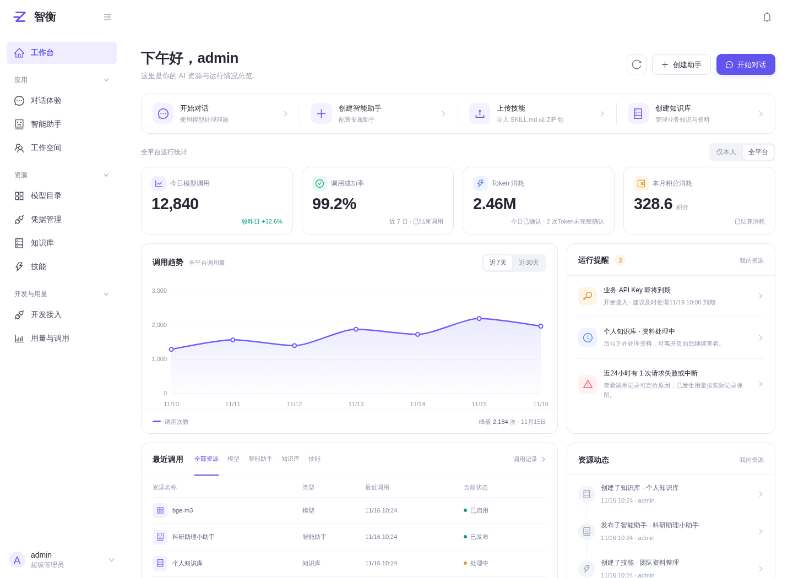
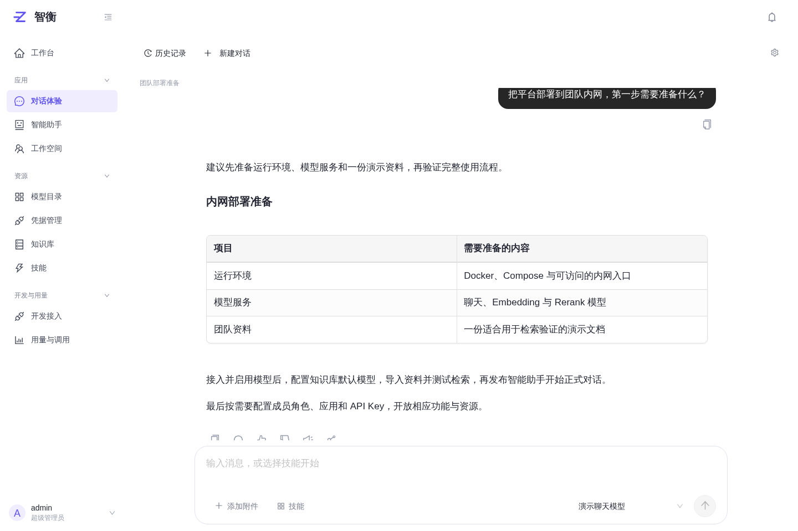
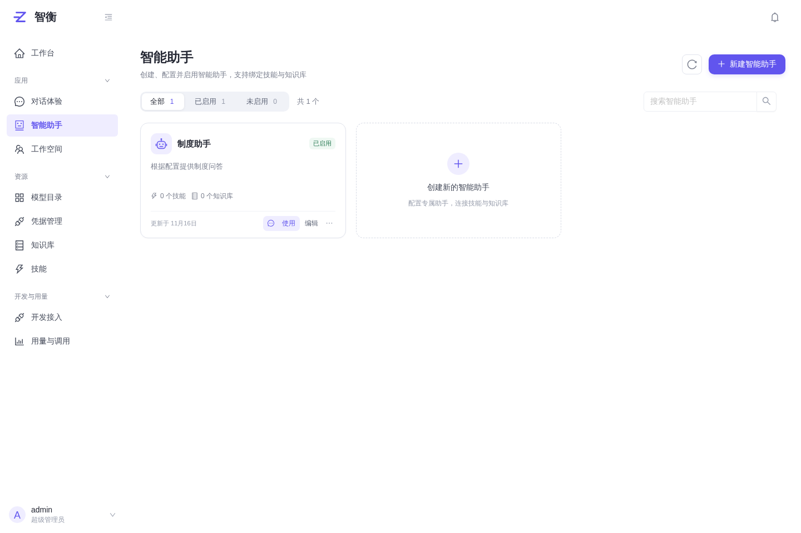
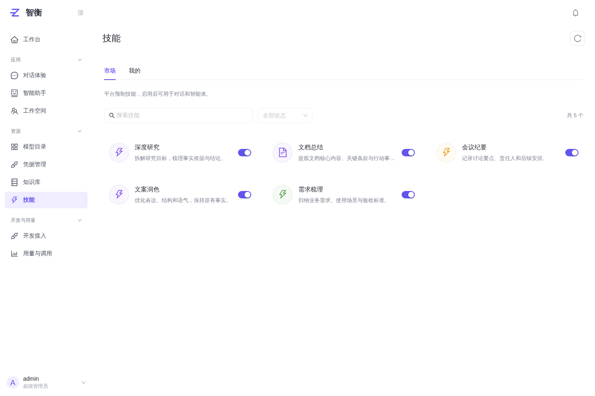

基于 FastAPI 与 Vue 3 的 AI 应用平台，在同一个工作区连接模型、管理知识、配置私人智能助手，并通过 API 接入业务系统。

[Gitee](https://gitee.com/cyhja/zhiheng) · [快速启动](#快速启动) · [能力展示](#能力展示) · [使用文档](docs/README.md) · [部署指南](docs/deployment.md) · [开发指南](docs/development.md)

## 智衡能做什么

智衡面向希望自行部署、统一管理模型和知识，并为成员提供网页与 API 服务的团队。

- **查看真实运行情况**：工作台汇总调用趋势、已确认 Token、积分消耗、运行提醒和最近资源，个人与全平台统计分别授权。
- **一个入口使用多种模型**：管理 OpenAI 兼容服务连接，接入聊天、向量和重排模型，独立试用并记录调用用量。
- **让对话持续积累上下文**：流式回答、文档和图片附件、回复重新生成与版本切换；长对话按已配置的上下文预算自适应摘要，原始消息完整保存。
- **把资料变成可检索知识**：上传文档，经 MinerU 解析、切片和向量化入库，结合检索与重排返回来源，供绑定知识库的智能助手及资源 API 使用。
- **配置私人智能助手**：组合模型、提示词、欢迎语、技能与知识库，调试后发布，在独立会话中使用，也可授权应用调用。
- **围绕任务执行与交付**：工作空间选择模型和技能，理解上传资料、维护计划，按权限在独立沙盒处理文件，保存成果预览、版本和可继续的工作现场。
- **控制成员权限与使用成本**：用户、部门、角色、应用、访问密钥、资源授权、用量统计与可选积分计费统一管理。
- **接入已有业务系统**：提供 OpenAI 兼容推理接口，以及文件、知识库、技能和异步任务资源 API。

## 菜单与功能入口

工作台提供真实调用指标、近 7/30 天趋势、积分消耗、运行提醒和最近调用资源；全平台统计独立授权。口径及权限见[工作台运行总览](docs/api/workbench.md)。

左侧菜单按应用、资源、开发与用量分组；当前页面所在分组保持展开。账号只显示角色已开放的功能，没有授权的入口和子页面不能直接访问。

| 位置 | 当前入口 |
| --- | --- |
| 工作台 | 本人/全平台运行统计、趋势、提醒、最近调用与资源动态 |
| 应用 | 对话体验、智能助手、工作空间 |
| 资源 | 模型目录、凭据管理、知识库、技能 |
| 开发与用量 | 开发接入、用量与调用 |
| 左下角账号菜单 → 后台管理 | 用户管理、角色权限、通知公告、存储管理、系统运维 |

后台“用户管理”下包含用户、部门和应用治理；“系统运维”下包含系统状态、在线会话、登录日志和操作日志。应用治理仅超级管理员可用。公告展示开关放在通知公告页；知识库默认模型和文档解析配置从“知识库 → 默认配置”进入。菜单、字典与岗位管理已下线，旧管理地址回到当前账号有权访问的后台页面。

角色权限采用“模块开关 + 模块内操作”，新增、编辑、删除、共享、API 调用等按需授权；各模块全选相互独立。模型目录与凭据管理是两个独立模块，开放模型目录不会开放凭据。配置方式见[模块与操作权限](docs/api/platform-module-permissions.md)。

## 快速启动

### 前置条件

- Git、Docker Engine 和 Docker Compose v2.20.3+。
- Python 3，用于初始化部署配置。
- 可用的模型服务；知识库还需要 Embedding 与 Rerank 模型。
- Windows 建议在 WSL 2 的 Linux 环境中执行以下命令。

获取代码并在仓库根目录执行：

~~~bash
git clone https://gitee.com/cyhja/zhiheng.git
cd zhiheng

# 生成本实例独立配置和随机密钥；不会覆盖已有配置
./deploy.sh init

# 构建并启动服务，等待依赖、迁移和健康检查完成
./deploy.sh build
./deploy.sh up

# 创建管理员，按提示输入密码，没有固定默认口令
./deploy.sh exec api python -m zhiheng create-admin --username admin
~~~

打开 [http://127.0.0.1:19080](http://127.0.0.1:19080)，使用刚创建的管理员登录。

首次使用建议：

1. 在“凭据管理”添加模型服务的地址和密钥，再到“模型目录”接入聊天、Embedding 和 Rerank 模型。保存前校验连接与模型标识；上下文窗口、输出上限和视觉能力按实际接入服务配置。启用后按模型类型使用，无需发布模型。
2. 在“知识库 → 默认配置”设置默认 Embedding 与 Rerank 模型；按需配置本地或官方云端 MinerU，再创建知识库并添加资料。知识检索必须具有有效重排模型。
3. 创建智能助手，调试并发布后点击“使用”开始正式对话；需要开放 API 时再绑定应用。
4. 在“后台管理 → 角色权限”配置成员可用模块及操作，再通过用户管理分配角色。新角色默认不开放功能。
5. 在「开发接入」创建应用，先关联已有资源，再签发访问密钥。每把密钥可组合模型直调、指定智能体调用、资源动作和创建权限。详见[密钥配置示例](docs/api/developer-keys.md)。

~~~bash
./deploy.sh ps
curl --fail http://127.0.0.1:19080/health/ready
~~~

健康检查应返回 JSON：status 为 ok。局域网访问、HTTPS、备份恢复、图谱连接与源码运行见[部署指南](docs/deployment.md)。

## 能力展示

以下界面截图使用演示数据，不包含真实用户文档、访问密钥或供应商调用。

### 工作台与运行总览

白色底色的工作台提供今日模型调用、已确认 Token、近 7/30 日趋势、成功率、积分消耗和运行提醒。具有“全平台统计”权限的账号可切换聚合范围；最近资源、动态与提醒继续遵循当前用户的资源权限。

最近调用使用真实运行和冻结版本记录，覆盖普通对话、正式助手会话、助手调试、工作空间、知识处理与检索。供应商未提供的计数单独标注，统计读取失败显示重试提示。日与月按北京时间汇总，详细口径见[工作台运行总览](docs/api/workbench.md)。

### 对话与模型

流式输出与持久运行状态配合，离开页面后可恢复查看。对话支持文档与视觉附件、Markdown/代码/公式展示、重新生成、反馈和文本分享。模型目录维护模型配置、输出上限和启停状态；服务地址及密钥在独立的凭据管理中维护。

模型连接、首个有效输出、流空闲和整次生成分别设置时限；正文、思考与工具参数增量会刷新空闲计时，持续输出仍受总预算约束。工作空间模型与摘要子调用共用父任务剩余期限。超时保留已收到的内容和实际用量，不自动重发供应商请求；配置及恢复边界见[模型执行时限](docs/architecture/model-timeouts.md)。

普通“对话体验”正式接入 LangChain `create_agent`、`SummarizationMiddleware` 和官方 PostgreSQL checkpoint。平台继续管理身份、权限、模型准入、原生运行、取消、账本和文件；原消息与回复版本完整保存。

摘要默认随已配置的有效输入预算计算，约 70% 触发整理、20% 保留近期原文，并受本轮输入和模型限制约束；管理员可使用 `auto` 或固定数值覆盖。窗口未知时采用保守默认值，不从模型名称推断容量。已有运行恢复查看原状态，受理结果未知时沿用原请求标识确认。配置及边界见[会话上下文](docs/architecture/chat-context-memory.md)。

普通对话使用会话历史、附件和技能指令上下文。绑定知识库的检索入口位于智能助手及资源 API；工作空间使用明确加入任务的文件，并可按需调用已配置的公开网页搜索。

### 知识库与文档解析

在知识库内管理文件夹、资料和成员，查看后台处理状态，调整切片参数并测试检索。检索使用向量模型和有效重排模型，返回命中文档来源；资料共享通过邀请链接管理。

绑定知识库的智能助手回答使用 `[1]`、`[2]` 等数字引用，点击可预览对应文档，下方“知识来源”按文档归并展示命中片段。同一文档的片段共用编号；已有回复中可匹配真实来源的 UUID 引用也会转换显示。预览与下载继续校验权限，API 来源字段保留真实标识。编号规则见[知识检索与重排](docs/api/knowledge-retrieval-policy.md)。

解析优先使用本地 MinerU，再按已启用配置使用云端后备，最后尝试基础解析。官方 MinerU v4 已接通签名上传、任务轮询和 ZIP/Markdown 结果读取，使用 vlm 模型。解析任务与源文件引用持久保存。见[文档解析](docs/architecture/document-parsing.md)。

LightRAG 提供独立的图谱构建、浏览和上下文查询；需要额外配置专用数据库运行角色。普通知识问答使用向量检索链路。

### 智能助手与技能

配置智能助手的模型、提示词、欢迎语、温度、输出长度、技能和知识库。输出长度超出所选模型配置时，在字段旁提示并阻止保存。正式会话通过 LangChain 与持久 checkpoint 自动管理历史，并在容量需要时整理摘要。

侧栏“智能助手”提供私人助手和正式对话，支持新建会话、历史记录、继续对话与断线恢复。私人使用不要求绑定应用；对外 API 仍需应用、Key 和资源授权。助手只维护一份最新配置与启用状态，保存后用于下一次调用；已受理的请求和历史回复保留。详情见[智能助手会话](docs/api/assistant-conversations.md)。

正式助手会话支持文档与模型支持的图片附件，按当前用户和会话校验上传、发送与历史下载权限；附件不自动加入知识库。接口与生命周期见[助手对话附件](docs/api/assistant-attachments.md)。

配置调试与外部 API 每请求独立，正式会话持续保存记忆。摘要与主回答分别记录模型用量。技能页面分为“市场”和“我的”：市场提供不可删除的预制技能，我的支持 SKILL.md 和 ZIP 包上传、预检、安装与修订。普通对话与助手使用技能主文件作为提示上下文；工作空间还可在授权沙盒中调用包内脚本和资源。

### 工作空间

输入区提供“添加附件”和“技能”，技能按“预置技能”“我的技能”分组，支持搜索和最多五项多选，已选技能显示为可移除标签。已有任务的技能调整自动保存；模型在输入框右侧选择，“资料与成果”从右上角打开。

提交目标和资料后，由任务 Agent 按需阅读文件、维护清单、请求补充信息并完成处理。普通问答无需沙盒；具有 `platform:work:execute_code` 权限的账号默认可由模型按需执行代码和制作文件，无需任务开关，执行时需要可用的隔离环境。

执行采用官方 LangChain Agent、任务清单与摘要 Middleware、PostgreSQL checkpoint 和标准工具调用协议，继续复用平台模型、权限、运行、计费、技能和 MinIO 文件服务。Python/Shell 在独立 OpenSandbox 运行，成果可预览、下载并保留历史版本；下一轮从工作快照恢复。失败、暂停或取消后可明确选择继续任务，复用可信检查点和已确认的工具结果，不重复追加原问题；结果未知的操作保留待核对状态，不自动重放。旧成员任务保留历史读取，新任务不再从智能助手选成员，本期不接入知识库检索。

文档读取按可用上下文预算优先提供全文，超出预算时分页，并保留长段落、长表格的段内续读位置和真实来源。解析结果有界缓存，每次读取继续验证文件权限；预算内正文直接进入模型上下文，避免再次变成通用预览。

工作空间默认提供轻量资料与沟通工具，模型按任务需要加载 Python、命令行、沙盒文件或结构检查工具组。加载状态随检查点保留，继续任务时复用，新问题重新从轻量工具集开始；工具加载和实际执行都沿用当前权限，成果仍需校验后发布。

所选技能包经归属和完整性校验后，在沙盒中提供本轮固定修订的只读文件，加载说明不会自动运行脚本。依赖、语言运行时和网络仍受现有环境限制；访问第三方系统需要另行接入受控工具或 MCP。

主 Agent 直接流式回答，普通对话不再经过独立的“最终交付”模型改写。感谢、知识问答和实时查询按当前问题收敛；搜索遇到明确额度或配置错误后停止本轮重试，新的用户请求可以重新查询。文件发布校验、用量计量和中断恢复继续保留。

长文档读取过程按模型容量整理历史摘要，摘要失败时保留已读取内容并暂停，不用失败占位语覆盖资料。继续任务时可从可信检查点恢复已保存的上下文，复用已确认的工具结果；详见[工作空间任务 Agent](docs/api/workspace-agent.md)。

在独立部署配置 `deploy/core/.env.core` 中设置 `CORE_BOCHA_API_KEY` 后，工作空间自动提供博查 `web_search` 工具，由模型按任务需要调用。查询过程沿用执行记录，回答引用实际返回的网页链接；服务商额度不足时显示明确错误。

接口、状态和恢复规则见[工作空间任务 Agent](docs/api/workspace-agent.md)。文件执行是可选部署能力，需启用 [workspace 沙盒配置](docs/deployment/workspace-sandbox.md)。

### 应用、API 与平台管理

| 模块 | 提供的能力 |
| --- | --- |
| 开发接入 | 应用、访问密钥、模型与智能体调用授权、按对象分配资源动作、密钥轮换和停用 |
| 用量与计费 | Token/检索用量、调用记录、可选积分定价、预占结算及未知用量核对 |
| 成员管理 | 用户、部门、角色、会话管理、密码重置与权限控制 |
| 运行管理 | 持久任务、状态恢复、操作审计、文件引用与回收、通知公告 |
| 数据边界 | 用户与应用资源隔离，文件、知识库和技能按当前权限读取 |

积分计费默认关闭。启用时需先配置模型积分价格并分配积分；平台不提供支付或充值通道。

调用详情关联原运行、Token/检索用量、费用预占与积分流水。供应商缺失的计数保留为“待核对”，已确认数值、原付费人和价格快照保持。积分、Token 与平台配置的货币费率分别记录；费率金额不表示已核验的供应商账单。职责与事务说明见[账务模块边界](docs/architecture/billing-boundaries.md)。

## API 接入

外部请求使用开发接入签发的 Bearer 密钥。模型直调使用平台模型 ID，助手接口使用平台助手 ID。账号须具备「API 调用」权限。平台同时校验密钥的操作能力、被调用对象、应用状态及当前资源权限。

从旧部署升级到对象授权时，原有开发者访问密钥会失效。请在所属应用重新签发密钥并更新客户端。模型服务商凭据和历史用量保留。

“开发接入 → API 说明”从当前服务的 OpenAPI 加载接口、请求字段、成功响应结构及 curl 示例，分为资源 API 和推理 API；接口深链接保留分组与位置，也可打开 Swagger 在线调试。调用地址使用实际部署入口，下面的本机地址需按部署环境替换。

| 协议入口 | 用途 | 鉴权 |
| --- | --- | --- |
| /api | 网页控制台 | 登录会话 Cookie |
| /v1 | OpenAI 兼容模型与智能体推理 | Bearer API Key |
| /api/v1 | 文件、知识库、技能与异步操作 | Bearer API Key、Scope 与资源授权 |

~~~bash
export ORIGIN='http://127.0.0.1:19080'
export API_KEY='你的访问密钥'
export MODEL_ID='平台模型ID'

curl "$ORIGIN/v1/chat/completions" \
  -H "Authorization: Bearer $API_KEY" \
  -H "Content-Type: application/json" \
  -d "{\"model\":\"$MODEL_ID\",\"messages\":[{\"role\":\"user\",\"content\":\"你好\"}],\"stream\":false}"
~~~

- [推理 API 文档](http://127.0.0.1:19080/docs/inference)
- [资源 API 文档](http://127.0.0.1:19080/docs/resources)
- [资源 API 接入说明](docs/api/resources-v1.md)：上传文件 → 指定知识库入库 → 轮询操作结果 → 检索。

资源变更按接口要求发送 `If-Match`；需要可靠重试的提交生成一次 `Idempotency-Key` 并复用。202 表示已接纳，须按返回的操作地址查询终态；`cancel_allowed` 结合当前权限和任务状态返回。文件下载默认取完整内容，仅明确传入 `Range` 时返回部分字节。

模型用量未知时保留待核对状态，不按零消耗处理。`provider_insufficient_balance` 表示上游模型服务余额不足，应联系管理员处理供应商账号；平台积分余额与上游服务额度分别管理，反复重试不能恢复上游额度。

## 技术架构

模块化单体后端负责业务与权限；独立 Worker 处理生成、解析、索引和恢复任务。前端使用 Vue 3、TypeScript 与 Ant Design Vue。

| 层次 | 技术 |
| --- | --- |
| 后端 | Python、FastAPI、SQLAlchemy、Alembic |
| 普通对话执行 | LangChain create_agent、摘要 Middleware、官方 PostgreSQL checkpoint |
| 工作空间执行 | LangChain create_agent、清单/摘要 Middleware、标准工具调用、OpenSandbox 文件环境 |
| 前端 | Vue 3、TypeScript、Ant Design Vue、Vite |
| 状态与任务 | PostgreSQL 业务/运行/账本事实与 checkpoint，Redis、ARQ、事务 Outbox |
| 知识与解析 | Milvus、LightRAG、本地及云端 MinerU |
| 文件存储 | 独立业务 MinIO、私有桶、专用应用账号；下载经过权限与完整性校验 |
| 部署 | Docker Compose、Nginx、API/Worker 分进程 |

~~~text
backend/
  src/zhiheng/api/          Console、推理、资源三组 HTTP 协议
  src/zhiheng/application/  用例、事务和跨模块协作
  src/zhiheng/modules/      领域规则与供应商适配
  src/zhiheng/runtime/      持久运行、租约与 Outbox
  src/zhiheng/worker/       独立任务执行与恢复
  migrations/              数据库迁移
  tests/                   单元与集成测试
frontend/
  src/app/                 入口、路由和导航外壳
  src/modules/             业务页面、组件和 API 客户端
  src/shared/              通用组件、权限、HTTP 和样式
  tests/                   核心与浏览器回归
deploy/core/               Compose、环境示例和源码模式配置
deploy/sandbox/            独立管理服务与办公运行镜像
docs/                      使用、API、架构和开发文档
tools/                     架构、打包检查及源码导出工具
compose.yaml               根部署组合配置
deploy.sh / dev.sh         镜像部署 / 源码运行入口
~~~

## 文档导航

- [文档总览](docs/README.md)
- [使用与操作](docs/usage.md)
- [工作台口径与权限](docs/api/workbench.md)
- [普通对话与自适应摘要](docs/architecture/chat-context-memory.md)
- [工作空间任务 Agent](docs/api/workspace-agent.md)
- [工作空间执行环境](docs/deployment/workspace-sandbox.md)
- [部署、升级与备份](docs/deployment.md)
- [本地开发与测试](docs/development.md)
- [架构与模块边界](docs/architecture/README.md)
- [代码规范](docs/architecture/code-standards.md)
- [模型供应商用量](docs/api/model-provider-usage.md)
- [模块与操作权限](docs/api/platform-module-permissions.md)
- [后台菜单与子页面](docs/api/admin-console-ui.md)
- [应用与资源授权](docs/api/application-governance.md)
- [知识检索与重排](docs/api/knowledge-retrieval-policy.md)
- [局域网访问](docs/api/lan-access.md)

## 工程检查与源码发布

仓库提供架构与依赖方向、Python 类型与规则、前端类型与规则、独立数据库集成、真实浏览器及安装后 wheel 端到端检查。测试使用独立 PostgreSQL、Redis、Milvus 与本地模型服务，命令见[开发指南](docs/development.md)。

源码导出检查发布文件范围，wheel 检查独立入口、全部迁移及许可文本。实例配置、访问凭据、用户文件、缓存和本机验证记录不属于源码发布内容。

## 参与贡献

欢迎通过 Issue 或 Pull Request 反馈问题、完善文档和贡献功能。提交前请按[开发指南](docs/development.md)运行对应检查；测试使用独立服务和演示数据。

## 许可证与致谢

项目采用 [MIT License](LICENSE)。再分发时保留原有版权与许可声明。

感谢 RuoYi / 智衡原项目的界面基础，以及 FastAPI、Vue、Ant Design Vue、LangChain、Milvus、LightRAG、MinerU 和 OpenSandbox 等项目。第三方代码、模型和容器镜像遵循各自许可证，见[第三方说明](THIRD_PARTY_NOTICES.md)。
