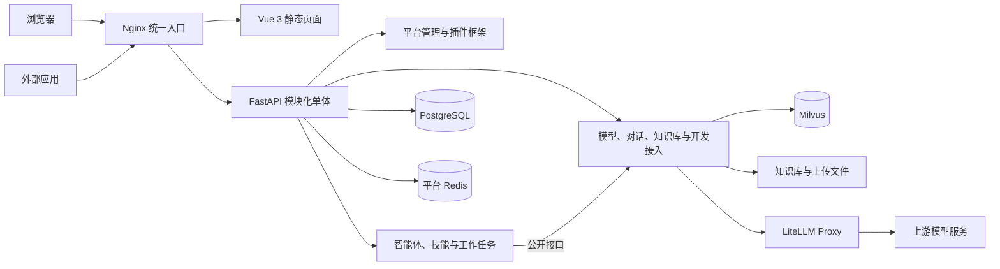

# 智衡 AI 开放平台

智衡 AI 开放平台基于 FastAPI 和 Vue 3 构建，面向企业和团队提供模型接入、智能对话、知识库、智能体、应用开发接入和用量记录能力。平台采用前后端分离的模块化单体架构：业务通过插件和公开接口协作，统一构建与发布；外部应用通过 OpenAI 兼容接口调用。

文档更新：2026-10-19。本文与 `release/platform-integration-merge` 分支的集成代码对应。仓库目录名称不决定 Git 分支，开发前请用 `git branch --show-current` 核对；已有在线实例的版本以实际镜像与前端构建产物为准。

## 技术组成与版本

- 后端：FastAPI、SQLAlchemy、PostgreSQL、Redis
- 前端：Vue 3、Vite、Ant Design Vue；部分管理页面沿用 Element Plus
- 模型网关：LiteLLM Proxy
- 认证方式：JWT、平台 API Key、Bearer Token
- 默认平台端口：`12580`

前端包版本见 `frontend/package.json`，后端 CLI 包版本见 `backend/pyproject.toml`，后端接口元信息版本由 `backend/config/env.py` 的 `app_version` 配置。镜像交付版本以发布包 `release.json` 为准，这些版本号分别维护。

## 功能概览

### 平台工作台

- 智能对话：支持流式输出、历史会话、重命名、归档、恢复和删除。通过会话菜单归档后，可在侧栏“已归档”中查看历史并恢复继续对话；归档保留消息，永久删除仍需确认。
- 模型中心：接入和管理对话、向量（Embedding）、重排序（Rerank）模型，支持连接复用、测试、发布与停用。
- 图片理解：接入对话模型时可声明视觉能力，已有模型可在目录中修改图片理解设置；文档附件和图片按各自的校验流程处理。
- 生成控制：停止或断连后完成运行状态保存与会话锁释放；结束通知在收尾后发送，原会话可以继续生成。
- 开发接入：创建应用、配置模型授权、生成和轮换 API Key。
- 用量记录：查看请求状态、Token 消耗、检索单元和费用。
- API 说明：在开发接入页面查看平台 API 调用方式和示例。
- 智能体扩展：管理员统一维护平台技能，普通用户可在对话中按消息选择技能。
- 知识库与工作任务：提供文档分块、向量检索、可选知识图谱，以及基于智能体的工作任务与历史记录。

### 管理后台

- 用户、角色、菜单、部门、岗位和字典管理。
- 参数配置、通知公告、操作日志、登录日志和在线用户。
- 定时任务、服务监控、缓存监控和代码生成。
- 插件发现、安装、启停、升级、卸载、迁移和权限菜单管理。
- 后台侧栏和顶部提供返回 AI 工作台入口，按当前账号权限选择目标页面；默认导航已去掉旧官网与首页入口。

## 系统架构



前后端各有一个整体构建产物。模块化用于明确职责、减少跨模块内部依赖，并不提供独立进程隔离。后端公开入口位于业务插件的 `public/`，前端插件也通过 `public/` 向宿主暴露会话、资源选择与工作任务能力。完整说明见 [代码结构](./代码结构说明.md)。

### 目录结构

以下按当前 Git 维护的目录列出主要入口；后端完整目录见[后端目录说明](./backend/docs/后端目录说明.md)，前后端调用关系见[代码结构说明](./代码结构说明.md)。

```text
./
├── backend/       # FastAPI 后端
│   ├── app.py                   # Uvicorn 启动入口
│   ├── server.py                # 应用工厂与生命周期
│   ├── cli/                     # zhiheng 命令行、向导与交互终端
│   ├── module_admin/            # 用户、权限、文件、监控等基础管理
│   ├── module_generator/        # 代码生成服务与模板
│   ├── module_plugin/           # 插件管理 HTTP 入口
│   ├── module_task/             # 定时任务实现
│   ├── module_Knowledge/        # 文档解析与分块基础工具
│   ├── plugins/
│   │   ├── core/                # 插件发现、生命周期、迁移与运行时
│   │   ├── ai/                  # 模型、对话、知识库、应用与开放 API
│   │   └── agent_extension/     # 智能体、技能与工作任务
│   ├── scripts/                 # 初始化、SQL 构建和文件迁移脚本
│   ├── sql/                     # 数据库初始化与增量升级 SQL
│   ├── tests/                   # 后端及部署工具测试
│   └── docs/                    # 后端代码导航与使用说明
├── frontend/      # Web 前端
│   ├── src/                     # 宿主布局、路由、公共组件和管理页面
│   ├── plugins/
│   │   ├── ai/                  # AI 工作台业务页面、API 和公开接口
│   │   └── agent_extension/     # 智能体、技能和工作任务界面
│   ├── tests/                   # plugins/ 契约测试与 e2e/ 浏览器检查
│   ├── bin/                     # Nginx 配置和 Windows 前端辅助脚本
│   └── dist/                    # 随仓库交付的前端构建产物
├── deploy/
│   ├── platform.py              # 根目录 deploy.sh 的源码部署实现
│   ├── release_cli.py           # 镜像发布命令入口
│   ├── compose.release.yaml     # 镜像发布专用编排模板
│   ├── release/                 # 离线包构建、校验、部署与回滚
│   ├── legacy/                  # 拆分部署兼容入口
│   ├── litellm/                 # 网关配置、独立编排与密钥初始化
│   ├── zhiheng/                 # PostgreSQL 初始化与部署说明
│   ├── milvus/                  # 向量服务配置
│   ├── frp/                     # FRP 服务单元
│   └── windows/                 # Windows 局域网访问辅助脚本
├── docs/                        # 架构、设计、实现计划与运维记录
├── .github/workflows/            # 后端、前端浏览器及 Python 风格检查
├── compose.yaml                 # 默认源码部署编排
├── docker-compose.pg.yml         # 拆分部署兼容编排
├── deploy.sh                     # 源码部署与 release 子命令入口
├── 代码结构说明.md               # 前后端结构与调用关系
└── README.md
```

后端 `plugins/core/` 是插件框架。前端宿主框架位于 `frontend/src/`，其中 `src/plugins/` 放置通用功能适配；前端业务插件则位于 `frontend/plugins/`，包含 `ai/` 和 `agent_extension/`。知识库业务在后端 `plugins/ai/knowledge/`，`module_Knowledge/` 保留文档解析与分块工具。

### 运行时目录与本地生成文件

统一源码部署默认在仓库根目录生成以下文件数据目录；可用 `PLATFORM_DATA_DIR` 更改位置。镜像发布则默认使用安装目录下的 `data/`。

```text
data/
├── agent-skills/                # 平台技能持久文件
├── knowledge/                   # 知识库文档及相关文件
├── platform-files/              # 平台附件，挂载到容器 /app/vf_admin
└── milvus/                      # Milvus 持久数据
```

这些目录在运行时生成，不随源码提交。PostgreSQL 和 Redis 默认使用 Docker 命名卷，备份范围见[数据持久化](#数据持久化)。本地后端还可能生成 `vf_admin/`、`logs/` 等目录，位置与启动工作目录和配置有关；它们不是新的业务模块。

当前分支维护桌面 Web 前端，已移除独立移动端工程。`.venv/`、`node_modules/`、Python 缓存及旧 `ruoyi-fastapi-*` 目录中的本地残留不属于当前源码结构；测试分别维护在前后端的 `tests/` 中。

## 快速开始

### 环境要求

- 运行端需要 Docker Engine、Docker Compose v2（支持 `up --wait`）和 Python 3.10+，建议至少 8 GB 内存。
- 离线镜像发布当前面向 Linux amd64；服务器无需源码 checkout、Node.js 或下载镜像与 Python 依赖。
- 发布构建机需要 Node.js 24、npm、已安装的前端依赖及 Docker；首次准备镜像和依赖需要网络。

### 镜像发布与回滚

向服务器交付完整的版本发布目录。在源码仓库根目录构建：

```bash
npm install --prefix frontend
./deploy.sh release build --version 2026.09.30-rc1 --output /path/new-bundle
./deploy.sh release verify --bundle /path/new-bundle
```

`--output` 必须是新目录。发布包包含六个镜像的 `images.tar`、记录 Git revision/dirty/源码哈希及文件校验值的 `release.json`、运行脚本和配置。将整个目录复制到服务器，在发布目录内执行：

```bash
./release.sh verify
./release.sh deploy --site /opt/zhiheng
./release.sh status --site /opt/zhiheng
./release.sh rollback --site /opt/zhiheng  # 已有上一成功版本时恢复应用
```

后续版本沿用同一 `--site`。实例的 `.env`、`data/`、`runtime/`、`releases/` 与 `state.json` 独立于交付目录，密钥按实例生成并持久保留。默认 Compose 项目名由安装路径派生；需要自定义项目名、端口、监听地址或数据目录时，在首次部署前设置安装目录的 `.env`。发布管理器拒绝接管现有源码部署容器。

快捷升级和回滚要求数据及基础运行契约指纹一致；兼容更新失败会尝试自动恢复原应用版本。SQL、插件 manifest、初始化器、非 SQL 持久格式或基础运行配置变化需要专项备份与迁移，回滚不自动降级数据库。`status` 只显示发布记录，不是实时健康检查。

完整复制、可选 tar 打包、配置、失败恢复与备份步骤见 [镜像发布包说明](./deploy/release/README.md)。校验值不是数字签名，只接收可信来源的发布包。服务器无需源码仓库，但 Python 镜像仍包含运行代码，不承诺源码加密。

### 源码部署：首次启动

保留原有源码部署流程。该流程从仓库构建后端，首次部署需要网络下载镜像和 Python 依赖；前端 dist 已随仓库提供，运行预构建前端不需要 Node.js。在新环境的仓库根目录执行：

```bash
./deploy.sh init
```

根目录 `compose.yaml` 统一管理 PostgreSQL、Redis、LiteLLM、Milvus、初始化任务、后端和 nginx。脚本自动生成并复用密钥，导入完整 PostgreSQL 初始化 SQL、创建网关运行密钥、安装内置插件，等待健康检查后显示访问地址。

可先复制 `deploy/platform.env.example` 为 `.env`，修改 `PLATFORM_PORT` 和数据目录。详细说明见 [一键部署说明](./deploy/README.md)。

### 源码部署：日常运维

```bash
./deploy.sh start      # 启动完整服务并等待就绪
./deploy.sh restart    # 重启应用
./deploy.sh stop       # 停止服务，保留数据
./deploy.sh status
./deploy.sh logs --tail=100
./deploy.sh update     # 构建镜像、执行增量迁移并更新
```

源码统一部署默认项目名为 `zhiheng`，平台服务为 `zhiheng-backend-pg`、`zhiheng-frontend`、`zhiheng-redis`，数据库默认使用 `zhiheng-fastapi` / `zhiheng`。已有 `ruoyi-*` 容器的实例请先按 [旧命名实例升级说明](./deploy/README.md#旧命名实例升级) 备份并迁移容器，保留原有 Compose 项目名、数据目录、数据卷和密钥，再通过 `PLATFORM_DB_NAME` / `PLATFORM_DB_USER` 显式选择已有数据库。

拆分部署入口保留在 `deploy/legacy/manage.sh`，其中 `legacy` 表示独立 LiteLLM 与平台的拆分编排方式；它使用根目录 `docker-compose.pg.yml`，新默认项目名为 `zhiheng-vue3-fastapi`。原 `ruoyi` 实例先沿用原发布入口管理，完成迁移后再使用当前脚本；详见 [拆分部署说明](./deploy/README.md#拆分部署兼容入口)。

完整数据库初始化文件为 [`backend/sql/platform-pg.sql`](./backend/sql/platform-pg.sql)，按现有增量迁移自动生成。新库导入合并文件，旧库按迁移账本升级。

### 访问地址

| 服务 | 地址 |
| --- | --- |
| 智衡平台 | <http://127.0.0.1:12580/> |
| Swagger | <http://127.0.0.1:12580/docker-api/docs> |
| ReDoc | <http://127.0.0.1:12580/docker-api/redoc> |
| 平台开放 API | `http://127.0.0.1:12580/v1` |

默认管理员账号由项目初始化数据提供。生产环境请首次登录后修改密码，不要在公开环境使用默认凭据。

## 接入模型

1. 在智衡平台进入「模型中心 → 模型目录」，点击「接入模型」，选择模型类型并填写服务商模型名称。
2. 选择服务商，复用已有连接或填写新凭据；点击「测试连接」，通过后再点击「接入模型」保存、绑定并发布。单独测试连接不会创建模型目录记录。
3. 在「开发接入」创建应用，为应用授权可用模型。
4. 在「访问密钥」生成 API Key。密钥只在创建时完整展示，请妥善保存。
5. 使用平台 API 地址和 Bearer Token 发起调用。

对话模型默认关闭图片理解。确认服务商支持视觉后，在接入表单「模型信息」中开启「支持图片理解」；已接入模型可使用目录行的「图片理解设置」。这个标记不会让纯文本模型获得视觉能力。

硅基流动的 `BAAI/bge-reranker-v2-m3` 应选择「重排序」，API 地址填写 `https://api.siliconflow.cn/v1`，可复用已有连接。平台内部处理重排序协议和返回字段兼容；此类模型用于检索重排，不会出现在聊天模型选择框中。

示例：

```bash
curl http://127.0.0.1:12580/v1/chat/completions \
  -H 'Authorization: Bearer <平台 API Key>' \
  -H 'Content-Type: application/json' \
  -d '{
    "model": "<模型编码>",
    "messages": [{"role": "user", "content": "你好"}],
    "stream": true
  }'
```

Embedding 和 Ranker 模型使用对应的模型类型和接口参数，具体请求字段以平台内「API 说明」为准。网页和 API 统一经过 Nginx：页面接口使用 `/docker-api/`，开放 API 使用 `/v1/`，已有 `/docker-api/v1/` 地址继续兼容。统一部署不单独暴露后端和模型网关端口。已有 FRP 部署可继续使用配置好的公网地址。

## 使用平台技能

管理员进入「智能体扩展 / 技能管理」，可以上传单个 `SKILL.md` 或根目录包含 `SKILL.md` 的 ZIP 技能包。技能安装后支持查看、启用、停用和删除；启用中的技能必须先停用再删除，平台内置技能不能删除。

普通用户在智能对话输入框输入独立的 `@`，或点击“选择技能”按钮，即可为当前消息选择最多 5 个已启用技能。技能只作用于本次发送，消息发出后自动清空选择，不会改变整个会话的永久设置。

技能包不会执行脚本或自动安装依赖。生产部署应限制 `data/agent-skills` 的宿主机访问权限，并随数据库一起备份。

## 本地开发

### 后端

```bash
cd backend
python -m venv .venv
. .venv/bin/activate
pip install -r requirements-pg.txt
zhiheng app run --env=dev
```

后端本地开发需要 PostgreSQL、Redis 和 LiteLLM。安装 PostgreSQL 依赖后，还需将 `.env.dev` 的 `DB_TYPE` 设为 `postgresql`，并配置开发实例的数据库、Redis 和网关连接；安装依赖不会自动切换配置。数据库初始化和环境变量说明见 [`deploy/zhiheng/README.md`](./deploy/zhiheng/README.md) 与 [`deploy/litellm/README.md`](./deploy/litellm/README.md)。

### 前端

```bash
cd frontend
npm install
npm run dev -- --host 127.0.0.1 --port 5173 --strictPort
```

以上命令将开发服务器启动在 <http://127.0.0.1:5173/>。前端通过 Vite 代理访问本地后端。

## 测试与质量检查

```bash
# 前端插件和契约测试
cd frontend
npm run test:plugin

# 后端测试
cd ../backend
python -m pip install -r requirements-test.txt
pytest -q

# Shell 脚本语法检查
cd ..
sh -n deploy.sh
ruff check backend deploy/release deploy/release_cli.py
ruff format backend deploy/release deploy/release_cli.py --check
```

后端测试需要先安装对应运行依赖。真实 PostgreSQL 并发测试通过 `ZHIHENG_TEST_POSTGRES_DSN` 指向专用测试库；未配置时跳过这些用例，不要用业务库代替测试库。

浏览器检查使用 mock API，无需启动后端或数据库。先在一个终端启动前端：

```bash
cd frontend
npm install
npm run dev -- --host 127.0.0.1 --port 15174 --strictPort
```

再从仓库根目录打开另一终端运行检查：

```bash
cd frontend
python -m pip install playwright Pillow
python -m playwright install --with-deps chromium
python -m unittest discover -s tests/e2e -p 'test_*.py' -v
CHAT_WORK_CHECK_BASE_URL=http://127.0.0.1:15174 python tests/e2e/chat_work_mode_check.py
python tests/e2e/platform_shell_check.py
python tests/e2e/model_vision_check.py
python tests/e2e/desktop_layout_check.py
python tests/e2e/desktop_review_fixes_check.py

# 可选：模型接入向导专项检查
MODEL_ONBOARDING_BASE_URL=http://127.0.0.1:15174 python tests/e2e/model_onboarding_check.py
```

平台浏览器检查默认访问 `http://127.0.0.1:15174`，可通过 `PLATFORM_SHELL_BASE_URL` 指定地址；工作模式和接入向导专项脚本分别使用 `CHAT_WORK_CHECK_BASE_URL`、`MODEL_ONBOARDING_BASE_URL`。截图默认保存到 `/tmp`，可通过 `PLATFORM_SHELL_SCREENSHOT_DIR` 指定目录。前端契约测试、浏览器辅助测试以及上面的工作模式、平台、视觉和两组桌面检查已接入 [Playwright 工作流](./.github/workflows/playwright.yml)。Python 风格检查覆盖后端及其 `tests/`。

其中 `platform_shell_check.py` 运行两轮功能检查，并比较五张关键截图。Chromium 的圆角抗锯齿可能产生少量边缘差异，因此使用同尺寸 RGB 像素比较替代 PNG 字节哈希相等：至多允许 32 个像素变化，且任一通道差值不超过 8；任一条件超限即失败。日志保留每张图的哈希与实际像素差异，独立回归测试验证这些边界不会放过尺寸、大范围或明显颜色变化。

## 重要配置

### 实例配置 `.env`

源码部署使用仓库根目录 `.env`；镜像发布使用 `--site` 安装目录的 `.env`。配置由对应初始化脚本维护，包含 ZhiHeng 数据库连接、JWT 密钥、LiteLLM Runtime Key 和 Management Key，文件权限应为 `0600`，禁止提交或随发布包分发。发布实例的 `.env` 或 `state.json` 丢失时应恢复备份，不能通过重新生成密钥初始化已有数据。

### API Key 安全

- 平台 API Key 只保存摘要，不保存明文。
- API Key 只在创建或轮换时完整展示一次。
- 停用应用后不能调用其 API Key；重新启用应用后恢复调用。
- 轮换或撤销密钥会立即影响后续请求。

### 数据持久化

PostgreSQL 和 Redis 数据由 Docker 数据卷持久化；技能、知识库、平台附件及 Milvus 文件保存在 `PLATFORM_DATA_DIR` 下。停止服务不会删除数据；执行带 `--volumes` 的 Compose 命令或清理技能目录前必须先完成备份。

镜像发布还需备份安装目录的 `.env`、`state.json`、`runtime/` 与 `releases/`。只备份 `data/` 不包含数据库、Redis 命名卷或发布身份，不能用于完整恢复。

## 文档索引

- [统一一键部署说明](./deploy/README.md)
- [离线镜像发布、升级与应用回滚](./deploy/release/README.md)
- [LiteLLM 部署说明](./deploy/litellm/README.md)
- [ZhiHeng PostgreSQL 部署说明](./deploy/zhiheng/README.md)
- [代码结构与测试目录](./代码结构说明.md)
- [后端目录说明](./backend/docs/后端目录说明.md)
- [后端运行与数据约束](./backend/docs/后端运行与数据约束.md)
- [前端测试](./frontend/tests/)
- [后端测试](./backend/tests/)
- [当前模块边界与改造记录](./docs/architecture/2026-09-29-module-boundaries.md)
- [模型图片理解配置](./docs/operations/2026-10-08-model-vision-settings.md)
- [对话停止与断连恢复](./docs/operations/2026-10-10-chat-cancellation-recovery.md)
- [严格审查六项修复、验收及旧库升级说明](./docs/operations/2026-10-10-strict-review-fixes.md)
- [硅基流动重排序兼容与正式接入](./docs/operations/2026-10-10-siliconflow-rerank.md)
- [桌面 Web 布局与审查修复发布记录](./docs/operations/2026-10-10-desktop-web-layout-release.md)
- [CLI 使用说明](./backend/docs/cli_usage.md)
- [技术架构演进汇报](./AI%20Open%20Platform%20技术架构演进汇报.md)
- [智能体扩展与技能管理设计](./docs/superpowers/specs/2026-09-07-agent-extension-skill-management-design.md)
- [变更日志](./CHANGELOG.md)

## 许可证

本项目采用 [MIT License](./LICENSE)。
