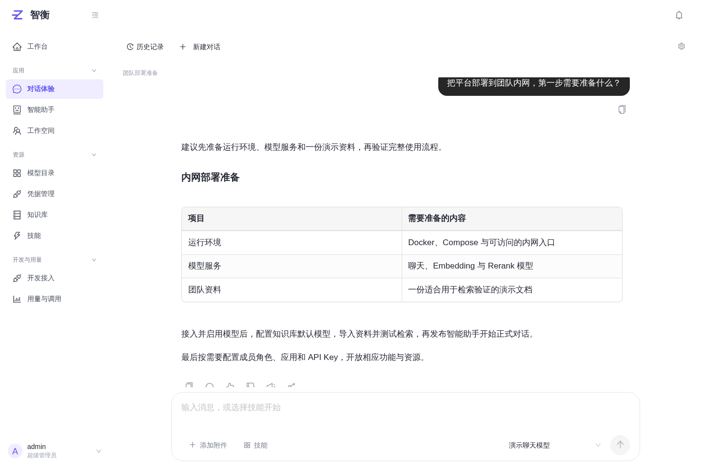
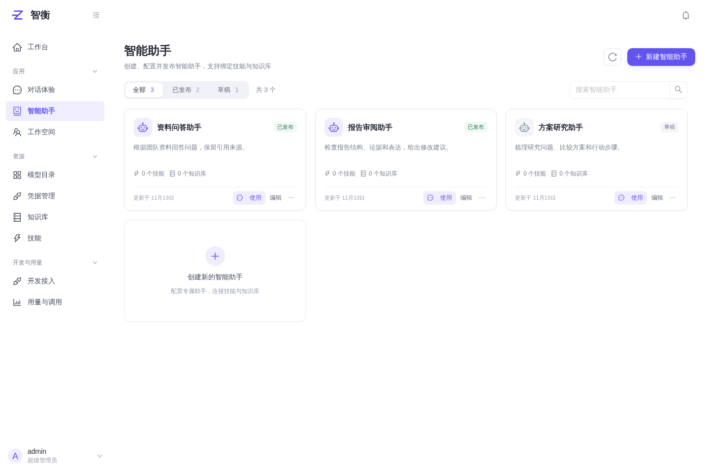
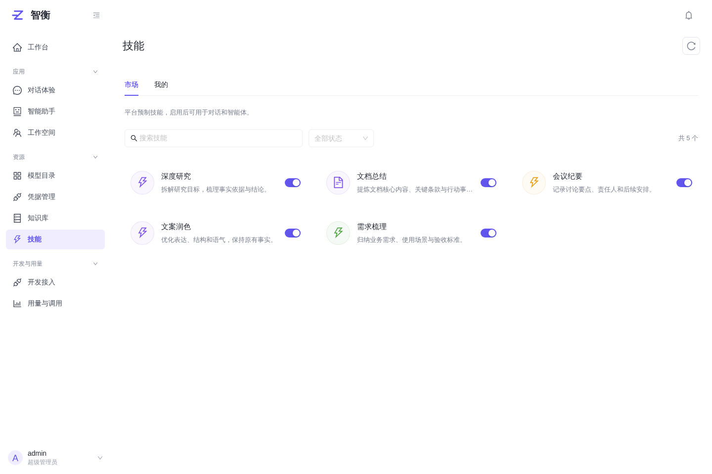

# 智衡 AI

**多模型对话 · 知识库 RAG · 私人智能助手**

基于 FastAPI 与 Vue 3 的 AI 应用平台，在同一个工作区连接模型、管理知识、配置私人智能助手，并通过 API 接入业务系统。

[Gitee](https://gitee.com/cyhja/zhiheng) · [快速启动](#快速启动) · [能力展示](#能力展示) · [使用文档](docs/README.md) · [部署指南](docs/deployment.md) · [开发指南](docs/development.md)

## 智衡能做什么

智衡面向希望自行部署、统一管理模型和知识，并为成员提供网页与 API 服务的团队。

- **一个入口使用多种模型**：管理 OpenAI 兼容服务连接，接入聊天、向量和重排模型，独立试用并记录调用用量。
- **让对话持续积累上下文**：流式回答、文档和图片附件、回复重新生成与版本切换；长对话使用近期原文与滚动摘要。
- **把资料变成可检索知识**：上传文档，经 MinerU 解析、切片和向量化入库，结合检索与重排为回答提供来源。
- **配置私人智能助手**：组合模型、提示词、欢迎语、技能与知识库，调试后发布，在独立会话中使用，也可授权应用调用。
- **让多个角色接力处理任务**：工作空间保存任务目标、成员和历史，由用户逐轮选择成员继续工作。
- **控制成员权限与使用成本**：用户、部门、角色、应用、访问密钥、资源授权、用量统计与可选积分计费统一管理。
- **接入已有业务系统**：提供 OpenAI 兼容推理接口，以及文件、知识库、技能和异步任务资源 API。

## 菜单与功能入口

左侧菜单按应用、资源、开发与用量分组；当前页面所在分组保持展开。账号只显示角色已开放的功能，没有授权的入口和子页面不能直接访问。

| 位置 | 当前入口 |
| --- | --- |
| 工作台 | 平台概览与常用入口 |
| 应用 | 对话体验、智能助手、工作空间 |
| 资源 | 模型目录、凭据管理、知识库、技能 |
| 开发与用量 | 开发接入、用量与调用 |
| 左下角账号菜单 → 后台管理 | 用户管理、角色权限、通知公告、存储管理、系统运维 |

后台“用户管理”下包含用户、部门和应用治理；“系统运维”下包含系统状态、在线会话、登录日志和操作日志。应用治理仅超级管理员可用。公告展示开关放在通知公告页；知识库默认模型和文档解析配置从“知识库 → 默认配置”进入。菜单、字典与岗位管理已下线，旧管理地址回到当前账号有权访问的后台页面。

角色权限采用“模块开关 + 模块内操作”，新增、编辑、删除、共享、API 调用等按需授权；各模块全选相互独立。模型目录与凭据管理是两个独立模块，开放模型目录不会开放凭据。配置方式见[模块与操作权限](docs/api/platform-module-permissions.md)。

## 快速启动

### 前置条件

- Git、Docker Engine 和 Docker Compose v2.20.3+。
- Python 3，用于初始化部署配置。
- 可用的模型服务；知识库还需要 Embedding 与 Rerank 模型。
- Windows 建议在 WSL 2 的 Linux 环境中执行以下命令。

获取代码并在仓库根目录执行：

~~~bash
git clone https://gitee.com/cyhja/zhiheng.git
cd zhiheng

# 生成本实例独立配置和随机密钥；不会覆盖已有配置
./deploy.sh init

# 构建并启动服务，等待依赖、迁移和健康检查完成
./deploy.sh build
./deploy.sh up

# 创建管理员，按提示输入密码，没有固定默认口令
./deploy.sh exec api python -m zhiheng create-admin --username admin
~~~

打开 [http://127.0.0.1:19080](http://127.0.0.1:19080)，使用刚创建的管理员登录。

首次使用建议：

1. 在“凭据管理”添加模型服务的地址和密钥，再到“模型目录”接入聊天、Embedding 和 Rerank 模型。保存前自动校验服务连接和模型标识；启用后按模型类型使用，无需发布模型。
2. 在“知识库 → 默认配置”设置默认 Embedding 与 Rerank 模型；按需配置本地或官方云端 MinerU，再创建知识库并添加资料。知识检索必须具有有效重排模型。
3. 创建智能助手，调试并发布后点击“使用”开始正式对话；需要开放 API 时再绑定应用。
4. 在“后台管理 → 角色权限”配置成员可用模块及操作，再通过用户管理分配角色。新角色默认不开放功能。
5. 在“开发接入”创建应用和访问密钥，选择 Scope、允许的模型和资源授权。API 调用还受账号当前角色权限约束。

~~~bash
./deploy.sh ps
curl --fail http://127.0.0.1:19080/health/ready
~~~

健康检查应返回 JSON：status 为 ok。局域网访问、HTTPS、备份恢复、图谱连接与源码运行见[部署指南](docs/deployment.md)。

## 能力展示

以下界面截图使用演示数据，不包含真实用户文档、访问密钥或供应商调用。

### 对话与模型

流式输出与持久运行状态配合，离开页面后可恢复查看。对话支持文档与视觉附件、Markdown/代码/公式展示、重新生成、反馈和文本分享。模型目录维护模型配置、输出上限和启停状态；服务地址及密钥在独立的凭据管理中维护。

普通对话在未压缩完整问答累计 30 轮时整理早期内容，保留最近 15 轮原文；可配置模型上下文窗口。原始历史完整保存，摘要只改变后续发送给模型的表示。见[会话上下文](docs/architecture/chat-context-memory.md)。

### 知识库与文档解析

在知识库内管理文件夹、资料和成员，查看后台处理状态，调整切片参数并测试检索。检索使用向量模型和有效重排模型，返回命中文档来源；资料共享通过邀请链接管理。

解析优先使用本地 MinerU，再按已启用配置使用云端后备，最后尝试基础解析。官方 MinerU v4 已接通签名上传、任务轮询和 ZIP/Markdown 结果读取，使用 vlm 模型。解析任务与源文件引用持久保存。见[文档解析](docs/architecture/document-parsing.md)。

LightRAG 提供独立的图谱构建、浏览和上下文查询；需要额外配置专用数据库运行角色。普通知识问答使用向量检索链路。

### 智能助手与技能

配置智能助手的模型、提示词、欢迎语、温度、输出长度、技能和知识库。输出长度超出所选模型配置时，在字段旁提示并阻止保存；上下文轮数可设置为 0–20，默认 20。

侧栏“智能助手”提供私人助手和正式对话，支持新建会话、历史记录、继续对话与断线恢复。私人发布不要求绑定应用；对外 API 仍需应用、Key 和资源授权。重新发布后，新消息使用最新发布配置，已接纳运行和历史回复保留。详情见[智能助手会话](docs/api/assistant-conversations.md)。

草稿调试与正式会话相互独立；修改草稿不会自动改变线上行为。技能页面分为“市场”和“我的”：市场提供不可删除的预制技能，我的支持 SKILL.md 和 ZIP 包上传、预检、安装与修订。主文件作为提示上下文使用。

### 工作空间

为一个任务选择已发布的智能助手成员，保留目标、成员发布快照和完整消息记录。用户每轮选择一个成员接力，适合研究、归纳、审阅等需要人工控制节奏的工作。

当前工作空间采用人工指定成员接力，尚未提供自动多智能体规划、MCP 或沙盒代码执行。

### 应用、API 与平台管理

| 模块 | 提供的能力 |
| --- | --- |
| 开发接入 | 应用、访问密钥、Scope、模型与资源授权、密钥轮换和停用 |
| 用量与计费 | Token/检索用量、调用记录、可选积分定价、预占结算及未知用量核对 |
| 成员管理 | 用户、部门、角色、会话管理、密码重置与权限控制 |
| 运行管理 | 持久任务、状态恢复、操作审计、文件引用与回收、通知公告 |
| 数据边界 | 用户与应用资源隔离，文件、知识库和技能按当前权限读取 |

积分计费默认关闭。启用时需先配置模型积分价格并分配积分；平台不提供支付或充值通道。

## API 接入

使用开发接入中创建的 API Key；模型标识为平台模型 ID，助手接口使用平台助手 ID。账号需开放开发接入并授予“API 调用”，Key 的 Scope、模型允许列表和应用资源授权不能扩大账号的操作权限。

| 协议入口 | 用途 | 鉴权 |
| --- | --- | --- |
| /api | 网页控制台 | 登录会话 Cookie |
| /v1 | OpenAI 兼容模型与智能体推理 | Bearer API Key |
| /api/v1 | 文件、知识库、技能与异步操作 | Bearer API Key、Scope 与资源授权 |

~~~bash
export ORIGIN='http://127.0.0.1:19080'
export API_KEY='你的访问密钥'
export MODEL_ID='平台模型ID'

curl "$ORIGIN/v1/chat/completions" \
  -H "Authorization: Bearer $API_KEY" \
  -H "Content-Type: application/json" \
  -d "{\"model\":\"$MODEL_ID\",\"messages\":[{\"role\":\"user\",\"content\":\"你好\"}],\"stream\":false}"
~~~

- [推理 API 文档](http://127.0.0.1:19080/docs/inference)
- [资源 API 文档](http://127.0.0.1:19080/docs/resources)
- [资源 API 接入说明](docs/api/resources-v1.md)：上传文件 → 指定知识库入库 → 轮询操作结果 → 检索。

## 技术架构

模块化单体后端负责业务与权限；独立 Worker 处理生成、解析、索引和恢复任务。前端使用 Vue 3、TypeScript 与 Ant Design Vue。

| 层次 | 技术 |
| --- | --- |
| 后端 | Python、FastAPI、SQLAlchemy、Alembic、LangChain |
| 前端 | Vue 3、TypeScript、Ant Design Vue、Vite |
| 状态与任务 | PostgreSQL、Redis、ARQ、事务 Outbox |
| 知识与解析 | Milvus、LightRAG、本地及云端 MinerU |
| 部署 | Docker Compose、Nginx、API/Worker 分进程 |

~~~text
backend/
  src/zhiheng/api/          Console、推理、资源三组 HTTP 协议
  src/zhiheng/application/  用例、事务和跨模块协作
  src/zhiheng/modules/      领域规则与供应商适配
  src/zhiheng/runtime/      持久运行、租约与 Outbox
  src/zhiheng/worker/       独立任务执行与恢复
  migrations/              数据库迁移
  tests/                   单元与集成测试
frontend/
  src/app/                 入口、路由和导航外壳
  src/modules/             业务页面、组件和 API 客户端
  src/shared/              通用组件、权限、HTTP 和样式
  tests/                   核心与浏览器回归
deploy/core/               Compose、环境示例和源码模式配置
docs/                      使用、API、架构和开发文档
tools/                     架构、打包检查及源码导出工具
compose.yaml               根部署组合配置
deploy.sh / dev.sh         镜像部署 / 源码运行入口
~~~

## 文档导航

- [文档总览](docs/README.md)
- [使用与操作](docs/usage.md)
- [部署、升级与备份](docs/deployment.md)
- [本地开发与测试](docs/development.md)
- [架构与模块边界](docs/architecture/README.md)
- [代码规范](docs/architecture/code-standards.md)
- [模型供应商用量](docs/api/model-provider-usage.md)
- [模块与操作权限](docs/api/platform-module-permissions.md)
- [后台菜单与子页面](docs/api/admin-console-ui.md)
- [应用与资源授权](docs/api/application-governance.md)
- [知识检索与重排](docs/api/knowledge-retrieval-policy.md)
- [局域网访问](docs/api/lan-access.md)

## 参与贡献

欢迎通过 Issue 或 Pull Request 反馈问题、完善文档和贡献功能。提交前请按[开发指南](docs/development.md)运行对应检查；测试使用独立服务和演示数据。

## 许可证与致谢

项目采用 [MIT License](LICENSE)。再分发时保留原有版权与许可声明。

感谢 RuoYi / 智衡原项目的界面基础，以及 FastAPI、Vue、Ant Design Vue、LangChain、Milvus、LightRAG 和 MinerU 等项目。第三方代码、模型和容器镜像遵循各自许可证，见[第三方说明](THIRD_PARTY_NOTICES.md)。
