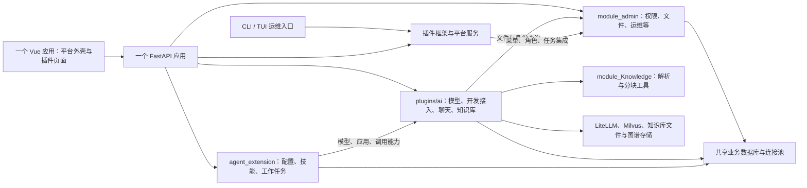
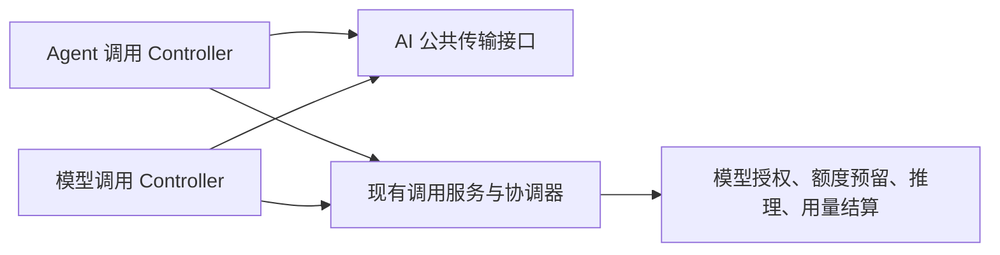

# 模块化单体现状梳理

日期：2026-09-29。对象：`fix/platform-integration-review` 当前工作区，基于 `ec860293` 并包含尚未提交的修复。

结论：项目已有插件、分层、接口协议和适配器基础，适合渐进完善模块化单体。主要工作是明确业务所有权、收拢公开接口、约束依赖方向，并保护已有事务和权限语义。当前目录划分与实际业务边界并不完全重合。

第 1–9 节与依赖 CSV 保留试点实施前的分析快照，文件数量、行号和待改造项均以该时点为准。实施后的最新状态见第 10–16 节；本轮约定的前端边界、后端应用查询、模型引用与费率主线均已完成。运行与发布仍是单个后端应用、单个前端构建产物；模块化单体本身不提供独立发布或进程故障隔离。

## 1. 当前运行与代码结构

这是便于理解的主要依赖图，不是完整运行调用图。前端内部还存在 AI 与扩展插件之间的双向源码依赖，见第 4 节。

- HTTP 入口、后台调度、插件生命周期集中在 [server.py](../../zhiheng-fastapi-backend/server.py)，主要装配位置为 L157–187、L190–223。
- 业务 ORM 共享 [config/database.py](../../zhiheng-fastapi-backend/config/database.py) 的引擎、会话工厂和 `Base`（L104–108）。模块可以拥有自己的事务边界，但没有独立数据库连接身份。
- 内置路由按目录扫描，插件另走清单、注册表和生命周期；这属于应用装配机制，见 [common/router.py](../../zhiheng-fastapi-backend/common/router.py) L306–337、[plugins/core/runtime/bootstrap.py](../../zhiheng-fastapi-backend/plugins/core/runtime/bootstrap.py)。
- 前端插件通过菜单中的 `plugin/<pluginId>/<viewPath>` 加载页面，两个业务插件都声明 `delivery.type: source`、`buildRequired: true`。它们参与同一次 Vite 构建，动态导入不等于独立部署。

## 2. 按业务能力看模块与数据归属

下表描述当前职责，路径省略后端根目录 `zhiheng-fastapi-backend/`。这些是业务边界候选，不代表下一步必须创建同名目录或服务。

| 业务能力 | 当前主要位置 | 主要数据归属 | 当前边界评价 |
| --- | --- | --- | --- |
| 身份、组织与权限 | `module_admin` 中 user/role/dept/menu/login | `sys_user`、角色/部门/岗位及关联表，登录会话 | 平台共用能力；调用方普遍依赖管理模块的用户 DTO |
| 平台管理与运维 | `module_admin`、`module_task`、`config/get_scheduler.py` | 字典、配置、公告、审计、`sys_job*` | 多个职责集中在同一管理模块，可先明确子能力入口 |
| 文件与资源治理 | `module_admin/service/file_*` | `sys_file_*`，上传文件、引用、ACL、保留与清理记录 | 已有生命周期/查询/传输服务；聊天通过适配器消费 |
| 模型目录与推理运行时 | `plugins/ai` 的 model catalog/service/engine | `ai_model_catalog`、`ai_resource_binding`；LiteLLM 管理上游部署和凭据 | 被多个业务消费，应明确模型查询与调用公开接口 |
| 开发接入、授权与用量 | `plugins/ai` 的 application/developer/public API | 应用、API Key、grant、quota、费率、usage ledger/bucket；Redis 配额预留 | 内部一致性要求较高，不能随意拆散数据操作 |
| 会话与聊天 | `plugins/ai` 的 platform chat/coordinator/adapters | `ai_chat_session/message/run/preferences`，附件引用与快照 | 后端已有多个 Protocol；前端会话 API 维护位置重复 |
| 知识库与检索 | `plugins/ai/knowledge` 与 knowledge controller | `metadata.json`、uploads、Milvus；图谱还有 PostgreSQL workspace 存储 | 业务与持久化相对集中，但模型/权限查询仍跨内部实现 |
| 智能体、技能与工作任务 | `plugins/agent_extension` | `agent_configuration`、`agent_skill`、`agent_work_*`、技能包文件 | 可视为一个能力组的三个子域；消费模型、应用、知识库能力 |
| 插件框架 | `plugins/core`；`module_plugin` 提供管理入口 | `sys_plugin*`、迁移账本、菜单/配置/任务集成 | 属于平台支撑能力，需保留与权限和运维的集成接口 |
| 开发与操作工具 | `module_generator`、`cli` | `gen_table*`；CLI 主要操作其他能力 | 是工具或适配入口，不宜按目录数量当成独立业务域 |

特别说明：`module_Knowledge` 当前只有解析、分块等工具代码，没有独立 Controller、DAO 或业务 ORM 表。真正的知识库业务和持久化在 `plugins/ai/knowledge`。平台文件 `sys_file_*` 与知识库自己的 uploads 也不是同一套存储所有权。

数据模型可从 [AI 模型目录](../../zhiheng-fastapi-backend/plugins/ai/entity/do/ai_model_catalog_do.py)、[开发接入模型](../../zhiheng-fastapi-backend/plugins/ai/entity/do/ai_developer_api_do.py)、[聊天模型](../../zhiheng-fastapi-backend/plugins/ai/entity/do/ai_chat_platform_do.py)、[扩展模型](../../zhiheng-fastapi-backend/plugins/agent_extension/entity/do/agent_do.py)、[文件模型](../../zhiheng-fastapi-backend/module_admin/entity/do/file_do.py)核对。

## 3. 后端主要依赖与需要收拢的入口

静态扫描发现 561 个非测试 Python 文件，其中 `module_admin` 82、`plugins/core` 93、`plugins/ai` 80、`plugins/agent_extension` 39、`module_Knowledge` 5；其余包含 CLI、框架、工具与脚本。发现 51 个 ORM 表声明：管理模块 26、代码生成 2、AI 13、扩展 5、插件框架 5。SQL-only、第三方及动态创建的表不包含在这个数字中。

[依赖统计 CSV](./2026-09-29-module-dependencies.csv)按“含静态 import 的不同源文件数”统计，排除测试和第三方依赖，包含函数内与类型引用。它不代表运行调用次数，也未覆盖动态导入、`app.state` 绑定和 AI 插件内部不同业务之间的依赖。

| 静态依赖 | 引用源文件数 | 应如何理解 |
| --- | ---: | --- |
| `agent_extension → ai` | 6 | 复用模型、开发接入与调用能力合理，但部分调用穿透 DAO 和 Controller |
| `ai → module_admin` | 7 | 5 个文件使用身份 DTO，另外涉及文件实体和权限查询；不能全部视为业务耦合错误 |
| `core → module_admin` | 3 | 插件菜单、角色和任务集成，属于需要明确接口的平台协作 |
| `ai → module_Knowledge` | 3 | 文档解析工具复用，可作为知识库适配层管理 |

优先值得改善的四个具体点：

1. **跨 Controller 调私有函数。** [agent_invocation_controller.py](../../zhiheng-fastapi-backend/plugins/agent_extension/controller/agent_invocation_controller.py) L24、L105–129 复用另一个 Controller 的认证、请求读取、流输出和错误转换。适合整理为公开的请求认证与流式响应能力，继续复用现有调用协调器。
2. **模型可用性规则分散。** [agent_service.py](../../zhiheng-fastapi-backend/plugins/agent_extension/service/agent_service.py) L230–250 直接查询模型/应用 DAO；[ai_knowledge_controller.py](../../zhiheng-fastapi-backend/plugins/ai/controller/ai_knowledge_controller.py) L83–108 直接 join 模型与绑定。模型状态、可用条件一旦调整，需要同步检查多个消费者。适合通过模型查询接口提供稳定结果，保留各业务所需的不同筛选语义。
3. **模型定价与开发接入之间的归属需要明确。** [model_catalog_service.py](../../zhiheng-fastapi-backend/plugins/ai/service/model_catalog_service.py) L109–158 经 Developer API DAO 读写费率。可以明确价格维护的唯一入口和查询契约，页面仍可保留在模型中心。
4. **资源删除的引用规则还不完整。** 同文件 L49–81 已有 `ModelReferenceChecker`，默认使用空实现；部分聊天/授权/费率/账本引用有数据库外键保护，扩展配置与知识库 JSON 引用则不是同一种约束。需要先明确引用时禁删还是允许失效，再设计生命周期接口，不能假设外键已覆盖所有消费者。

正常的公共能力复用应保留：鉴权、日志、数据库会话、文件服务、统一模型运行时、用量结算都不应在各模块重复实现。改造重点是调用公开能力并遵守事务约定。

## 4. 前端边界并不完全跟随插件目录

前端仍是一个 Vue 应用、一个 Pinia 和一个构建产物。`src/` 与 `plugins/` 范围的生产源码静态统计为 290 个 JS/Vue/TS 类文件：宿主 `src` 228，AI 插件 42，扩展插件 20；未计入 tests、dist、node_modules 和这些目录之外的构建配置。

| 现状 | 证据与影响 | 可收拢方向 |
| --- | --- | --- |
| Chat 会话 API 同时由宿主与 AI 插件维护 | [platformWorkspace.js](../../zhiheng-fastapi-frontend/src/api/platformWorkspace.js) L3–31 与 [chat.js](../../zhiheng-fastapi-frontend/plugins/ai/api/chat.js) L50–70 定义重复的列表/删除入口 | 明确 Chat 是会话契约 owner，侧栏通过公开客户端使用 |
| 工作任务状态主要放在宿主 | [workTask.js](../../zhiheng-fastapi-frontend/src/store/modules/workTask.js)、宿主侧栏与路由直接知道 Work 业务 | 明确状态 owner，外壳只消费导航摘要与公开动作 |
| 宿主身份 store 直接清理扩展业务状态 | [user.js](../../zhiheng-fastapi-frontend/src/store/modules/user.js) L10、L80–85 | 用明确的会话清理扩展点接入，保持退出和 401 清理语义 |
| AI 与扩展插件有双向源码依赖 | Chat 的 SkillPicker 使用扩展 API；Agent 编辑器使用 AI 模型、知识库、应用接口；Work API 依赖 AI 内部 SSE parser | 使用公开客户端/共享传输协议，避免消费者绑定内部文件 |
| 菜单、权限、导航分组共同决定入口 | [permission store](../../zhiheng-fastapi-frontend/src/store/modules/permission.js)、[workspaceTransforms.js](../../zhiheng-fastapi-frontend/src/components/Workspace/workspaceTransforms.js)、[router](../../zhiheng-fastapi-frontend/src/router/index.js) | 把页面路径、权限码、导航、深链和默认落地作为一个可验证契约 |

后端 manifest 声明扩展依赖 AI，但前端还存在 Chat 对 Skill 的反向消费。页面动态导入提供构建分块，不能据此认为任意插件可以独立发包或卸载。

公共 [request.js](../../zhiheng-fastapi-frontend/src/utils/request.js) 已统一 Token、加密、重复提交和错误恢复，是好的基础；Chat/Work 的 SSE 使用 `fetch`，仍需单独遵循认证、错误和取消协议。通用 SSE parser 可以成为共享传输能力，业务事件和状态机仍归各自模块。

## 5. 已有基础应继续利用

- [ModelRuntimeEngine](../../zhiheng-fastapi-backend/plugins/ai/domain/model_runtime.py) 提供 Protocol，LiteLLM 实现在适配层。
- [platform_chat_service.py](../../zhiheng-fastapi-backend/plugins/ai/service/platform_chat_service.py) 已定义模型、知识、技能、文件等协作接口，[platform_chat_provider.py](../../zhiheng-fastapi-backend/plugins/ai/infrastructure/platform_chat_provider.py) 集中装配依赖。
- [SkillContextAdapter](../../zhiheng-fastapi-backend/plugins/ai/infrastructure/skill_context_adapter.py) 用独立只读会话，避免技能读取的 rollback 破坏聊天写事务。
- [AgentKnowledgeProvider](../../zhiheng-fastapi-backend/plugins/agent_extension/domain/agent_knowledge.py) 已约束超时、片段数量、内容大小和来源范围。
- 插件清单已经声明依赖、权限、菜单与迁移，插件扫描也有隔离损坏插件的处理；这些机制可以承载渐进模块化。
- 数据表按能力有明显归属，当前阶段可以保留已有表名和数据库，在代码与审查规则中约束读写入口。

## 6. 改造时必须守住的语义

| 场景 | 必须保留的约束 |
| --- | --- |
| 创建/轮换开发密钥 | 新 key、模型授权、quota 一起提交；轮换时旧 key 状态与新授权集合保持原子性 |
| 公开 API 调用 | 授权、模型绑定、费率、额度快照需保持一致；Redis 预留与 SQL ledger 是带补偿的流程，不是跨存储 ACID 事务 |
| 聊天写入 | Session、用户消息、pending run 及最终响应状态有既定提交边界；读取其他能力不能意外 rollback 写事务 |
| 工作任务创建 | 任务、成员发布快照和首条消息保持同一事务；可用性查询不能擅自提交调用方会话 |
| 知识库更新 | 保留 metadata 原子替换、锁、workspace、模型绑定与维度约束、任务状态及重试语义；当前图谱实现的单 worker 限制需继续遵守 |
| 权限与资源归属 | 知识库目前是平台共享资源，按权限和绑定范围检查；不能把一次模块化改造当成新增每用户/每库 ACL 的授权 |
| 数据库迁移 | 继续使用已有迁移账本和校验机制，不编辑已应用脚本来适配目录变化；公开 URL、权限码和插件 ID 也属于兼容契约 |

代表证据：[调用快照 DAO](../../zhiheng-fastapi-backend/plugins/ai/dao/ai_developer_api_dao.py) L449、[密钥轮换服务](../../zhiheng-fastapi-backend/plugins/ai/service/developer_key_service.py) L263、[调用协调器](../../zhiheng-fastapi-backend/plugins/ai/service/public_invocation_coordinator.py) L419/L586、[聊天服务](../../zhiheng-fastapi-backend/plugins/ai/service/platform_chat_service.py) L559/L1010、[任务服务](../../zhiheng-fastapi-backend/plugins/agent_extension/service/work_task_service.py) L131、[知识库 metadata](../../zhiheng-fastapi-backend/plugins/ai/knowledge/metadata.py) L56、[知识库运行时](../../zhiheng-fastapi-backend/plugins/ai/knowledge/runtime.py) L597/L631/L1013。

## 7. 常见改动的影响范围

| 改动对象 | 应检查的消费者 | 回归重点 |
| --- | --- | --- |
| 模型状态、标识、绑定 | 模型中心、对话、开发授权、知识库、扩展配置与执行 | 发布/停用、权限、不同模型能力筛选、引用生命周期 |
| 应用、密钥或额度 | 开发接入、用量、公开 API、扩展公开调用 | 轮换原子性、禁用、授权快照、配额补偿 |
| 文件访问与保留规则 | 系统文件管理、聊天附件、后台清理 | 所有权/ACL、引用、过期、路径限制；知识库上传需按其独立存储另查 |
| 知识检索返回结构 | 知识库页面、聊天、扩展与工作任务 | 权限、绑定、超时、片段上限、来源、索引一致性 |
| 技能标识或可用性 | 技能管理、配置编辑器、聊天选择和发送 | 禁用、权限、快照、大小上限、可选能力不可用时的行为 |
| 聊天会话结构 | 聊天页、最近会话侧栏、workspace store | 分页、归档、恢复、删除和详情竞态 |
| 工作任务状态/版本 | 工作页、宿主 store、侧栏、退出/401 清理 | 版本冲突、重复提交、恢复、取消和账号切换 |
| 身份、菜单、插件核心 | 全平台入口和插件生命周期 | 登录、权限落地、动态路由、依赖启停、迁移与恢复 |

## 8. 适合当前项目的渐进顺序

| 顺序 | 范围 | 验收标准 |
| --- | --- | --- |
| 1：固定边界基线 | 确认上面的职责与数据 owner，记录允许的公共依赖和现有例外 | 每项业务有明确入口、数据归属和消费者；依赖规则能识别新增越界引用 |
| 2：小范围试点 | 优先收拢前端 Chat 会话 API；后端选择模型可用性查询作为另一独立试点 | 参数、返回和错误语义明确，现有路径/权限不变，侧栏与页面及对应后端消费者的行为测试通过 |
| 3：处理较强的跨域依赖 | 公开 API transport、文件/身份查询、模型费率归属、资源引用校验 | 消费者通过公开接口协作，事务和权限约束有回归保护；每个小项单独验收 |
| 4：收拢前端业务状态 | Work store 所有权、会话清理扩展点、共享 SSE 基础协议 | 宿主只依赖公开动作/摘要，退出登录和异常恢复行为保持正确 |
| 5：形成持续规则 | CI 加依赖约束和关键跨模块契约，逐步消化基线例外 | 普通模块内改动有针对性回归；公共接口变化明确触发相关消费者检查 |

第一步实现建议优先选“Chat 会话 API 归属收敛”：它有明确的重复维护位置、已有共享 store 和行为测试，可以用较少文件证明边界约束的价值。后端的模型查询试点随后独立实施。当前不需要为这两个试点迁表、改公开接口地址或调整部署拓扑。

收拢接口后再决定是否调整目录结构。保留现有 `ai` / `agent_extension` 插件 ID 与迁移归属，可以先在插件内部形成清晰子能力。模块化单体依旧整体发布；如果未来要求模块独立重启、扩容或隔离内存故障，那是后续部署架构需求。

## 9. 验证基础与本次限制

现有测试可以复用：后端已有模型、授权计费、聊天、知识库、技能、工作任务和插件生命周期测试；前端有路径校验、SSE 解析、状态管理及页面契约测试。前端 Node 入口发现 47 个测试文件，其中 27 个含源码文件读取；文件数量不是覆盖率，也不能把源码文本断言等同于真实运行验证。

CI 浏览器入口使用 mock API，验证页面、导航、主题和部分业务交互；它不能单独证明真实后端接口、数据库事务或所有独立浏览器脚本均被覆盖。已有 CLI 冷导入边界测试，但本次检查范围内未发现覆盖全部业务模块依赖规则的统一门禁配置。

本轮采用 AST 静态扫描、路由/模型/迁移与调用点阅读，并交叉核对前后端。没有运行全量业务测试或对生产数据做查询，未做性能测量，也没有修改运行服务。表归属、风险和实施顺序是当前代码的分析结论；目标边界属于待后续实施确认的建议。

## 10. 首批试点实施状态（2026-09-29）

已在当前工作区完成两个入口收拢，详细验证见[试点记录](../operations/2026-09-29-module-boundary-pilots.md)：

| 范围 | 当前入口与规则 | 对应基线问题 |
| --- | --- | --- |
| 前端 Chat 会话 API | [chatSessions.js](../../zhiheng-fastapi-frontend/plugins/ai/public/chatSessions.js) 统一定义列表、详情、重命名、归档/恢复、删除请求；原 Chat 与宿主 API 文件通过 re-export 兼容原名称 | 第 4 节的重复会话请求定义已收拢；没有移动 store 或状态机 |
| 后端模型查询 | [model_queries.py](../../zhiheng-fastapi-backend/plugins/ai/public/model_queries.py) 返回不可变字段快照；Agent 配置、公开调用、工作任务、知识库选项使用此入口 | 第 3 节第 2 项的模型 DAO/ORM 直接依赖已在这些调用点收拢；应用 DAO 仍待后续处理 |

聊天查询保留“聊天类型、启用、已发布”的条件；知识库模型选项保留“类型匹配、模型启用、绑定启用”的条件，没有新增发布时间限制。公开查询使用调用方数据库会话，不提交、不回滚，也不负责授权和上游健康检查。

现有公开 URL、权限码、插件 ID、数据库结构与部署拓扑不变。已增加会话请求契约测试、真实 SQL 模型筛选与事务测试，以及限定范围的模型持久化导入检查；这不是覆盖所有业务模块的统一门禁。

首批试点结束时，跨 Controller 私有调用、应用/费率依赖、资源引用生命周期、Work store 归属、退出清理及 SSE 共享协议仍是后续候选项。其中跨 Controller 私有调用已在第 11 节继续收拢。本次结果不能解释为 Agent 已能独立发布，或其任何改动都不会影响其他功能。

## 11. 第三个试点：公共调用传输接口（2026-09-29）

Agent 和普通模型调用现已共同消费 [api_transport.py](../../zhiheng-fastapi-backend/plugins/ai/public/api_transport.py)，Agent 不再导入 AI Controller。公共入口负责单认证头读取、JSON 请求验证、固定错误响应，以及 SSE 响应头与流清理；它不负责数据库事务、模型授权、额度或结算。

两种入口的 HTTP 地址和返回格式保持不变。Agent 仍先校验应用绑定与模型授权，再准备技能/知识上下文并调用现有服务；原事务结束时机保留。新增回归覆盖重复认证头、请求体上限、额度拒绝、请求取消、流清理和异常优先级，并添加限定范围的导入约束测试。

相关后端回归 323 项通过。详细环境、命令和限制见[第三个试点记录](../operations/2026-09-29-agent-public-transport.md)。这些验证使用 SQLite、带 Lua 的模拟 Redis 和模拟模型上游，没有更新运行服务。

应用 DAO、模型运行时装配与 Agent 预览调用等依赖仍然存在。第三个试点结束时，前端 Work 状态归属、会话清理扩展点、SSE 解析协议尚未调整；前两项现已继续在第 12 节处理。此次后端 SSE 传输接口提取，不代表前端的 SSE 共享协议也已收拢。

## 12. 第四个试点：Work 状态与会话生命周期（2026-09-29）

Work 的 Pinia store 现由扩展插件的 [stores/workTask.js](../../zhiheng-fastapi-frontend/plugins/agent_extension/stores/workTask.js) 管理。旧宿主入口仅兼容转发，保留同一 store ID 和实例。平台侧栏使用 [public/workTasks.js](../../zhiheng-fastapi-frontend/plugins/agent_extension/public/workTasks.js) 的导航接口，读取任务摘要、分页、加载/错误状态，调用列表刷新、重命名和删除；执行、草稿、成员和重试状态仍由 Work 模块内部管理。

平台 [sessionLifecycle.js](../../zhiheng-fastapi-frontend/src/store/sessionLifecycle.js) 提供按 Pinia 实例隔离的清理机制。已创建的 store 用 `sessionCleanup` 指定自己的同步清理动作，dispose 时注销。用户模块触发本应用清理，不再直接引用 Work；未打开的业务模块不会因此实例化。Work 是本轮接入该机制的业务模块，其他业务状态尚未全部接入。

退出、登录过期和成功登录新会话都会清理 Work。清理保留递增的请求代次，丢弃旧结果，停止流与轮询，并重置加载、错误和分页状态。另修正既有请求竞态：只有请求携带的身份仍匹配当前令牌，其 401 才能清除当前会话；旧身份和匿名请求仍失败，但不能清掉新身份。

前端导入约束现覆盖宿主不引用扩展插件内部实现。三个工作流支持 master 与 release/** 的 push/PR；后端显式测试依赖包含模拟 Redis 的 Lua 支持，前端 CI 增加 Work 桌面/移动浏览器验收。这些是代码与配置中的检查，尚未推送触发云端流水线。

详细结果见[第四个试点记录](../operations/2026-09-29-work-session-boundary.md)。共享 SSE 解析器已继续在第 13 节收拢；前端跨插件模型/应用/技能客户端，以及后端应用查询、模型引用与费率归属，仍是后续候选项。

## 13. 第五个试点：前端共享 SSE 解析（2026-09-29）

前端公共边界已进一步拆成五个小项：共享流解析、技能选择、模型/知识库选择、应用管理和密钥操作，见[逐步实施计划](../superpowers/plans/2026-09-29-frontend-public-boundaries.md)。共享 SSE 这一轮完成第一项，其他四项随后在第 14 节完成。

Chat 和 Work 现在直接使用 [src/utils/platformSse.js](../../zhiheng-fastapi-frontend/src/utils/platformSse.js)。AI 的旧 `utils/sseParser.js` 仅兼容转发，Work 不再引用 AI 插件内部的流解析实现。共享函数处理平台 JSON SSE 事件，不依赖插件，不承载 HTTP 认证、错误映射或业务状态机。

分块回归发现并修复了两个既有问题：CRLF 被分到不同数据块时可能丢失事件类型；读取提前结束或解析失败时没有取消 reader。现已正确保留跨块换行状态，并在非正常 EOF 结束时尽力取消及释放 reader，保留原读取、解析与取消异常。

前端 52 个测试文件、隔离构建和 Chat/Work 桌面与移动浏览器验收通过。验证范围及限制见[共享 SSE 实施记录](../operations/2026-09-29-shared-sse.md)。这不代表技能、模型、知识库、应用或密钥的其他跨插件引用已收拢。

## 14. 完成其余四个前端公共入口（2026-09-29）

| 入口 | 已接入的跨插件消费者 |
| --- | --- |
| [skills.js](../../zhiheng-fastapi-frontend/plugins/agent_extension/public/skills.js) | Chat 的可选技能列表、归一化及输入触发符 |
| [resourceSelection.js](../../zhiheng-fastapi-frontend/plugins/ai/public/resourceSelection.js) | Agent 编辑器的模型、知识库选择、可调用判定和分页 |
| [applications.js](../../zhiheng-fastapi-frontend/plugins/ai/public/applications.js) | Agent 编辑器的应用列表、创建和归一化 |
| [developerKeys.js](../../zhiheng-fastapi-frontend/plugins/ai/public/developerKeys.js) | Agent API 抽屉的密钥操作、公开展示、API 地址与复制 |

9 个 HTTP 请求函数的唯一实现迁入这些入口，原 API 文件直接 re-export。同模块纯辅助函数仍由原模块维护，public 明确选择要暴露的能力。四个消费组件仅修改 import，权限、加载和密钥明文生命周期保持一致。

本轮静态检查中，AI 与扩展插件之间的相对 import 均已指向对方 public，未再发现对方 api/utils 的引用；新增测试约束此范围。它不消除两模块间业务依赖，不等于可以独立部署、卸载或隔离故障。

完整前端检查 53 个文件通过，隔离构建、技能选择、Agent 桌面/移动配置、应用创建、知识库恢复及密钥流程的浏览器检查通过。详见[实施记录](../operations/2026-09-29-public-client-completion.md)。

前端这一轮结束时，后端应用查询接口、模型删除引用规则和费率归属尚未完成。其中应用查询已继续在第 15 节处理。后端既有 Ruff 问题、平台权限落地浏览器测试偶发超时、完整云端 CI 验证仍需处理。运行时、文件/身份等其他公共能力可按后续改动需要继续收拢。

## 15. 后端应用查询公共入口（2026-09-29）

AgentService 现通过 [application_queries.py](../../zhiheng-fastapi-backend/plugins/ai/public/application_queries.py) 的 `is_active_owned_application` 检查应用绑定条件，不再直接引用应用 DAO。

查询复用既有“按 ID 且未软删除”的 SQL，要求应用启用且属于指定所有者，只返回 bool。创建时传入创建者；管理员更新或发布时仍传入 Agent 原所有者。未绑定草稿、发布快照、错误码/文案/422 及事务提交回滚时机均保留，查询本身不管理事务，也不替代开发密钥认证、模型授权或额度检查。

新增查询与消费者测试先验证入口缺失，再完成真实 SQLite 状态/归属/软删除、调用方事务、数据库异常与取消检查；Agent 范围内新增应用持久化导入约束。相关后端回归 335 项通过，独立审查通过，见[实施记录](../operations/2026-09-29-application-query-boundary.md)。

应用查询这一轮结束时，剩余主线是模型删除引用规则和费率归属，默认空检查器与目录中的直接费率访问尚未替换。这两项随后已在第 16 节完成。

## 16. 模型引用、费率边界与质量收尾（2026-09-29）

模型删除由 [ModelDeletionReferences](../../zhiheng-fastapi-backend/plugins/ai/infrastructure/model_reference_provider.py) 汇总各数据所有者的检查：平台聊天/授权/费率/用量、[Agent 与 Work 持久快照](../../zhiheng-fastapi-backend/plugins/agent_extension/public/model_references.py)、[知识库配置及历史版本](../../zhiheng-fastapi-backend/plugins/ai/knowledge/model_references.py)。仅未发布草稿或已停用模型可删除，且必须没有持久引用。归档、已移除成员和仍保留的历史记录不会被当作“引用已经解除”。默认空 checker 已改为未装配即拒绝删除。

核心通过可选 `backend.resourceReferences` 声明发现公开查询，所有已安装插件都参与，不以启停状态代替数据存在性。已安装插件缺源、加载/查询失败和元数据读取失败都拒绝删除。AI 不直接导入 Agent 内部 DAO/ORM；具体引用判断仍由拥有数据的模块实现。

引用写入与删除共用模型行锁，遵循模型在先、业务行在后的顺序，多模型按 ID 排序。知识库引用写入共享文件锁，删除独占文件锁并保持到 SQL 提交；这样保留配置更新并发，同时防止删除检查后新增引用。所有非空 LLM 配置都先验证，即使图谱尚未启用。真实 PostgreSQL 验证了两种竞争顺序，以及 Agent 更新/发布与删除无反向锁死锁。

费率列表、模式规则、版本和价格字段映射由 [RateCardService](../../zhiheng-fastapi-backend/plugins/ai/public/rate_cards.py) 拥有。ModelCatalogService 消费公开服务并负责模型存在检查与事务；它不再直接操作开发接入 DAO/费率 ORM。价格仍追加版本，金额、时间和计费语义保留；模型不存在或费率历史读取失败也纳入回滚。授权/结算的原子快照查询没有拆散。

此前全仓 Ruff 与格式问题已处理。浏览器检查复现到鉴权前的本地模块 `ERR_NETWORK_CHANGED`：仅对这一类且尚无业务请求/脚本异常的冷启动失败允许重建一次上下文，保存首次诊断；错误落地、业务/API 错误和连续失败仍报错。权限落地增加目标页面可见断言，截图阈值未放宽。

本地验收：后端 3331 项通过、5 项跳过；前端 53 个文件与 14 个浏览器辅助测试通过；平台浏览器两轮通过；全仓 Ruff 与 823 文件格式检查通过。CI 加入临时 PostgreSQL 行锁测试，测试依赖和 Ruff 版本已固定。详见[最终实施记录](../operations/2026-09-29-model-lifecycle-pricing.md)。

这些结果完成的是本轮已约定的模块化和本地质量收尾。改动尚未提交、推送或部署，云端 CI 未触发；其他能力可在具体需求出现时继续细化，不代表项目已经具备任意模块独立卸载、独立发布或故障隔离。
