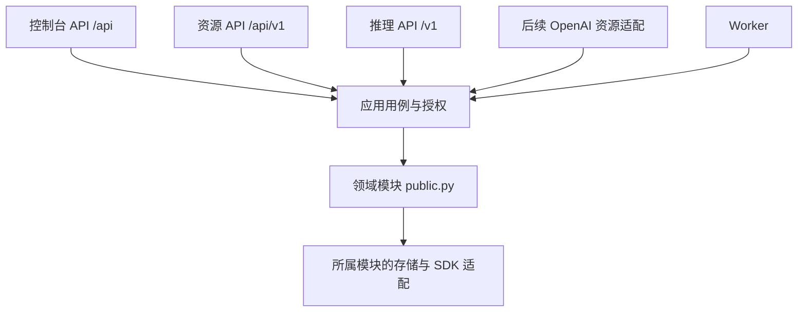

# 对外资源 API 与代码结构设计

状态：用户已授权实施。个人技能和个人知识库都是硬性归属边界，按实施计划逐阶段落地。

## 1. 已确认的产品边界

用户确认本期以平台资源 API 为主，预留 OpenAI 兼容适配层；重点保证代码结构和职责合理。技能和知识库都是个人资源，默认私有，不能作为全平台资源池开放。普通资源入口即使由管理员访问也默认限制本人；主动共享必须由拥有者明确授权，Key还需应用资源授权。

本期覆盖文件、知识库、个人技能、应用资源授权、异步操作及完整接口文档。AI 能力继续内置，保留模块化单体、现有 Vue 界面、LangChain、统一 Run/Worker/积分账本，以及普通聊天与工作空间的独立入口。

OpenAI Files/Vector Stores/Skills 的完整 SDK 兼容、代码执行环境、MinerU、第三方业务插件、组织租户模型属于后续独立范围。本期不会把仅有相似 URL 的接口标为 OpenAI 兼容。

## 2. 参考与现状

百炼的参考价值是将模型调用和资源管理分别提供清晰接口，知识入库使用异步索引任务，技能版本在挂载后保持稳定。

- [百炼知识库 API 指南](https://help.aliyun.com/zh/model-studio/rag-knowledge-base-api-guide)：上传、解析、索引、任务状态与检索。
- [百炼技能 API](https://help.aliyun.com/zh/model-studio/skills-api/)及[技能指南](https://help.aliyun.com/zh/model-studio/managed-agents-skill)：文件上传后创建技能、独立版本、明确挂载版本。文档中的云 IAM、OSS、扫描服务和厂商域名不直接搬入本平台。
- [OpenAI Skills API](https://developers.openai.com/api/reference/resources/skills/methods/create)与[Retrieval](https://developers.openai.com/api/docs/guides/retrieval)：作为未来协议适配的参考，本期保留边界。

当前代码已有 `/api/files`、知识库上传/文档任务、技能预检/确认；主要使用 Cookie。`/v1` 主要开放推理，Key 只保存模型授权，尚无文件/知识库/技能资源授权。上传路由使用原始二进制请求，自动 OpenAPI 没有完整描述请求体及 Cookie 安全方案。

另一个必须补齐的现状是：`SkillDraft` 有 `owner_id`，但 `Skill` 主表没有归属，列表和可用技能查询未按个人隔离。这与“个人技能”的产品语义不一致，不能只在路由加过滤来掩盖。

当前 `api/routes/public.py` 同时包含协议 DTO、路由、等待、SSE 和生命周期处理；资源路由也直接编排模块服务。新增 API 时应收拢这些职责，复用业务用例。

## 3. 方案选择

| 方案 | 成本与取舍 | 选择 |
| --- | --- | --- |
| 协议层分类，应用层按业务域组织，复用领域模块 | 需要迁移调用入口；业务规则、存储与账本只有一套 | 推荐 |
| 在现有路由追加 Bearer 分支 | 初期改动少；Cookie/Key 的授权和响应容易散入各路由 | 不采用 |
| 单独建立资源 API 服务 | 可独立部署；增加身份同步、事务和作业协调成本 | 当前规模不采用 |

依赖方向如下。协议之间通过共同用例复用业务，不通过 HTTP 调用本平台另一个接口。



## 4. 目标目录

下列是目标结构，不表示这些目录已经存在。按业务迁移现有文件；每次迁移完成后删除旧写实现，避免长期双轨。

```text
backend/src/zhiheng/
├── api/
│   ├── main.py                    # 唯一 HTTP 装配与生命周期入口
│   ├── common/
│   │   ├── dependencies.py        # Cookie/Key 身份依赖，构建调用上下文
│   │   ├── errors.py              # 错误到 HTTP 的映射
│   │   ├── uploads.py             # 文件传输、大小限制与临时文件清理
│   │   ├── pagination.py          # 游标和列表响应
│   │   └── openapi.py             # 从同一路由/Schema生成分组规范
│   ├── console/                   # 原 /api 路径和前端契约
│   │   ├── router.py
│   │   ├── files.py
│   │   ├── knowledge.py
│   │   ├── skills.py
│   │   └── ...                    # 原身份、后台、聊天等控制台路由
│   ├── resources/                 # 平台 /api/v1 资源接口
│   │   ├── router.py
│   │   ├── files.py
│   │   ├── knowledge.py
│   │   ├── skills.py
│   │   ├── operations.py
│   │   └── schemas/               # 资源协议的输入/输出DTO
│   │       ├── files.py
│   │       ├── knowledge.py
│   │       ├── skills.py
│   │       └── operations.py
│   ├── inference/                 # 现有 /v1 推理协议
│   │   ├── router.py
│   │   ├── models.py
│   │   ├── chat.py
│   │   ├── embeddings.py
│   │   ├── rerank.py
│   │   ├── agents.py
│   │   ├── schemas.py
│   │   └── streaming.py           # SSE 编码/断开策略，无账务编排
│   └── compat/                    # 后续协议适配；本期不注册新路由
│       └── openai/
├── application/
│   ├── access/
│   │   ├── context.py             # 不可变 CallerContext
│   │   ├── authorization.py       # Owner、Scope、应用授权与ACL交集
│   │   └── job_guard.py           # 已接纳任务阶段性的权限复核
│   ├── files/
│   │   ├── commands.py            # 上传/回收/恢复等事务用例
│   │   └── queries.py             # 受限列表、详情与下载
│   ├── knowledge/
│   │   ├── commands.py            # 库、文档入库和引用组合
│   │   ├── queries.py             # 元数据与来源查询
│   │   ├── jobs.py                # 迁入现有 knowledge_jobs.py
│   │   ├── retrieval.py           # 迁入现有 knowledge_preparation.py
│   │   └── graph/                 # 原 graph_jobs/runs 按域归组
│   ├── skills/
│   │   ├── commands.py            # 预检/确认/版本/删除引用保护
│   │   └── queries.py             # 本人技能及授权应用可读版本
│   ├── operations/
│   │   ├── queries.py             # 对既有作业的外部查询视图
│   │   └── cancellation.py        # 分派给所属用例，保留取消语义
│   ├── inference.py               # 统一模型执行器
│   └── ...                        # 其余现有用例在触及时按业务域迁移
├── modules/
│   ├── identity/                  # 用户和当前角色权限
│   ├── developer/
│   │   ├── applications.py
│   │   ├── keys.py                # 密钥签发/轮换/撤销
│   │   ├── scopes.py              # 操作能力定义和验证
│   │   ├── resource_grants.py     # 应用与具体资源的授权关系
│   │   ├── api_requests.py        # 请求身份/幂等结果/作业关联
│   │   ├── contracts.py
│   │   ├── orm.py
│   │   └── public.py
│   ├── files/                     # 文件、ACL、引用、生命周期和存储规则
│   ├── knowledge/                 # 库/文档/索引/图谱及领域规则
│   ├── skills/
│   │   ├── access.py              # 个人归属规则，默认无跨用户读取
│   │   ├── builtin.py             # 内置模板定义和个人副本初始化
│   │   ├── package.py             # 包校验
│   │   ├── service.py             # 技能与不可变修订
│   │   ├── contracts.py
│   │   ├── orm.py
│   │   └── public.py
│   └── ...                        # models/billing/chat/agents/work等
├── runtime/                       # 原Run、租约、outbox和恢复原语
├── worker/                        # 执行与调度
├── infrastructure/                # 数据库、文件存储与加密实现
└── bootstrap/container.py          # 显式依赖注入
```

划分原则：

- HTTP 层只处理传输、协议 DTO 和响应映射；不能直接查 ORM、扣积分、操作 Milvus 或调用供应商。
- 应用用例负责调用上下文、授权复核、事务、跨域引用和接纳作业。Console、资源 API、后续兼容层调用相同用例。
- 模块持有业务规则和自己的数据，只通过 `public.py` 跨模块使用。SDK 与物理存储实现留在所属适配层。
- `Operation` 是已有知识作业/准备请求的外部视图，不建立第二套 task 模块、队列、状态机或积分账本。
- 服务采用组合和构造器注入，不为每张表机械添加 Repository/Manager/Service/Impl 多层。只在需要替换实现的存储、解析器或供应商边界抽协议。
- 文件服务当前较大；触及上传/授权/生命周期时按 `metadata.py`、`access.py`、`queries.py`、`lifecycle.py` 分离规则，`service.py` 保留稳定入口。后台维护和图谱 SDK 不随这次 API 整体重写。

## 5. 身份、应用和资源授权

### 调用上下文

`CallerContext` 包含来源、由服务端恢复的真实个人 Principal、可选 application/key 身份、请求 ID。不接收客户端指定的 `owner_id`、管理员标记或任意调用来源。

- Console 中需登录的路由只接收 Cookie；健康、登录、既有公开分享/公开文件入口保持各自明确的匿名规则。
- 资源 API 和推理路由只接收 Bearer Key，不从 Cookie 回退。
- 一个 FastAPI 应用统一装配 Container。分组文档不额外创建另一套业务容器或生命周期。

资源授权同时满足：用户当前基础能力/角色权限、Key Scope、应用资源授权、领域当前归属及 ACL。管理员的全局管理身份不能自动扩大 Key 的资源范围。不存在或不可见资源统一返回 404；没有相应操作 Scope 返回 403。

通过资源 API 创建的个人资源自动关联当前应用；控制台创建的资源默认只归本人，需本人显式授权给应用。普通聊天和工作附件不因签发 Key 自动开放。应用拥有者相同，也不能让两个应用互相遍历未授权资源。列表、搜索、下载和 operation 查询都先收窄应用资源集合，不在取回全平台结果后由前端过滤。

### Key 能力

首期 Scope：`models:invoke`、`agents:invoke`、`files:read`、`files:write`、`knowledge:read`、`knowledge:write`、`knowledge:query`、`skills:read`、`skills:write`。

旧 Key 保留原推理能力和模型列表，不自动获得任何资源 Scope。只做文件、技能或知识元数据管理的资源 Key 可以没有模型列表；执行索引或检索时仍须显式获得相关 Embedding/生成模型授权。资源用例内检查这些模型授权和自身 Scope，不因此额外开放裸推理接口。

每个应用对具体资源记录读、写、查询、删除等动作授权，Key Scope只能进一步缩小。创建时授权当前新资源；关联现有资源时检查本人归属或允许委托的共享权限。资源转移、ACL撤销、应用停用和账号停用必须使后续访问失效。

本期 Key 的 Scope 随签发固定，资源集合由应用的显式授权关系决定；应用资源授权修改使用 CAS 并即时生效。修改 Key Scope 通过签发新 Key 并撤销/轮换旧 Key，轮换复制相同权限，不隐式增权。后续若引入在线编辑 Key Scope，再增加明确的授权版本。

## 6. 个人技能的硬性约束

- 当前技能以用户为归属主体：新建必有 `owner_id`，默认私有；唯一标识为 `(owner_id, slug)`，不同用户可有同名技能。
- 本人私有技能的上传、更新、启停、删除和恢复是个人基础管理能力，仍受有效引用和在途操作保护。平台管理权限不替代普通资源入口的本人归属检查。
- API Key 创建的技能仍归应用拥有者本人，自动授权给该应用；其他应用需本人另行授权。不会另建一套“API技能表”。同 Owner 的同名技能已存在但未授权给当前应用时，预检不得泄露目标详情、自动绑定或覆盖，必须先由本人授权。
- `SkillService.list/available/get/import/resolve` 必须显式接受个人上下文。聊天按会话拥有者解析；智能体配置按智能体拥有者解析；Work按已发布成员的固定修订使用，不暴露其他人的原始包。
- 对外使用技能 ID 与不可变 `revision_id`。`package_version` 是包内标签，`resource_version` 是状态 CAS 版本，三者不能混用。版本内容不能原地覆盖，删除/恢复保持历史修订和引用事实。
- 内置内容作为模板初始化为个人副本；用户可以启停或删除自己的副本，不能改变别人的副本。模板定义本身只读，不放在“我的技能”里当作可全局编辑的个人记录。
- ZIP路径/大小/YAML等现有包校验继续由 skills 模块负责。不会把格式校验称作第三方安全扫描；脚本附件不因开放上传 API 就自动获得执行能力。

### 原有技能迁移

现有上传技能先从已确认安装草稿的 `owner_id`、安装动作及审计记录推导归属，保留能够唯一归属的技能 ID、修订、内容哈希和旧确认结果。不能把无法判定的记录统一分给管理员或公开给所有人。

内置旧记录保留为历史模板档案，为已有用户生成个人副本；通过 `skill_legacy_bindings(old_skill_id, owner_id, personal_skill_id)` 显式处理仍在使用旧标识的配置，当前可用性和引用保护都考虑此关联。历史消息、Run、发布快照和账务不改写。旧修订只可经可信历史引用读取，不继续提供未归属的全局可用列表。

无法唯一归属的上传记录隔离保留，审计报告列出待认领记录及活动引用。跨用户旧引用不能通过扩大访问权限维持可用；需经归属确认处理。迁移先输出审计清单，实际升级遇到未处理活动引用时停止接纳升级，保持原库和备份，不静默改变用户数据。

## 7. 平台资源接口

基础路径为 `/api/v1`；现有 `/api/...` 和 `/v1` 契约保持。资源使用稳定 ID，客户端不能提交物理路径、OSS地址或供应商凭据。

| 方法/路径（省略 /api/v1） | 行为与接纳结果 |
| --- | --- |
| `POST /files` | multipart 单文件上传，含 purpose，201返回已登记文件 |
| `GET /files`、`GET /files/{id}` | 当前应用授权集合内的游标列表/元数据 |
| `GET /files/{id}/content` | Bearer鉴权下载，保留Range、审计和CSP |
| `DELETE /files/{id}`、`POST /files/{id}/restore` | 带If-Match回收/恢复；不提供Key永久清库能力 |
| `POST /knowledge-bases` | 创建本人知识库并关联当前应用，201 |
| `GET /knowledge-bases`、`GET/PATCH /knowledge-bases/{id}` | 授权范围内查询/元数据修改 |
| `DELETE /knowledge-bases/{id}` | 原引用保护下异步移除，202 |
| `GET/POST /knowledge-bases/{id}/folders`、`PATCH/DELETE /knowledge-bases/{id}/folders/{folder_id}` | 目录管理；递归删除走原异步作业 |
| `POST /knowledge-bases/{id}/rebuild`、`POST /knowledge-bases/{id}/documents/{document_id}/rechunk` | 显式重建/重新切片，202，保留失败前可用索引 |
| `POST /knowledge-bases/{id}/documents` | 由已授权file_ids入库，202返回operation |
| `GET /knowledge-bases/{id}/documents` | 经过源文件ACL过滤的文档列表 |
| `DELETE /knowledge-bases/{id}/documents/{document_id}` | 沿用原引用保护与异步索引更新，202 |
| `POST /knowledge-bases/{id}/query` | 受治理检索，202；不把有模型调用的检索当作纯GET |
| `POST /skill-imports` | 从file_id预检个人技能，201返回draft/action/目标状态 |
| `POST /skill-imports/{id}/confirm` | 确认安装/更新/恢复，201返回固定结果 |
| `GET /skills`、`GET/PATCH/DELETE /skills/{id}` | 本人且已授权给应用的技能管理，PATCH只改启停状态；写入需If-Match，内容更新/恢复走预检确认 |
| `GET /skills/{id}/versions`、`GET /skills/{id}/versions/{revision_id}` | 不可变修订列表/元数据，不等同于包内版本标签 |
| `GET /skills/{id}/versions/{revision_id}/content` | 返回当时保存的原始主文件或ZIP，权限在读取时复核 |
| `GET /operations`、`GET /operations/{id}` | 当前应用内的操作列表/详情，读取结果复核目标Scope与ACL |
| `POST /operations/{id}/cancel` | 写入原领域取消意图，返回请求已接纳；不宣称已立即停止 |

知识库ACL沿用原有模型，应用不能通过Key自行为别人授权；跨用户共享由本人控制台管理。目录、删除和构建均复用现有用例。平台配置、凭据管理、积分发放/回收和全局计费开关仍是控制台管理操作，不随资源Scope开放。

统一约定：

- 上传采用multipart；保留单文件20MiB、技能包10MiB、解压30MiB/200文件/主文件128KiB等现有限制。普通JSON不套用上传大请求上限；上传策略集中声明，不继续散写URL特判。multipart只做HTTP解析，若锁定依赖中缺少对应解析器仅增这一传输依赖，不借机升级模型SDK。
- 创建、导入、确认及有计量的query要求UUID `Idempotency-Key`；相同应用/操作/键和相同请求返回原结果，换内容409。查询状态不创建第二个任务或重复扣费。
- 单资源返回对象；列表统一 `items/next_cursor/has_more`，默认20、最大100，稳定按创建时间与ID排序，游标绑定过滤条件与应用。
- 可变资源通过 `ETag/If-Match` 表达当前版本；适配器转换为领域的 expected_version。缺少必要前置条件428，陈旧版本412，引用/幂等/在途冲突409。
- 成功异步接纳202，附 `Location` 和operation对象。统一状态为 queued/running/succeeded/partially_succeeded/cancel_requested/cancelled/failed/interrupted；保留阶段、进度和取消能力，禁止把partial映成成功。
- 资源 API 每次响应有 `X-Request-ID`；错误为 `error.code/message/details/request_id`。推理兼容接口继续原OpenAI错误形状，由协议适配器映射。
- 资源操作单独执行请求频率限制，不把文件上传算Token。首期资源请求默认每Key每分钟120次，可由平台调低；推理原RPM/TPM/并发和积分限制保持语义。429返回Retry-After，操作轮询建议不快于每秒一次。

应用资源默认上限为 1000 个原始文件、1GiB 原始文件逻辑空间，可由管理端配置。软删除文件在物理清理前仍计入，应用内同一文件不重复计数；派生索引及技能不可变快照单独纳入平台存储统计，不换算成 Token。容量复核在登记事务内按应用串行，存储 IO 在事务外；并发超额的本次未登记对象回收，不能删除已有文件。

个人技能响应明确提供 id、owner_id、slug、status、resource_version、current_revision_id、package_version、content_hash，Owner只读；启停/软删除映射到外部状态，包内容只能追加修订。package_sha校验原始包字节，content_hash校验规范文件树，两者不能混用。

`knowledge:query`允许返回已授权的检索片段，不自动授予原文件下载。入库/技能预检需要源文件当前可读及对应写Scope；原文ACL仍与知识库权限取交集。

## 8. 用例、异步执行与账务

上传文件的业务用例完成归属、领域登记、应用关联和请求结果；大字节传输与存储IO不占用数据库锁。失败只清理本次新写且未被登记/引用的对象，复用文件对账发现崩溃遗留，不能按用户文件名删除存量内容。

知识入库流程为：上传 → 入库用例校验Key/模型/源文件 → 在同一短事务创建原领域作业、应用请求关联和必要预留 → Worker解析/切片/模型调用/索引 → 对外operation投影。页面或HTTP断开不取消已经接纳的任务。

作业使用服务端写入的可空来源元数据（owner/application/key/request），不保存管理员标记和永久权限快照。旧Console作业来源为空时沿用原规则。Worker在新模型调用/阶段切换前重新校验Key、应用、个人权限、资源及模型授权；撤销后停止未执行步骤，已发生调用按原冻结价格结算。

operation只是查询/取消适配，状态事实仍在原KnowledgeJob/Preparation/Run等记录。operation详情、结果与幂等重放每次复核当前应用授权和源文件ACL，缓存不永久授予内容读取权；取消要求目标写Scope，检索结果要求knowledge:query。读取历史事实不重新检查模型活性或重复收费。来源关联供应用隔离和审计，不能建立另一个执行队列。所有模型调用经过原inference与billing，索引、检索、重排序不得另接供应商或另算一份费用。

模型授权和有效定价在作业接纳前检查；预占、余额/Key预算与结算按原模型步骤执行，后续余额变化造成的部分失败需要显式展示。普通资源管理本身不扣模型积分。

新事务继续遵守现有 Key→Application、Model→Connection→KB及领域资源顺序；不持锁跨HTTP/磁盘IO，不在持KB时再锁陌生模型。需真实PG回归证明并发接纳、配置改选、撤权、取消和完成互不反锁；不能只写函数调用顺序断言。

幂等结果快照默认保存24小时；请求身份、目标引用和已接纳事实按对应领域历史规则保留，幂等命名空间为应用＋操作＋键；跨Key接续仍校验当前Scope/资源授权，原Key计量归属不改写。快照失效的旧键返回409及可授权读取的结果引用，不自动当新请求重做。技能旧确认结果仍由原冻结确认事实提供。正在处理或结果不确定时明确返回状态/Location，不能靠生成新键静默重试。

## 9. 数据与文档

增量迁移分两步：

1. `0014_personal_skill_ownership`：技能归属、用户内slug唯一、个人内置副本、旧引用关联及归属审计。新个人技能强制owner；仅历史隔离档案允许空owner且不能进入当前可用列表。先验证现有活动引用和历史快照。
2. `0015_resource_api_access`：Key Scope及resource_rpm_limit、应用资源授权、应用文件数/原始空间限额和API请求/作业关联。旧Key只有原推理Scope，空资源授权；不回填“全部文件/知识库/技能”，不改旧余额、价格和模型列表。
3. `0016_file_purpose`：文件领域持久保存上传用途，旧文件默认 `general`；追加迁移，不修改前两次迁移，所有旧行的原有列保持。

授权关系与请求身份归developer模块；技能归属归skills；文件和知识库原ACL继续归各自模块。实际模型预占、费用和对账只在billing，不复制到API请求表。

提供 `/docs/resources`、`/openapi/resources-v1.json`，以及单独推理分组规范；原 `/docs` 保留。所有Schema由实际路由与DTO生成，正确标注multipart、Cookie/Bearer、Scope、游标、If-Match和202状态；OpenAPI的HTTPBearer没有OAuth Scope字段，额外以 `x-required-scopes` 描述，不伪造OAuth流程。

前端开发接入增加资源权限、应用已授权资源和API文档分组。文档目录从相同路由元数据生成，示例与契约测试联动，不再手抄第二份字段定义。先提供curl/Python HTTP示例；不把编写独立SDK当作本期必要条件。

## 10. 实施顺序与验收

第一步先完成个人技能归属与隔离，使Console与领域服务的语义一致。第二步完成Caller/Key Scope/应用资源授权及文件入口。第三步接入知识库、技能和operation门面。第四步迁移受影响控制台路由到同一用例，拆分原public.py并补规范、文档和回归。其他域的目录在迁移该域时整理，不一次搬动全部SDK和Worker代码。

验收必须包括：

- 两个用户同slug、UUID猜测、Owner字段伪造、两个同Owner应用互访、只读Key写入、旧Key资源Scope默认拒绝。
- 本人技能CRUD、个人内置副本、旧数据归属审计、版本/恢复稳定身份，以及Agent/Work历史内容和引用保护。
- 原API/Key/模型授权与全部个人数据不退化；撤销、停用、转移、ACL变化和在途模型费用按现有规则处理。
- 相同幂等键并发/响应丢失、不同内容冲突、后台静默任务、取消/完成竞争、部分失败和真实积分结算。
- 原始上传、权限、SDK调用、真实PG/Redis/Milvus及浏览器关键链路；OpenAPI输入输出契约校验与依赖边界检查。

代码审查检查三个问题：规则属于哪个模块、谁拥有数据、哪层决定事务与授权。新路由不直接拿ORM或SDK；模块不反向导入application/api；跨模块只走public。对本次新增或迁移代码执行类型/规范/架构检查，不通过扩大全局忽略掩盖问题。

未来OpenAI资源兼容层只进行请求/响应/状态映射，继续调用同一应用用例。不能复制文件、重建第二个向量索引、另存一份技能或重复记账；其完整兼容范围在下一阶段单独定义和测试。
