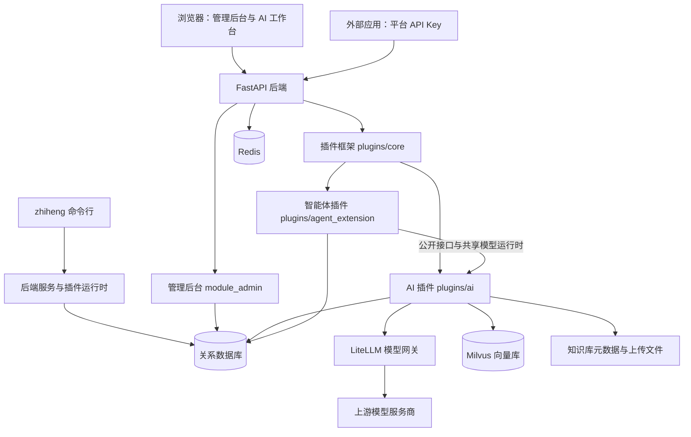
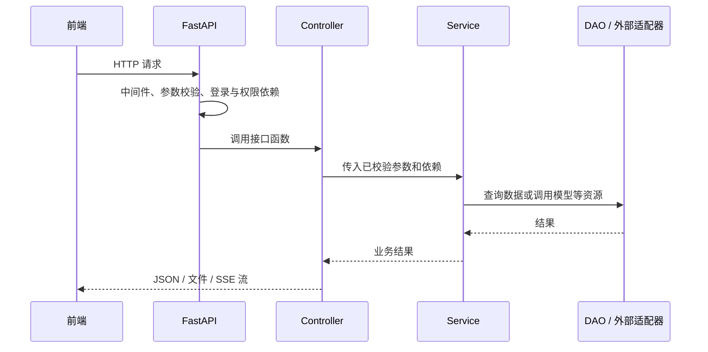
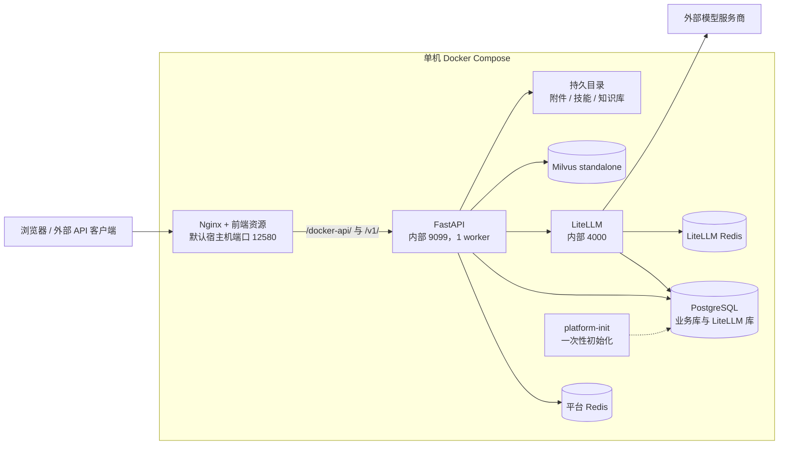

# 后端目录说明

## 1. 文档范围

本文记录后端架构、目录职责、模块依赖和关键调用链路，以及数据一致性、运行和交付约束。

更新日期：2026-10-10。代码范围为 `release/platform-integration-merge` 集成后的 `zhiheng-fastapi-backend`，已同步模块化边界、模型视觉与重排序接入、对话停止与断连恢复等变更。

源码版本以 Git 提交为准，运行版本需结合容器镜像与静态资源核对。以下文件链接均相对于本文所在目录；模型配置、服务商凭据和上传数据不属于 Git 源码。

| 主题 | 对应章节 | 主要内容 |
| --- | --- | --- |
| 架构与模块边界 | 第 2 节[架构概览](#architecture-summary)、第 11 节、[第 14 节](#design-and-runtime) | 设计取舍、依赖关系、变更影响与实现约束 |
| 代码组织与调用链路 | 第 3～8 节、第 12 节 | 目录职责、启动过程、功能入口与数据访问路径 |
| 数据、部署与验证 | 第 9～10 节、第 13 节、第 14.2、14.6～14.8 节 | 存储归属、部署拓扑、恢复机制、测试证据与演进条件 |

文中的“已实现”指当前源码存在该机制；“已验证”必须附带验证范围和时间；“建议 / 待验证”不代表已经交付。本文不据源码分支推断在线镜像版本，也不把历史测试结果当作当前生产容量承诺。

## 2. 整体架构

这份后端属于**带插件机制的模块化单体应用**：管理后台、AI、智能体等业务模块运行在同一个 FastAPI 应用中，复用数据库连接、Redis、身份认证和日志机制。跨模块能力通过公开入口和声明的资源引用回调协作。LiteLLM、数据库与向量数据库是应用连接的外部服务。



几个容易混淆的概念：

| 名称 | 在本项目中的含义 |
| --- | --- |
| 平台模型 | 用户在模型目录看到的模型，拥有平台 ID、类型、能力标记和发布状态 |
| 运行时绑定 | 把平台模型关联到 LiteLLM 中可调用的模型别名 |
| 服务商凭据 | 访问硅基流动等上游服务的连接信息，由模型引擎管理链路维护 |
| 平台 API Key | 外部应用调用本平台时使用的密钥，受应用、模型授权与配额约束 |
| 插件 | 同一后端应用内按清单加载的功能包，不等于独立进程或独立容器 |
| 智能体 | 模型、系统提示词、技能与知识库等组成的业务配置 |
| 技能 | 可选择的提示词及相关文件包；本插件不会自动执行其中的脚本 |

<a id="architecture-summary"></a>

### 2.1 架构概览与关键约束

当前采用模块化单体，模型接入、对话、知识库和智能体复用身份、模型与文件能力，集中部署以控制开发和运维复杂度。模块边界用于明确职责和依赖；当前仍共用应用进程与发布产物，尚不具备单模块独立发布、进程故障隔离或多节点高可用能力。

| 设计项 | 当前实现 | 约束 |
| --- | --- | --- |
| 模块划分 | `core`、`ai`、`agent_extension` 分别负责插件生命周期、AI 基础业务、智能体与任务编排 | Agent 仍复用 AI 的部分内部服务与类型 |
| 变更影响 | 公开查询、资源引用回调和领域目录缩小代码改动范围 | 共用后端进程、数据库连接和发布包；修改共享协议时需跨模块回归 |
| 交付方式 | 已有版本化镜像包交付，运行服务器无需源码 checkout | Python 镜像内仍包含运行代码，未提供源码加密 |
| 数据一致性 | SQL 事务、行锁、Redis Lua、文件锁及补偿恢复分别处理各自边界 | PostgreSQL、Redis、文件、Milvus 和 LiteLLM 之间没有统一分布式事务 |
| 扩展能力 | 当前交付配置为单机 Compose、后端 `APP_WORKERS=1` | 图谱协调和本地持久目录限制扩容，多 worker / 多节点运行需另行改造和验证 |
| 验证范围 | 已有模块测试、真实 PostgreSQL 并发验证、特定故障恢复和镜像发布演练 | 最大并发、可用性指标和完整灾难恢复时间尚未形成验证结论 |

部署方案的演进取决于可用性目标、维护窗口、备份恢复目标及知识处理负载。具体运行机制、验证依据和后续实施条件见第 14 节。

## 3. 顶层目录全览

```text
zhiheng-fastapi-backend/
├── app.py                    # 启动 Uvicorn
├── server.py                 # 创建 FastAPI 应用，管理启动与关闭
├── config/                   # 环境配置、数据库、Redis、调度器
├── common/                   # 路由、权限依赖、装饰器、公共对象
├── middlewares/              # 请求处理中的通用中间件
├── exceptions/               # 统一异常与响应处理
├── module_admin/             # 用户、角色、菜单、文件等平台管理
├── module_generator/         # 根据数据库结构生成业务代码
├── module_plugin/            # 插件管理 HTTP 入口
├── module_task/              # 文件生命周期任务与调度示例
├── module_Knowledge/          # 抽取的文档解析、文本分块基础代码
├── plugins/
│   ├── core/                 # 插件发现、校验、安装、启动、升级框架
│   ├── ai/                   # 模型、对话、知识库、开发者 API
│   └── agent_extension/      # 智能体、技能、工作任务
├── cli/                      # zhiheng 命令行与交互终端
├── utils/                    # 文件、日志、分页、密码等工具
├── sub_applications/         # 静态文件子应用挂载
├── sql/                      # 初始化 SQL 与生成的整合 SQL
├── alembic/                  # Alembic 数据库迁移工具配置
├── scripts/                  # 初始化、SQL 构建、文件迁移等脚本
├── tests/                    # 按模块组织的自动化测试
├── docs/                     # 开发与操作文档
├── assets/                   # 字体等静态资源
├── resources/                # 构建与运行所需的离线资源
├── Dockerfile.pg             # PostgreSQL 版后端镜像构建
├── .dockerignore             # Docker 构建上下文排除规则
├── .env.dev                  # dev 环境配置文件
├── .env.prod                 # prod 环境配置文件
├── .env.dockerpg             # dockerpg 环境配置文件
├── requirements*.txt         # 不同数据库与知识库能力的依赖
├── requirements-test.txt     # pytest、异步数据库、Redis Lua 和附件测试依赖
├── pyproject.toml            # CLI 包与命令入口、pytest 路径配置
├── ruff.toml                 # Python 静态检查与格式规则
├── alembic.ini               # Alembic 入口配置
└── README.md                 # 本后端的文档导航
```

运行后还可能产生 `logs/`、`data/`、`vf_admin/`、`__pycache__/` 等目录。它们和当前列出的源码目录用途不同，具体数据位置受环境配置与 Docker 挂载影响。

## 4. 常见代码分层

管理模块常用 `controller → service → dao`；AI 与智能体还增加 `domain` 和 `infrastructure`。

| 层 | 作用 | 通俗理解 |
| --- | --- | --- |
| `controller/` | 声明 URL、HTTP 方法、参数、权限和响应，调用业务服务 | 接待请求的入口 |
| `service/` | 编排业务规则、状态变化与事务 | 决定事情怎样完成 |
| `dao/` | 查询和更新数据库 | 负责存取数据 |
| `entity/do/` | SQLAlchemy 表映射 | 数据库里如何存 |
| `entity/vo/` | Pydantic 请求与响应模型 | 接口允许输入什么、返回什么 |
| `domain/` | 业务协议、错误、值对象及较独立的规则 | 业务使用的概念和约定 |
| `infrastructure/` | 调用网关、文件系统、其他模块；组装服务依赖 | 把业务接到实际资源上 |
| `public/` | 提供跨模块可复用接口，明确返回字段、事务和授权边界 | 模块对其他业务的协作入口 |

例如修改“用户重置密码”，先看 `module_admin/controller/user_controller.py` 中对应接口，再追到 `service/user_service.py`；需要改变保存方式时才继续看 DAO 和表模型。

目录分层是组织方式，不代表每一处代码已经完全解耦。已经收拢的公开边界及仍有的共享依赖见第 11 节。

## 5. 后端如何启动与处理请求

### 5.1 启动入口

主要入口是 [app.py](../app.py) 和 [server.py](../server.py)。CLI 的 `zhiheng app run` 最终通过 [cli/bootstrap.py](../cli/bootstrap.py) 启动同一个 `app.py`。

1. `config/env.py` 解析运行环境并加载配置。
2. `app.py` 让 Uvicorn 调用 `server:create_app` 应用工厂。
3. `create_app()` 配置 API 文档、挂载静态子应用、注册中间件和异常处理、自动注册内置业务路由，并绑定插件运行时。
4. FastAPI 的 `lifespan()` 创建 Redis 连接，协调应用主节点租约并验证传输加密配置。
5. 初始化数据库元数据，启动插件运行时，处理插件实体、安装状态、迁移及当前进程的 Hook。
6. 初始化字典和系统参数缓存，启动调度器与日志消费任务。
7. 停止时先关闭插件资源，再结束后台任务、释放 Redis 与数据库连接并等待日志写完。

**应用主节点租约和插件启动写入锁不是同一件事。** 插件使用启动代际、ready 标记和生命周期锁协调初始化写入；其他进程仍需要建立自己的本地连接与运行时资源。相关实现见 [插件应用运行时](../plugins/core/runtime/application.py)。

### 5.2 路由从哪里来

- 内置模块：`common/router.py` 扫描后端根目录下 `*/controller/*.py`，发现 `APIRouterPro` 等路由实例。
- 插件模块：插件框架依据 `plugin.yaml` 和运行状态处理其控制器、公共前缀与路由守卫。
- `APIRouterPro` 在 FastAPI 路由器上补充注册顺序与自动注册开关。

因此，新增文件时既要放到能被发现的位置，也要定义相应路由对象；新插件还需要清单声明。

### 5.3 一次普通请求



后台登录接口与公开模型 API 的认证链路不同。后台主要使用登录态与菜单权限；`/v1` 接口使用平台 API Key 及应用授权。声明为公共前缀不意味着允许匿名调用模型。

## 6. 平台基础与管理模块

### 6.1 `config/`、`common/`、`middlewares/`、`exceptions/`

| 位置 | 具体职责 |
| --- | --- |
| [config/env.py](../config/env.py) | App、JWT、数据库、Redis、日志、上传与传输加密等配置；按运行环境加载 `.env.*` |
| [config/database.py](../config/database.py) | SQLAlchemy `Base`、数据库连接地址、同步/异步引擎与会话工厂 |
| [config/get_db.py](../config/get_db.py) | 请求会话获取、`create_all` 元数据建表与连接池关闭 |
| [config/get_redis.py](../config/get_redis.py) | Redis 连接池、连接检查、字典和配置缓存初始化 |
| [config/get_scheduler.py](../config/get_scheduler.py) | APScheduler、任务加载、执行参数与主节点租约协调 |
| `common/annotation/` | 缓存、操作日志、Pydantic 校验与限流装饰器 |
| `common/aspect/` | 数据范围、数据库会话、登录与接口权限依赖；会话文件实际名为 `db_seesion.py` |
| `common/constant.py`、`enums.py`、`context.py`、`vo.py` | 常量、枚举、上下文及统一响应/分页模型 |
| `middlewares/handle.py` | 中间件注册入口 |
| `middlewares/` 其他文件 | CORS、Gzip、上下文清理、接口响应头、链路追踪、演示模式和传输加密 |
| `exceptions/exception.py`、`handle.py` | 业务异常类型及统一异常处理器 |

### 6.2 `module_admin/`：平台管理

控制器位于 [module_admin/controller](../module_admin/controller)，同名业务通常能在 `service/`、`dao/` 与 `entity/` 找到后续实现。

| 业务 | 入口文件 | 主要用途 |
| --- | --- | --- |
| 登录与验证码 | `login_controller.py`、`captcha_controller.py` | 登录、注册、注销、用户信息、菜单路由与验证码 |
| 用户与权限 | `user_controller.py`、`role_controller.py`、`menu_controller.py` | 用户账号、角色分配、菜单和按钮权限 |
| 组织结构 | `dept_controller.py`、`post_controller.py` | 部门与岗位 |
| 字典与参数 | `dict_controller.py`、`config_controller.py` | 枚举字典、业务配置参数 |
| 公告 | `notice_controller.py` | 公告内容与阅读状态 |
| 文件 | `common_controller.py`、`file_controller.py` | 通用上传下载、文件信息、授权、引用和生命周期管理 |
| 调度 | `job_controller.py` | 定时任务及执行日志 |
| 日志 | `log_controller.py` | 登录日志与操作日志 |
| 监控 | `online_controller.py`、`cache_controller.py`、`server_controller.py` | 在线用户、Redis 缓存和服务器信息 |
| 传输加密 | `transport_crypto_controller.py` | 前端加密配置与管理操作 |

文件管理内部继续分成 `file_service`、`file_access_service`、`file_business_service`：分别处理文件自身、访问规则和业务引用。文件内容与数据库中的元数据不是同一份东西，详见 [文件管理说明](file_management_usage_guide.md)。

### 6.3 其他 `module_*`

| 目录 | 作用 | 阅读入口 |
| --- | --- | --- |
| `module_generator/` | 读取数据库表结构并生成后端、前端与 SQL 代码 | [gen_controller.py](../module_generator/controller/gen_controller.py) → `service/gen_service.py` |
| `module_generator/templates/` | Jinja2 模板，分 `python/`、`vue/`、`js/`、`sql/` | 修改生成结果时改模板，而非只改一次生成出的文件 |
| `module_plugin/` | 给管理后台提供插件检查、安装、升级、诊断等接口，委托插件框架执行 | [plugin_controller.py](../module_plugin/controller/plugin_controller.py) 与 `service/plugin_service.py` |
| `module_task/` | 文件生命周期任务及调度示例 | [file_task.py](../module_task/file_task.py)、`scheduler_test.py`；后者是可调度示例，不是 pytest 测试文件 |
| `module_Knowledge/` | 文档解析和分块基础代码的抽取包，不是完整知识库 HTTP 服务 | [indexing.py](../module_Knowledge/src/knowledge/indexing.py)、[kb_utils.py](../module_Knowledge/src/knowledge/kb_utils.py) |

## 7. 三个插件相关目录

### 7.1 `plugins/core/`：插件框架

它负责“插件怎样被系统管理”，业务功能由 `ai` 和 `agent_extension` 提供。

| 子目录/文件 | 职责 |
| --- | --- |
| `manifest/` | `plugin.yaml` 的结构模型、菜单键与菜单树 |
| `discovery/` | 扫描插件目录、发现清单、建立注册信息 |
| `validation/` | 检查清单、目录结构、版本、插件依赖、Python 依赖策略和菜单冲突 |
| `lifecycle/` | 迁移、种子数据、任务注册、清理及安装前检查等底层操作 |
| `management/dao/`、`management/entity/` | 插件状态、配置、操作日志和迁移历史的数据访问与模型 |
| `management/service/` | 管理侧状态查询、配置、审计、菜单同步与运行时网关 |
| `runtime/application.py`、`startup*.py` | 应用启动接入、启动协调、进程本地激活与资源关闭 |
| `runtime/hooks.py`、`entities.py`、`route_guard.py`、`health.py` | Hook、实体导入、路由保护和健康检查 |
| `runtime/resource_references.py` | 汇总数据库中的资源归属与插件回调，停用、安全卸载或清理平台元数据后仍保护保留数据 |
| `management/service/resource_ownership.py` | 在生命周期事务中维护 `sys_plugin_resource_ownership`，记录资源回调及历史可信状态 |
| `runtime/service/` | 对上提供统一运行时操作服务，处理依赖、生命周期锁、事务、迁移与查询 |
| `runtime/service/lifecycle/` | 安装、启用、升级、卸载/清理操作的编排 |
| `runtime/support/` | 构造管理页面、审计、预检查和批量操作所需的结果数据 |
| `capability.py`、`environment.py`、`state.py`、`types.py`、`utils.py` | 运行能力、环境策略、状态与共享类型/工具 |

`module_plugin` 是 Web 管理入口，`plugins/core` 才是被 Web、CLI 和启动流程复用的插件框架。安装、启用、加载到当前进程、前端已构建是不同状态，需要分别理解。

### 7.2 `plugins/ai/`：模型、对话、知识库与开放 API

以 [plugin.yaml](../plugins/ai/plugin.yaml) 为准，本目录插件版本是 `0.9.1`。清单声明模块、Hook、路由、数据库脚本、菜单、权限、依赖以及配额对账任务。

**接口与业务入口：**

| 接口前缀 | 控制器 | 对应业务 |
| --- | --- | --- |
| `/ai/models` | `ai_model_catalog_controller.py` | 平台模型目录、能力、发布/停用、绑定、费率与测试 |
| `/ai/model-engine` | `ai_model_engine_controller.py` | 服务商、凭据、运行时部署与连接测试 |
| `/ai/chat` | `ai_chat_controller.py` | 对话、历史会话、偏好及运行控制 |
| `/ai/knowledge` | `ai_knowledge_controller.py` | 知识库、文档、分块、检索与图谱 |
| `/ai/applications` | `ai_application_controller.py` | API 应用、密钥、授权、配额和用量 |
| `/ai/runtime` | `ai_runtime_controller.py` | 模型运行时相关检查 |
| `/v1` | `openai_compat_controller.py` | 对外的模型列表、Chat Completions、Embedding、Rerank 接口 |

上表是**后端路径**。浏览器 URL 中的 `/docker-api` 或 `/dev-api` 由代理配置处理，不应直接加到业务控制器前缀里。

**内部文件分工：**

| 位置 | 作用 |
| --- | --- |
| `service/model_catalog_service.py` | 平台模型主数据、运行时绑定与生命周期 |
| `service/model_engine_service.py` | LiteLLM 管理操作、凭据和部署配置 |
| `service/model_service.py` | 用平台模型 ID 解析可调用模型，并统一调用模型运行时 |
| `service/model_smoke_test_service.py` | 按模型类型执行最小调用测试 |
| `public/model_queries.py`、`application_queries.py` | 跨模块模型/应用条件查询，返回字段快照并支持引用写入锁 |
| `public/model_references.py`、`rate_cards.py` | 模型引用契约、费率及价格版本操作 |
| `public/api_transport.py` | 模型与智能体公开 API 共用的认证、解析、错误和 SSE 传输 |
| `service/runtime_model_access_service.py` | 确保平台运行密钥可访问已发布的模型别名 |
| `service/platform_chat_service.py` | 组装用户消息、历史、图片/附件、技能和知识库上下文，记录对话运行 |
| `service/chat_preferences_service.py`、`chat_runtime_coordinator.py` | 用户偏好、对话运行的并发协调 |
| `service/application_service.py`、`developer_key_service.py`、`api_entitlement_service.py` | 应用、平台密钥与调用授权 |
| `service/openai_compat_service.py`、`public_invocation_coordinator.py` | 公开调用、配额预留、用量记录与结算协调 |
| `domain/` | 模型请求/响应协议、文件引用、资源 ID 与对外错误类型 |
| `infrastructure/litellm_*` | LiteLLM 管理面/调用面 HTTP 客户端、协议适配和异常映射 |
| `infrastructure/*_provider.py` | 将数据库、运行时等依赖组装为业务服务，供接口层使用 |
| `infrastructure/model_reference_provider.py` | 汇总 AI、智能体、工作任务及知识库模型引用，拒绝删除仍被引用的模型 |
| `infrastructure/connection_probe_policy.py`、`rerank_compatibility.py` | 已验证的轻量连接探测，以及硅基流动重排协议、地址和原连接身份转换 |
| `infrastructure/chat_file_adapter.py` | 读取当前用户有权访问的上传文件，解析文档、构造图片输入 |
| `infrastructure/chat_knowledge_adapter.py`、`skill_context_adapter.py` | 对话接入知识检索与技能上下文 |
| `infrastructure/developer_key_*`、`openai_stream_adapter.py`、`platform_sse.py` | API Key 认证/编码和流式响应适配 |
| `dao/`、`entity/` | 模型、绑定、对话、开发者 API 的数据访问及接口模型 |
| `hooks.py`、`config.py` | 初始化/关闭网关与知识库运行时，读取 AI 配置 |
| `jobs.py` | 恢复超时的公开调用记录并进行保守结算 |
| `migrations/`、`seeds/` | 表结构演进及初始化字典数据，按数据库类型选择执行 |

**知识库内部：**

| `plugins/ai/knowledge/` 文件 | 作用 |
| --- | --- |
| `runtime.py` | 知识库与文档操作、索引及检索编排 |
| `metadata.py` | 保存知识库元数据、文件锁与原子替换 |
| `model_references.py` | 检查配置及保留历史的模型引用，协调引用写入与模型删除 |
| `models.py` | 知识库相关数据模型和错误 |
| `stores.py` | Milvus 与兼容 Chroma 的向量存储适配 |
| `graph.py`、`graph_config.py` | LightRAG 图谱接入、模型回调与存储配置 |
| `graph_jobs.py`、`graph_progress.py` | 异步图谱任务和文档处理进度 |
| `graph_errors.py`、`graph_tokenizer.py` | 图谱错误及离线分词器资源验证 |

普通文档索引大致是“上传 → 解析文本 → 分块 → 调用平台 Embedding 模型 → 写向量库与元数据”。检索则是“问题向量化 → 查相似分块 → 校验并返回上下文”。图谱是额外的构建/查询能力，依赖 PostgreSQL、Milvus 和 LightRAG。

该版本的图谱实现要求单后端 worker；文档解析模块未启用扫描 PDF 或图片 OCR。它与聊天模型的图片理解能力属于两条处理链路，不能混为一谈。具体约束见 [知识库说明](../module_Knowledge/README.md)。

接入时的“测试连接”不会创建正式目录记录；只有完成部署、创建目录、绑定与发布后，模型才在目录中可用。视觉开关保存在 `capabilities.vision`，界面由前端接入表单及 `ModelVisionDialog.vue` 管理。

硅基流动重排序通过内部适配兼容 `/v1/rerank`，前端仍选择原服务商并填写 `/v1` 基础地址。后台向网关发送文本数组，保留 Token 用量；无有效正检索单元时沿用原有估算规则。详见 [重排序修复记录](../../docs/operations/2026-10-10-siliconflow-rerank.md)。

`platform_chat_service.py` 与 `litellm_client.py` 对取消后的清理加以保护，保存结束状态并释放会话锁后才通知正常完成。结果对象还显式负责首次迭代前的关闭，控制器使用 `ManagedStreamingResponse` 处理响应头阶段断连。公开 API 的配额结算同样保护取消收尾，重试保留原运行状态和错误码；删除会话会检查全部活动运行。详见 [对话取消恢复](../../docs/operations/2026-10-10-chat-cancellation-recovery.md) 与 [稳定性修复验收](../../docs/operations/2026-10-10-strict-review-fixes.md)。

### 7.3 `plugins/agent_extension/`：智能体、技能与工作任务

以 [plugin.yaml](../plugins/agent_extension/plugin.yaml) 为准，当前目录版本为 `0.4.0`，依赖 `ai >= 0.9.0`。旧插件 README 中的版本文字未同步到这个值。

| 子目录/文件 | 作用 |
| --- | --- |
| `controller/agent_controller.py` | 智能体配置管理，前缀 `/agent_extension/agents` |
| `controller/agent_invocation_controller.py` | 登录用户试聊与 `/v1/agents` 对外调用 |
| `controller/skill_controller.py` | 技能列表、导入、详情、启停与删除 |
| `controller/work_task_controller.py` | 工作任务、成员、消息与执行入口 |
| `service/agent_service.py` | 智能体草稿、发布快照、状态与业务校验 |
| `service/agent_invocation_service.py` | 组装智能体调用的提示词、技能、知识库与模型请求 |
| `service/skill_service.py` | 技能包导入确认、存储状态和上下文读取 |
| `service/work_task_service.py`、`work_task_run_service.py` | 工作任务管理、执行流程与过期运行恢复 |
| `domain/` | 智能体/技能错误、知识上下文协议、技能包校验与工作上下文规则 |
| `infrastructure/` | 技能文件存储、知识库提供器和工作任务服务组装 |
| `public/model_references.py` | 对插件框架报告 Agent、Work 配置与快照中的持久模型引用 |
| `dao/`、`entity/` | 智能体、技能、工作任务的表访问与请求/响应对象 |
| `buildin/` | 内置的“深度研究”“文档总结”技能；目录名实际拼写为 `buildin` |
| `hooks.py` | 同步内置技能、注册上下文提供器、恢复过期运行及清理资源 |
| `config.py`、`migrations/` | 技能存储与限制配置，智能体/技能/工作任务数据库迁移 |

技能文件包与数据库记录需要配合使用；只复制 `agent_skill` 表不能恢复所有技能文件。智能体的发布配置与草稿区分保存，修改草稿不等于立即改变已经发布的配置。

## 8. `cli/`：命令行与交互终端

这部分文件较多，是因为命令注册、执行逻辑和终端展示分别组织，属于同一套后端管理工具。

| 位置 | 职责 |
| --- | --- |
| `main.py` | `zhiheng` 命令总入口，定位项目、构建命令应用、分发补全请求 |
| `bootstrap.py` | 将 `app run` 转换为 Python 应用启动命令 |
| `core/` | 应用构建、运行上下文、命令执行与补全分发 |
| `groups/` | `app`、`db`、`ops`、`cache`、`job`、`config`、`crypto`、`gen`、`plugin`、`dev` 命令组 |
| `groups/*/command.py`、`controller.py`、`presenter.py` | 分别负责命令声明、操作编排和输出展示 |
| `runtime/` | 对应命令组的实际服务、网关及辅助逻辑 |
| `metadata/` | 命令/参数元信息、风险声明和补全配置 |
| `completion/` | Shell 补全生成、安装、诊断与候选项 |
| `wizard/` | 分步交互向导、输入提示、预览和结果展示 |
| `tui/` | Textual 终端界面，包含 screens、widgets、actions、adapters 等 |
| `context.py`、`guards.py`、`output.py`、`exit_codes.py`、`utils.py` | 通用上下文、操作保护、输出格式、退出码与工具 |

`pyproject.toml` 注册 `zhiheng = cli.main:main`，且打包发现范围为 `cli*`。这项安装并不等于已经把所有后端业务封装成可独立运行的完整 wheel。

在已装好依赖、已配置好对应环境的前提下，从**这份后端根目录**查看命令或启动开发服务：

```bash
cd /home/ja/project/RuoYi-Vue3-FastAPI/zhiheng-fastapi-backend
zhiheng --help
zhiheng app run --env=dev
```

`app run` 会实际启动服务。源码部署从仓库根目录使用部署脚本；离线镜像交付通过 `deploy/release/` 工具生成版本包。详见 [CLI 文档](cli_usage.md)、[部署文档](../../deploy/README.md) 和 [镜像交付说明](../../deploy/release/README.md)。

## 9. 配置、依赖、数据库与镜像

### 9.1 配置与依赖

| 文件 | 用途 |
| --- | --- |
| `.env.dev`、`.env.prod`、`.env.dockerpg` | 由 `--env` 选择的后端环境配置；`load_dotenv` 默认不覆盖已经存在的环境变量 |
| `requirements.txt` | MySQL 版基础依赖入口 |
| `requirements-pg.txt` | PostgreSQL 版依赖入口，同时包含图谱依赖和当前项目 CLI 安装项 |
| `requirements-knowledge.txt` | 兼容 Chroma 及附加文档解析依赖 |
| `requirements-knowledge-milvus.txt` | Milvus 客户端依赖 |
| `requirements-knowledge-graph.txt` | LightRAG、PostgreSQL 驱动及 Milvus 依赖 |
| `requirements-test.txt` | pytest、asyncpg、aiosqlite、Redis Lua 模拟及真实附件解析测试依赖 |
| `pyproject.toml` | CLI 包元数据和 pytest 的导入路径设置 |
| `ruff.toml` | 静态检查、格式与排除规则 |

主要配置分组：`APP_*` 控制应用启动，`DB_*` 连接业务数据库，`REDIS_*` 连接缓存，`LITELLM_*` 连接模型网关，`KNOWLEDGE_*` 配置知识库，`AGENT_SKILL_*` 配置技能存储。具体支持项以配置类和读取代码为准；本文不复制实例里的密钥、密码或完整连接串。

仓库根目录的 `.env` 供部署编排使用，后端目录的 `.env.*` 供应用配置加载使用，二者不能仅凭同名变量就当成同一个文件。

### 9.2 四类数据库结构入口

| 位置 | 用途与边界 |
| --- | --- |
| `entity/do/` 与 `Base.metadata.create_all` | 声明 ORM 表并创建缺失表；不会自动完成已有表的全部字段升级 |
| `plugins/*/migrations/` | 插件版本演进，按 manifest 顺序与当前数据库类型执行并记录历史 |
| `alembic/`、`alembic.ini` | Alembic 迁移与自动生成工具；当前目录没有随代码提供 `alembic/versions/` 修订文件，`env.py` 会按需创建该目录 |
| `sql/` | 平台基础初始化 SQL，以及面向空库的整合脚本 |

`sql/zhiheng-fastapi.sql` 对应 MySQL 基础结构，`sql/zhiheng-fastapi-pg.sql` 对应 PostgreSQL 基础结构。`sql/platform-pg.sql` 由 [build_platform_sql.py](../scripts/build_platform_sql.py) 合并 PostgreSQL 基础 SQL 与内置插件脚本生成，供**空库首次安装**使用；已有数据库按增量迁移处理。

该目录的 MySQL 与 PostgreSQL 插件迁移并非完全等量，例如 AI 的 `010_chat_attachments.sql` 只存在于 PostgreSQL 目录。文件说明不等于确认两个数据库版本的全部功能已经一致。

### 9.3 `scripts/` 与构建资源

| 文件/目录 | 作用 |
| --- | --- |
| [scripts/build_platform_sql.py](../scripts/build_platform_sql.py) | 生成 `platform-pg.sql`；`--check` 只检查产物与来源是否一致 |
| [scripts/initialize_platform.py](../scripts/initialize_platform.py) | Compose 一次性初始化：业务库、网关运行密钥、内置插件及迁移 |
| [scripts/migrate_legacy_files.py](../scripts/migrate_legacy_files.py) | 将旧文件信息迁入受管理的文件体系 |
| [scripts/prepare_graph_tokenizer.py](../scripts/prepare_graph_tokenizer.py) | 准备并验证图谱分词器缓存，支持离线来源 |
| `resources/tokenizer/` | 分词器资源、校验/使用说明及许可证 |
| `assets/font/Arial.ttf` | 字体资源，例如验证码生成会使用字体 |
| `Dockerfile.pg` | 安装依赖、复制后端文件、安装 CLI、检查整合 SQL、准备分词器，最终启动 `zhiheng app run --env=dockerpg` |
| `.dockerignore` | 排除日志、运行数据、虚拟环境与部分本地配置等构建上下文内容 |

这个 Dockerfile 使用 `COPY . .`，镜像包含后端代码；它不是 Java JAR 式的纯字节码交付。镜像与业务数据也不同：换镜像不应依赖把数据库或上传目录重新打进镜像。

## 10. 数据在哪里，工具目录做什么

### 10.1 数据归属

| 数据 | 主要存储 |
| --- | --- |
| 用户、角色、菜单、岗位、系统配置 | 业务关系数据库的 `sys_*` 表 |
| 文件信息、引用、授权、访问日志与清理记录 | `sys_file_*` 表；文件本体在配置的文件存储目录 |
| 插件保留数据的资源检查责任 | `sys_plugin_resource_ownership`；独立于可清理的插件平台元数据，记录 `none / retained / unknown` 与回调快照 |
| 模型目录与运行时绑定 | `ai_model_catalog`、`ai_resource_binding` |
| 对话会话、消息、运行、偏好 | `ai_chat_session`、`ai_chat_message`、`ai_chat_run`、`ai_chat_preferences` |
| 应用、平台密钥、模型授权、费率、用量、配额 | `ai_application`、`ai_api_key`、`ai_api_key_model_grant`、`ai_model_rate_card`、`ai_api_usage_ledger`、`ai_api_quota_*` |
| 智能体、技能、工作任务 | `agent_configuration`、`agent_skill`、`agent_work_*`；技能本体另有文件目录 |
| 知识库上传及元数据 | `KNOWLEDGE_DATA_DIR` 指向的目录，默认相对路径 `data/knowledge` |
| 技能文件 | `AGENT_SKILL_DATA_DIR` 指向的目录，默认相对路径 `data/agent-skills` |
| 知识向量与图谱 | Milvus、PostgreSQL 及相关知识库元数据；兼容旧 Chroma 存储 |
| 缓存、会话相关状态、运行协调与锁 | Redis，具体键由相应服务维护 |
| 上游凭据与网关部署 | 经 LiteLLM 管理接口维护，不等同于平台模型能力字段 |

默认相对路径基于进程工作目录解析；Docker 中的 `/app/...` 通常还会映射到宿主机目录。因此查看数据时需要结合实际配置和挂载，不能只看源码树有没有 `data/`。

### 10.2 `utils/` 与静态子应用

| 工具文件 | 用途 |
| --- | --- |
| `pwd_util.py`、`jwt_util.py`、`crypto_util.py`、`transport_crypto_util.py` | 密码、登录令牌、加解密及传输密钥相关处理 |
| `file_util.py`、`upload_util.py` | 文件与上传辅助 |
| `log_util.py`、`client_ip_util.py` | 日志及客户端 IP 识别 |
| `response_util.py`、`page_util.py`、`api_response_header_util.py`、`api_annotation_util.py` | 响应、分页、响应头和接口元信息 |
| `excel_util.py` | 表格导入导出 |
| `gen_util.py`、`template_util.py` | 代码生成与模板渲染 |
| `cron_util.py`、`time_format_util.py` | Cron 与时间格式 |
| `server_util.py` | 启动协调、地址与 API 文档等服务辅助 |
| `import_util.py`、`dependency_util.py` | 模型导入、请求依赖项与认证路由使用范围校验 |
| `common_util.py`、`string_util.py` | 通用对象和字符串辅助 |
| `message_util.py` | 短信验证码占位实现，目前写日志，未接入真实短信发送服务 |

`sub_applications/handle.py` 统一挂载子应用，`staticfiles.py` 提供带响应头处理的静态文件服务；HTML 文件使用下载处理。它不替代受管理文件接口中的登录、所有权和 ACL 校验。

## 11. 当前模块边界与改动影响

当前已经收拢以下跨模块边界：

- Agent 与 Work 的模型/应用条件查询通过 AI `public/` 接口，调用方不直接使用相应 DAO/ORM。
- 模型与智能体公开 API 共用 `public/api_transport.py`，智能体接口不再导入 AI Controller。
- 模型目录将费率职责委托给 `public/rate_cards.py`，事务仍由调用服务负责。
- Agent 与知识库分别报告自己的持久模型引用。删除模型时汇总这些引用；停用、安全卸载和清理插件平台元数据不会自动解除保留数据的检查责任。
- 持久引用写入与模型删除遵守锁顺序；公开查询和引用回调不会自行提交或回滚调用方事务。

模型运行时、文件、身份与数据库基础设施仍是共享能力。AI 的文件适配器和知识库提供器仍需集成管理模块能力，模块化不提供独立进程、独立数据库或单模块发布。

修改智能体自己的展示字段，影响通常局限在智能体配置、接口和前端；修改模型调用协议、权限或表结构，则应同时回归对话、智能体、工作任务、知识库和公开 API。最新边界以 [项目代码结构](../../代码结构说明.md) 和 [模块边界说明](../../docs/architecture/2026-09-29-module-boundaries.md) 的实施结果为准。

## 12. 按需求找代码

| 你要处理的事情 | 建议先看 | 继续核对 |
| --- | --- | --- |
| 服务启动失败 | `app.py`、`server.py`、`config/env.py` | 数据库/Redis、插件启动日志、依赖配置 |
| 登录失败或权限不对 | `module_admin/service/login_service.py`、`common/aspect/` | 用户角色、菜单权限、JWT 与 Redis |
| 菜单不显示 | `module_admin/service/menu_service.py`、插件 `plugin.yaml` | 插件菜单同步、登录路由响应和前端权限处理 |
| 新增/修改平台模型 | `plugins/ai/controller/ai_model_catalog_controller.py` | `model_catalog_service.py`、模型 VO/DO、前端表单 |
| 服务商连接失败 | `model_engine_service.py` | 管理客户端、连接解析、诊断映射 |
| 模型图片能力配置 | `ai_model_catalog_vo.py`、模型表的 `capabilities` | 前端接入表单和聊天上传校验；按钮文案不在后端目录 |
| 对话历史/流式/图片/文档 | `platform_chat_service.py` | `platform_chat_dao.py`、文件适配器、SSE、前端聊天页面 |
| API Key、配额、费用 | `developer_key_service.py`、`api_entitlement_service.py`、`public_invocation_coordinator.py` | 应用、授权、用量表与 LiteLLM 调用结果 |
| 知识库解析与分块 | `module_Knowledge/src/knowledge/` | AI `knowledge/runtime.py` 与向量存储 |
| 图谱构建失败 | AI `knowledge/graph*.py` | 模型、分词器资源、PostgreSQL、Milvus 和任务进度 |
| 智能体配置与发布 | `agent_service.py`、`agent_vo.py` | 发布快照、模型/应用授权与调用服务 |
| 技能导入失败 | `skill_package.py`、`skill_storage.py`、`skill_service.py` | 格式、大小、文件结构和存储权限 |
| 工作任务执行异常 | `work_task_run_service.py` | 成员配置、消息、运行状态与恢复任务 |
| 文件上传/下载问题 | `module_admin` 的通用和文件控制器 | 文件服务、访问规则、目录挂载和代理限制 |
| 插件安装/升级失败 | `plugins/core/runtime/service/`、`lifecycle/` | 清单、依赖校验、迁移历史与生命周期锁 |
| CLI 参数或终端界面 | `cli/groups/`、`cli/metadata/`、`cli/tui/` | 对应 `cli/runtime/` 服务及网关 |
| 初始化 SQL 需要更新 | 插件源迁移/种子脚本与 `plugin.yaml` | `build_platform_sql.py` 重新生成的产物 |

## 13. 测试与文档维护

`tests/` 按被测试对象划分：

| 测试目录 | 覆盖对象 |
| --- | --- |
| `tests/cli/` | CLI 核心、命令、补全、向导与终端界面 |
| `tests/common/`、`tests/config/`、`tests/server/`、`tests/utils/` | 路由、配置、调度租约、启动生命周期和工具 |
| `tests/module_admin/`、`tests/module_generator/`、`tests/module_plugin/` | 平台管理、生成器与插件管理接口 |
| `tests/plugins/ai/` | 模型、对话、开放 API、知识库及网关适配 |
| `tests/plugins/agent_extension/` | 智能体、技能与工作任务 |
| `tests/plugins/core/`、`tests/plugins/sample_plugins/` | 插件框架与样例/内置插件契约 |
| `tests/deploy/`、`tests/scripts/`、`tests/sql/` | 部署脚本、初始化、迁移脚本与 SQL 结构 |

本目录 `tests/conftest.py` 当前为空，不能据此假设全套测试都自动隔离真实服务。执行前应按测试内容准备依赖与隔离环境；单元测试通过也不等于外部模型和数据库的集成调用已验证。

先安装运行依赖，再安装 `requirements-test.txt`。真实 PostgreSQL 并发用例通过 `ZHIHENG_TEST_POSTGRES_DSN` 指向独立测试库；未配置时会跳过。`test_platform_chat_cancellation.py` 覆盖停止和断连续发，`test_siliconflow_rerank.py` 覆盖重排序协议、连接身份及用量字段兼容。

以后新增模块、修改路由、改变依赖关系或移动目录时，同步更新本文对应表格。插件版本与依赖以 `plugin.yaml` 为准；运行位置以实际进程/容器配置为准；旧 README 中不存在的路径应先核对源码，不能照搬。

相关文档：[后端导航](../README.md)、[CLI 使用](cli_usage.md)、[插件开发](plugin_development.md)、[文件管理](file_management_usage_guide.md)、[传输加密](transport_crypto_config.md)、[迁移故障处理](plugin_migration_failure_runbook.md)、[项目代码结构](../../代码结构说明.md)。

<a id="design-and-runtime"></a>

## 14. 设计约束与运行机制

本节补充模块职责、关键流程、故障影响和运行约束。当前实现包含基于 `c062464c` 的 2026-10-10 稳定性修复；验证记录按各自范围列出，源码版本与实际部署版本分别核对。后续演进条目不计入已实现能力。

### 14.1 架构取舍与模块责任

业务边界与部署边界需要分别判断。当前把业务分开组织，同时保持一个后端应用、一个前端构建产物；插件清单控制安装、启停、迁移和路由，不负责容器隔离。

| 模块 / 服务 | 拥有的责任与数据 | 协作方式及改动影响 |
| --- | --- | --- |
| 管理模块 `module_admin` | 用户、角色、菜单、部门、受管理文件及其授权 | 其他业务复用身份和文件能力；权限与文件协议变化影响整个应用 |
| 插件框架 `plugins/core` | 发现、依赖校验、生命周期、迁移、资源引用回调调度 | 通过清单和运行时加载业务插件；生命周期变化需回归所有插件 |
| AI 插件 `plugins/ai` | 模型目录、绑定、对话、知识库、开发者应用、密钥、计费与配额 | 向 Agent 提供模型和应用查询、模型调用与 API 传输能力 |
| Agent 插件 `plugins/agent_extension` | 智能体草稿/发布快照、技能包、工作任务及执行记录 | 依赖 AI；维护自己的持久引用查询，不由 AI 直接读取其 DAO |
| LiteLLM | 上游连接、服务商凭据、网关模型部署及调用适配 | 平台通过管理接口和运行时接口访问；其部署记录不等同于平台模型目录 |

继续采用模块化单体的收益是：本地调用便于追踪，SQL 业务可在一个事务中处理，部署与调试链路较短。代价是共享进程资源、依赖版本和发布节奏，知识处理或插件异常仍可能影响其他请求。若未来出现独立容量、隔离或团队交付需求，再按实际瓶颈提取服务；仅增加目录或插件数量不能获得这些能力。

**边界已经改善，但不是所有依赖都经过 `public/`。** Agent 已通过 AI 公开接口完成模型/应用条件查询与 API 传输；`work_task_run_service.py` 等仍导入 AI 的 `ModelService`、对话协议与运行时类型。后续可继续稳定这些契约，避免重新引入跨模块 DAO/ORM 访问。AI 通过可选技能提供器获得 Agent 技能上下文；没有提供器时，普通无技能对话可工作，显式使用技能则应报能力不可用。

依据：[模型公开查询](../plugins/ai/public/model_queries.py)、[应用公开查询](../plugins/ai/public/application_queries.py)、[资源引用调度](../plugins/core/runtime/resource_references.py)、[Work 运行服务](../plugins/agent_extension/service/work_task_run_service.py)、[技能上下文适配器](../plugins/ai/infrastructure/skill_context_adapter.py)。模块边界历史文档第 1～9 节是改造前快照，实施结果应看其第 10～16 节。

### 14.2 实际部署拓扑与故障范围

下图描述仓库统一部署配置，不是对某台服务器当前容器的实时盘点。默认包含 **7 个常驻服务与 1 个一次性初始化任务**；两个 Redis 使用相同镜像，初始化任务复用后端镜像，因此发布包共有 6 类镜像。



统一部署只向宿主机映射 Nginx 端口。`/docker-api/` 去掉前缀后转给后端，`/v1/` 保留路径转给后端，再由平台完成认证、授权与模型调用。使用 FRP 时，它属于入口之外的转发设施，不是业务模块，也不能替代应用认证与 TLS 配置。

| 故障位置 | 主要影响 | 当前处理边界 |
| --- | --- | --- |
| 后端进程或宿主机 | 同一应用的后台、对话、Agent 与公开 API 均可能受影响 | 容器可重启，但不等于请求无损恢复；没有备用节点接管 |
| PostgreSQL | 业务读写及 LiteLLM 管理/持久化能力受影响 | 两个数据库共享一个 PostgreSQL 实例，故障域没有隔离 |
| 平台 Redis | 会话协调、锁、配额和部分认证相关能力受影响 | 有协调保护的请求可能拒绝执行；不能按“只是缓存”任意清空 |
| LiteLLM / 上游服务商 | 模型推理、依赖模型的任务、部分模型管理操作失败 | 错误映射便于诊断，但不保证自动切换到其他服务商 |
| Milvus / 知识库目录 | 向量检索、索引或图谱相关能力受影响 | 普通不使用知识库的能力依赖较少，具体是否可用还受启动依赖影响 |
| 磁盘空间不足 | 数据库、上传、索引、日志及新镜像导入均可能失败 | 镜像包与业务数据都需纳入容量规划，不能仅统计源码大小 |

图谱当前仍受进程内协调与持久写入方式约束，部署设置 `APP_WORKERS=1`。应用工厂和部分生命周期锁具备多进程基础，不代表整个平台已经通过多 worker / 多节点验收。本地文件锁的保护范围也不能直接推广到任意网络存储。

依据：[源码部署编排](../../compose.yaml)、[镜像发布编排](../../deploy/compose.release.yaml)、[Nginx 路由](../../zhiheng-fastapi-frontend/bin/nginx.dockerpg.conf)、[图谱实现](../plugins/ai/knowledge/graph.py)、[模块边界实施记录](../../docs/architecture/2026-09-29-module-boundaries.md)。

### 14.3 关键业务链路

**模型接入：** 连接测试 → 创建或复用凭据 → 创建网关部署 → 写入平台模型目录 → 建立运行时绑定 → 发布。连接测试成功只证明该次探测可用，不能证明目录、绑定与授权已完成；重试要核对已保存资源，避免重复创建。视觉能力标记属于平台配置，仍需用真实图片调用验证；Embedding 与 Rerank 也需按各自协议验证。

**公开 API：** 验证平台密钥与所属应用 → 检查模型授权和可调用状态 → 获取调用所需快照 → Redis 配额预留 → SQL 写入开始账本 → LiteLLM 调用 → 结算并更新账本。上游响应、Redis 和 SQL 的失败窗口不同，补偿任务用于处理部分未结束账本；不能把请求重试理解为“上游只执行一次、费用只发生一次”的保证。

**流式对话：** 校验用户、模型、历史、附件与技能 → 保存用户消息和 `pending` 运行 → 获取会话锁 → 建立上游流 → 输出 SSE → 关闭上游、保存终态与已生成内容、释放锁 → 输出终止事件。当前保存消息发生在获取会话锁之前，因此并发发送被拒绝时仍可能留下用户消息和失败运行，客户端应正确处理冲突和重试。

用户停止或浏览器断连时，收尾处使用 AnyIO 取消屏蔽，防止数据库保存和解锁再次被请求取消。首次迭代之前已获取的资源也由结果对象与响应生命周期负责关闭。删除会话先锁定所属会话，再检查全部 `pending/running` 运行，较新的失败记录不会覆盖较旧的活动运行。进程被强制结束、主机掉电或持久化服务持续不可用时，这段代码无法提供同等保证；已经在内存中生成但尚未保存的内容也无法凭空恢复。

**智能体与 Work：** 智能体配置区分草稿和发布快照；工作任务记录成员配置及执行过程。Work 有过期运行恢复机制，不能将它当作所有普通聊天运行的通用恢复机制。

依据：[模型目录服务](../plugins/ai/service/model_catalog_service.py)、[公开调用协调器](../plugins/ai/service/public_invocation_coordinator.py)、[对话服务](../plugins/ai/service/platform_chat_service.py)、[Work 运行服务](../plugins/agent_extension/service/work_task_run_service.py)、[对话断连修复验证](../../docs/operations/2026-10-10-chat-cancellation-recovery.md)、[硅基流动 Rerank 接入记录](../../docs/operations/2026-10-10-siliconflow-rerank.md)。

### 14.4 数据一致性、事务与恢复

数据“归谁维护”见第 10 节；下表补充“哪些操作能一起成功，以及失败后靠什么恢复”。

| 边界 | 已有机制 | 保证范围与限制 |
| --- | --- | --- |
| 同一 SQL 业务写入 | 服务组织事务；公开查询和引用回调不擅自提交/回滚 | 事务只覆盖该会话参与的数据库操作，不覆盖上游 HTTP 调用 |
| 模型引用写入与删除 | 先锁模型再锁业务行，多模型按 ID 排序；独立资源归属表保留卸载后的检查责任 | 停用、异常及卸载后保留数据均受保护；历史状态未知或检查失败时拒绝删除，不级联清历史 |
| SQL 模型与知识库文件引用 | 引用写入持共享文件锁，删除持独占锁；元数据有原子替换 | 协调“引用与删除”竞争，不是 SQL、文件和向量库的一次原子提交 |
| API 配额与用量账本 | Redis Lua 预留/结算；取消收尾受保护；结算重试保留原终态与错误码；超时账本补偿 | Redis 与 SQL 仍有先后顺序；无用量或中断时可能保守估算，需要对账 |
| 普通对话运行 | Redis 会话锁默认 900 秒；取消、断连收尾时保存终态并释放锁 | 当前未见锁续租与普通聊天全局孤儿运行扫描；硬退出后的状态恢复仍需完善 |
| Work 运行 | 默认 120 秒过期阈值，插件启动及周期任务恢复过期运行 | 这是 Work 的恢复规则，不是通用聊天或上游推理续传机制 |
| 知识库索引 / 图谱 | 元数据、任务状态、文件与数据库/向量存储分别维护 | 中断后需结合具体任务状态重试或重建；不能承诺所有存储同时回到同一时刻 |
| 模型接入跨系统写入 | 按步骤保存并在重试时核对已有资源 | 平台 SQL 和 LiteLLM 管理操作没有统一事务，可能存在待绑定/待发布中间状态 |

长对话需要额外验证：若运行时间超过会话锁租期，不能仅依赖初始锁保证整个运行期间互斥。建议将续租、运行超时和异常状态扫描作为一组恢复设计处理，并测试进程强杀、Redis 中断、数据库中断和重复请求，而非仅测试用户点击停止。

插件归属中的 `none` 表示确认没有历史责任，`retained` 表示保留数据仍需检查，`unknown` 表示旧安装历史无法可靠判定。旧版卸载记录可能与从未安装记录完全相同，这类状态会保守阻止资源删除，完整重装可恢复可信状态。仅清理平台元数据或配置了 `onPurge` 都不会自动清除归属；若业务表或回调已被清理，也不能将查询失败当作无引用。升级前已经删除全部历史证据的遗留数据无法靠本次新表自动识别。

依据：[模型引用与锁验证](../../docs/operations/2026-09-29-model-lifecycle-pricing.md)、[知识库模型引用](../plugins/ai/knowledge/model_references.py)、[聊天协调器](../plugins/ai/service/chat_runtime_coordinator.py)、[配额与补偿实现](../plugins/ai/service/public_invocation_coordinator.py)、[Agent 生命周期 Hook](../plugins/agent_extension/hooks.py)。

### 14.5 身份、安全与信任边界

| 边界 | 当前实现 / 约束 | 使用要求 |
| --- | --- | --- |
| 后台用户 | 登录令牌、角色/菜单权限、资源归属及相关数据范围校验 | 隐藏菜单不等于 API 授权；新接口仍需校验操作权限和资源归属 |
| 外部 API 调用方 | 独立的平台 API Key、应用状态、模型授权与配额 | 平台 Key 与服务商 Key 不能混用；不能把一个可用模型自动开放给所有应用 |
| 平台 API Key 存储 | 使用带 Pepper 的摘要校验，创建/轮换时返回完整密钥 | Pepper 属于持久实例秘密；该存储方式不代表所有运行密钥都不可逆存储 |
| 上游凭据与实例配置 | LiteLLM 凭据、数据库密码、JWT、Salt、传输密钥等分别管理 | 限制读取、日志输出和备份访问；恢复时必须保留正确密钥材料 |
| 文件与知识内容 | 受管理文件有权限/引用规则；聊天附件与知识库有各自处理链路 | 不能把某一文件接口的 ACL 推广为所有本地目录或静态挂载的统一保障 |
| 插件代码 | 在主应用进程内加载 Python 代码 | 插件按可信代码对待；没有不可信插件执行沙箱或独立权限进程 |
| 用户 / 应用隔离 | 依赖各业务的所有权、授权及数据库查询条件 | 当前材料不足以宣称完整 SaaS 多租户隔离，更不代表独库隔离 |
| 网络传输 | Compose 提供 HTTP 入口，应用另有传输加密配置 | 公网部署仍需核对 TLS、代理和访问范围；应用字段加密不替代 HTTPS |
| 镜像与代码 | 后端镜像包含 Python 运行代码，前端资源发给浏览器 | 镜像交付解决部署一致性，不能承诺拿到镜像的人无法提取代码 |

依据：[密钥编码与摘要](../plugins/ai/infrastructure/developer_key_codec.py)、[公开 API 认证](../plugins/ai/infrastructure/developer_key_authenticator.py)、[API 模型授权](../plugins/ai/service/api_entitlement_service.py)、[文件权限说明](file_management_usage_guide.md)、[镜像构建](../Dockerfile.pg)、[发布手册](../../deploy/release/README.md)。

### 14.6 交付、回滚、备份与可观测性

已有 `release build / verify / deploy / rollback / status` 镜像交付链路。发布清单记录源码 revision、dirty 状态、快照摘要、镜像 ID 和文件校验值；版本定位与故障排查需结合这些信息，不能仅凭 Git 分支名识别在线代码。

**版本回滚恢复应用版本，数据恢复需要另一套流程。** 当前快捷升级/回滚要求数据和基础运行契约兼容；不提供数据库自动降级、不自动备份业务数据，也不直接接管已有源码部署实例。升级会停止前后端，需要维护窗口。包校验是完整性检查，没有发布者数字签名能力。

兼容更新会在停止旧应用及同实例一次性写入任务后，通过旧镜像刷新插件基线；自动恢复与中断重试保留合法启停状态，版本和迁移校验仍然严格。本轮新增资源归属表改变数据契约，旧发布包不能仅靠快捷更新跨过该变化；增量建表及 CLI 前置条件见 [本轮升级说明](../../docs/operations/2026-10-10-strict-review-fixes.md)。

| 需要保护的状态 | 恢复时必须考虑 |
| --- | --- |
| PostgreSQL 业务库与 LiteLLM 库 | 模型、绑定、权限、会话、账本、网关部署等需与目标应用版本匹配 |
| 附件、技能、知识库元数据与原文件 | 仅备份数据库会丢失文件本体；需与数据库中的引用关系核对 |
| Milvus 与图谱相关存储 | 选择一致的备份/恢复方式；可重建的数据也需保留原文和模型配置，并估算重建时间/费用 |
| 实例 `.env`、密钥与运行配置 | 受限保存并验证可恢复，避免生成新密钥后旧密文或 Key 摘要无法使用 |
| Redis 状态 | 区分可重建缓存与运行锁、配额状态；不能不加区分地恢复旧锁或丢弃计费协调状态 |
| 发布包与版本记录 | 保留可验证的回退版本；镜像包不是业务数据备份 |

当前尚未形成经过完整恢复演练确认的 RPO（允许丢失多长时间的数据）和 RTO（要求多久恢复服务）。上述备份范围也不是“运行中复制所有目录”即可保证一致；应按各存储方式制定流程，在隔离环境恢复并核对会话、文件引用、模型可调用性和账本。

已有请求追踪、应用日志、操作日志、任务状态和用量账本，可支持排障。当前后端容器健康检查访问 `/docs`，只能证明该 HTTP 入口可响应；发布门禁另检查版本、插件与路由，仍不能证明全部外部模型可用。`release status` 读取本地发布记录，也不是实时健康检查。

建议补充有明确负责人和阈值的指标：请求失败率与延迟、SSE 活跃数、长时间未结束运行、配额补偿积压、上游错误率、数据库连接池、磁盘剩余量和索引任务积压。容量验收需要区分普通 API、长连接对话和知识处理，分别测量并发、首 token 时间、完成时间和资源峰值；目前不填写未经压测的 QPS 或用户数。

依据：[发布手册与恢复限制](../../deploy/release/README.md)、[发布编排健康检查](../../deploy/compose.release.yaml)、[隔离发布与故障演练](../../docs/operations/2026-09-30-release-delivery.md)。

### 14.7 验证证据与尚未覆盖的范围

以下按验收批次列出证据。稳定性修复批次已重新运行完整后端测试并补充真实数据库与浏览器验收；其他历史结果只覆盖各自当时的代码和场景，不能替代当前部署验收。

| 时间 / 验证 | 已有证据 | 不能据此推出的结论 |
| --- | --- | --- |
| 2026-10-10 集成检查 | 后端 `3457 passed, 5 skipped, 2 warnings`；本地 Python 3.12，使用隔离 PostgreSQL 测试环境 | 不代表所有测试无跳过，也不代表 Python 3.10～3.13 云端矩阵全部通过 |
| 2026-10-10 稳定性修复 | 最终后端 `3539 passed, 5 skipped, 2 warnings`；前端 57 个测试文件、14 项浏览器辅助器通过；真实 PostgreSQL/Redis 断连与引用并发、双数据库增量 DDL、源码和构建页面登录恢复均验收通过 | 本轮未更新线上实例、未做真实 Docker 全栈版本切换或生产压测；跳过项和边界见[修复验收记录](../../docs/operations/2026-10-10-strict-review-fixes.md) |
| 同次前端与静态检查 | 56 个前端插件测试文件、14 项浏览器辅助器测试；Ruff 通过，846 个 Python 文件格式符合；Docker 模式前端构建成功 | 辅助器测试不是完整真实业务端到端验收，构建通过也不代表产物全部已上线 |
| 2026-10-10 对话断连 | 真实 PostgreSQL/Redis、真实业务链路、模拟上游 SSE，验证终态保存、解锁及同会话续发 | 没有覆盖宿主机掉电、全部数据丢失或所有服务商流式行为 |
| 2026-10-10 Rerank 接入 | 协议兼容回归及硅基流动实际调用，完成指定模型的目录接入验证 | 不能推广为全部服务商、全部模型都经过验证 |
| 2026-09-29 模型生命周期 | 真实 PostgreSQL 行锁竞争、持久引用保护及知识库相关行为验证 | MySQL 未做同等真实数据库竞争验收 |
| 2026-09-30 镜像交付 | 隔离实例首装、兼容升级、回滚、反代故障及插件状态恢复演练 | 不是完整灾难恢复，也不代表当时保留的镜像包包含之后的修复 |

10 月 10 日集成检查日志保存在执行机的 `/home/ja/.local/state/git-checkpoint-20261010-snnbg7lq/`，关键文件为 `backend-tests.log`、`frontend-tests.log`、`browser-helper-tests.log`、`ruff-check.log`、`ruff-format.log` 和 `frontend-build.log`。此路径是本地证据索引，其他机器未必存在；共享验证材料应使用脱敏日志或可访问的 CI 结果，不包含实例环境备份。

仓库内可追溯的场景证据：[对话断连](../../docs/operations/2026-10-10-chat-cancellation-recovery.md)、[Rerank](../../docs/operations/2026-10-10-siliconflow-rerank.md)、[模型生命周期](../../docs/operations/2026-09-29-model-lifecycle-pricing.md)、[镜像交付](../../docs/operations/2026-09-30-release-delivery.md)。历史记录中的分支、未提交状态与在线版本只描述记录当时，不作为当前状态结论。

### 14.8 后续演进与实施条件

以下是基于当前边界提出的后续建议，优先级应结合实际上线范围确定；没有把它们算作已经完成的模块化工作。

| 建议阶段 | 要解决的问题 | 建议验收结果 |
| --- | --- | --- |
| 正式生产交付前 | 源码、镜像、静态资源与实例版本可追溯 | 从指定提交构建并部署到隔离环境，能核对 revision、镜像和资源摘要；再决定生产切换 |
| 正式生产交付前 | 备份、恢复与磁盘容量缺少量化目标 | 确定 RPO/RTO、容量阈值和备份责任人；完成一次包含数据库、文件、向量存储及密钥的恢复演练 |
| 正式生产交付前 | 长对话、进程硬退出与异常运行恢复 | 验证超租期、强杀、数据库/Redis 中断和重复请求；确定续租、超时及孤儿运行处理规则 |
| 正式生产交付前 | 上线质量与访问边界验收 | 检查目标提交的 CI 结果和跳过项；在目标环境验证关键业务、资源越权、TLS 及入口权限 |
| 稳定性迭代 | Agent 仍依赖 AI 内部服务/类型，关键失败缺少统一运营指标 | 收敛明确的公开契约并做消费者回归；建立对话、配额、任务及资源告警 |
| 出现独立容量需求时 | 图谱与本地文件约束、后台任务争用主进程资源 | 先压测定位瓶颈，再评估任务执行器、存储迁移或服务提取，并验证多进程协调 |
| 有实际兼容需求时 | MySQL 与 PostgreSQL 的迁移/并发验证不对等 | 明确支持矩阵，补齐目标数据库迁移和真实集成测试后再承诺交付 |

后续演进需要明确部署可用性与维护窗口、数据恢复与性能指标、数据库和模型服务商的支持范围，以及模块维护边界。实施顺序应结合这些约束和实际瓶颈确定，优先落实恢复能力、容量验证和稳定的模块接口，再评估独立服务拆分。
