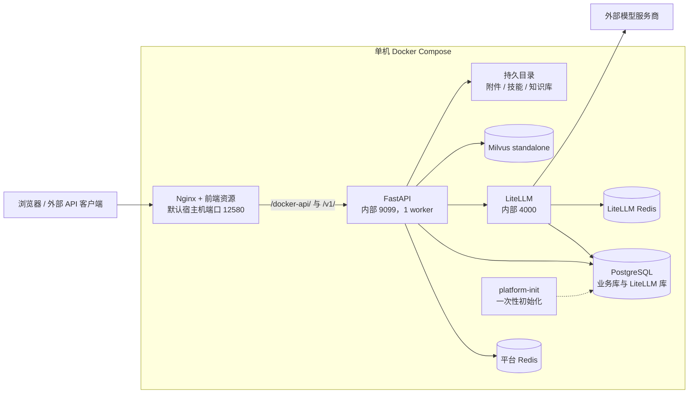

# 后端运行与数据约束

更新日期：2026-10-10。

本文说明部署拓扑、数据一致性、访问控制和交付约束。目录职责、模块依赖与代码入口见[后端目录说明](后端目录说明.md)。源码版本和运行版本分别核对，以下拓扑描述仓库配置。

## 1. 部署拓扑与故障范围

下图描述仓库统一部署配置，不是对某台服务器当前容器的实时盘点。默认包含 **7 个常驻服务与 1 个一次性初始化任务**；两个 Redis 使用相同镜像，初始化任务复用后端镜像，因此发布包共有 6 类镜像。

统一部署只向宿主机映射 Nginx 端口。`/docker-api/` 去掉前缀后转给后端，`/v1/` 保留路径转给后端，再由平台完成认证、授权与模型调用。使用 FRP 时，它属于入口之外的转发设施，不是业务模块，也不能替代应用认证与 TLS 配置。

| 故障位置 | 主要影响 | 当前处理边界 |
| --- | --- | --- |
| 后端进程或宿主机 | 同一应用的后台、对话、Agent 与公开 API 均可能受影响 | 容器可重启，但不等于请求无损恢复；没有备用节点接管 |
| PostgreSQL | 业务读写及 LiteLLM 管理/持久化能力受影响 | 两个数据库共享一个 PostgreSQL 实例，故障域没有隔离 |
| 平台 Redis | 会话协调、锁、配额和部分认证相关能力受影响 | 有协调保护的请求可能拒绝执行；不能按“只是缓存”任意清空 |
| LiteLLM / 上游服务商 | 模型推理、依赖模型的任务、部分模型管理操作失败 | 错误映射便于诊断，但不保证自动切换到其他服务商 |
| Milvus / 知识库目录 | 向量检索、索引或图谱相关能力受影响 | 普通不使用知识库的能力依赖较少，具体是否可用还受启动依赖影响 |
| 磁盘空间不足 | 数据库、上传、索引、日志及新镜像导入均可能失败 | 镜像包与业务数据都需纳入容量规划，不能仅统计源码大小 |

图谱当前仍受进程内协调与持久写入方式约束，部署设置 `APP_WORKERS=1`。应用工厂和部分生命周期锁具备多进程基础，不代表整个平台已经通过多 worker / 多节点验收。本地文件锁的保护范围也不能直接推广到任意网络存储。

依据：[源码部署编排](../../compose.yaml)、[镜像发布编排](../../deploy/compose.release.yaml)、[Nginx 路由](../../zhiheng-fastapi-frontend/bin/nginx.dockerpg.conf)、[图谱实现](../plugins/ai/knowledge/graph.py)、[模块边界实施记录](../../docs/architecture/2026-09-29-module-boundaries.md)。

## 2. 数据一致性与恢复

数据所属模块见[数据归属](后端目录说明.md#data-ownership)。下表说明各存储边界的事务、协调与恢复机制。

| 边界 | 已有机制 | 保证范围与限制 |
| --- | --- | --- |
| 同一 SQL 业务写入 | 服务组织事务；公开查询和引用回调不擅自提交/回滚 | 事务只覆盖该会话参与的数据库操作，不覆盖上游 HTTP 调用 |
| 模型引用写入与删除 | 通过模型行锁与业务状态锁协调并发，具体获取顺序见对应服务；独立资源归属表保留卸载后的检查责任 | 停用、异常及卸载后保留数据均受保护；历史状态未知或检查失败时拒绝删除，不级联清历史 |
| SQL 模型与知识库文件引用 | 引用写入持共享文件锁，删除持独占锁；元数据有原子替换 | 协调“引用与删除”竞争，不是 SQL、文件和向量库的一次原子提交 |
| API 配额与用量账本 | Redis Lua 预留/结算；取消收尾受保护；结算重试保留原终态与错误码；超时账本补偿 | Redis 与 SQL 仍有先后顺序；无用量或中断时可能保守估算，需要对账 |
| 普通对话运行 | Redis 会话锁默认 900 秒；取消、断连收尾时保存终态并释放锁 | 当前未见锁续租与普通聊天全局孤儿运行扫描；硬退出后的状态恢复仍需完善 |
| Work 运行 | 默认 120 秒过期阈值，插件启动及周期任务恢复过期运行 | 这是 Work 的恢复规则，不是通用聊天或上游推理续传机制 |
| 知识库索引 / 图谱 | 元数据、任务状态、文件与数据库/向量存储分别维护 | 中断后需结合具体任务状态重试或重建；不能承诺所有存储同时回到同一时刻 |
| 模型接入跨系统写入 | 按步骤保存并在重试时核对已有资源 | 平台 SQL 和 LiteLLM 管理操作没有统一事务，可能存在待绑定/待发布中间状态 |

长对话需要额外验证：若运行时间超过会话锁租期，不能仅依赖初始锁保证整个运行期间互斥。建议将续租、运行超时和异常状态扫描作为一组恢复设计处理，并测试进程强杀、Redis 中断、数据库中断和重复请求，而非仅测试用户点击停止。

插件归属中的 `none` 表示确认没有历史责任，`retained` 表示保留数据仍需检查，`unknown` 表示旧安装历史无法可靠判定。旧版卸载记录可能与从未安装记录完全相同，这类状态会保守阻止资源删除，完整重装可恢复可信状态。仅清理平台元数据或配置了 `onPurge` 都不会自动清除归属；若业务表或回调已被清理，也不能将查询失败当作无引用。升级前已经删除全部历史证据的遗留数据无法靠本次新表自动识别。

依据：[模型引用与锁验证](../../docs/operations/2026-09-29-model-lifecycle-pricing.md)、[知识库模型引用](../plugins/ai/knowledge/model_references.py)、[聊天协调器](../plugins/ai/service/chat_runtime_coordinator.py)、[配额与补偿实现](../plugins/ai/service/public_invocation_coordinator.py)、[Agent 生命周期 Hook](../plugins/agent_extension/hooks.py)。

## 3. 身份与信任边界

| 边界 | 当前实现 / 约束 | 使用要求 |
| --- | --- | --- |
| 后台用户 | 登录令牌、角色/菜单权限、资源归属及相关数据范围校验 | 隐藏菜单不等于 API 授权；新接口仍需校验操作权限和资源归属 |
| 外部 API 调用方 | 独立的平台 API Key、应用状态、模型授权与配额 | 平台 Key 与服务商 Key 不能混用；不能把一个可用模型自动开放给所有应用 |
| 平台 API Key 存储 | 使用带 Pepper 的摘要校验，创建/轮换时返回完整密钥 | Pepper 属于持久实例秘密；该存储方式不代表所有运行密钥都不可逆存储 |
| 上游凭据与实例配置 | LiteLLM 凭据、数据库密码、JWT、Salt、传输密钥等分别管理 | 限制读取、日志输出和备份访问；恢复时必须保留正确密钥材料 |
| 文件与知识内容 | 受管理文件有权限/引用规则；聊天附件与知识库有各自处理链路 | 不能把某一文件接口的 ACL 推广为所有本地目录或静态挂载的统一保障 |
| 插件代码 | 在主应用进程内加载 Python 代码 | 插件按可信代码对待；没有不可信插件执行沙箱或独立权限进程 |
| 用户 / 应用隔离 | 依赖各业务的所有权、授权及数据库查询条件 | 当前材料不足以宣称完整 SaaS 多租户隔离，更不代表独库隔离 |
| 网络传输 | Compose 提供 HTTP 入口，应用另有传输加密配置 | 公网部署仍需核对 TLS、代理和访问范围；应用字段加密不替代 HTTPS |
| 镜像与代码 | 后端镜像包含 Python 运行代码，前端资源发给浏览器 | 镜像交付解决部署一致性，不能承诺拿到镜像的人无法提取代码 |

依据：[密钥编码与摘要](../plugins/ai/infrastructure/developer_key_codec.py)、[公开 API 认证](../plugins/ai/infrastructure/developer_key_authenticator.py)、[API 模型授权](../plugins/ai/service/api_entitlement_service.py)、[文件权限说明](file_management_usage_guide.md)、[镜像构建](../Dockerfile.pg)、[发布手册](../../deploy/release/README.md)。

## 4. 交付、备份与可观测性

已有 `release build / verify / deploy / rollback / status` 镜像交付链路。发布清单记录源码 revision、dirty 状态、快照摘要、镜像 ID 和文件校验值；版本定位与故障排查需结合这些信息，不能仅凭 Git 分支名识别在线代码。

**版本回滚恢复应用版本，数据恢复需要另一套流程。** 当前快捷升级/回滚要求数据和基础运行契约兼容；不提供数据库自动降级、不自动备份业务数据，也不直接接管已有源码部署实例。升级会停止前后端，需要维护窗口。包校验是完整性检查，没有发布者数字签名能力。

兼容更新会在停止旧应用及同实例一次性写入任务后，通过旧镜像刷新插件基线；自动恢复与中断重试保留合法启停状态，版本和迁移校验仍然严格。资源归属表的引入改变了数据契约，旧发布包不能仅靠快捷更新跨过该变化；增量建表及 CLI 前置条件见[升级说明](../../docs/operations/2026-10-10-strict-review-fixes.md)。

| 需要保护的状态 | 恢复时必须考虑 |
| --- | --- |
| PostgreSQL 业务库与 LiteLLM 库 | 模型、绑定、权限、会话、账本、网关部署等需与目标应用版本匹配 |
| 附件、技能、知识库元数据与原文件 | 仅备份数据库会丢失文件本体；需与数据库中的引用关系核对 |
| Milvus 与图谱相关存储 | 选择一致的备份/恢复方式；可重建的数据也需保留原文和模型配置，并估算重建时间/费用 |
| 实例 `.env`、密钥与运行配置 | 受限保存并验证可恢复，避免生成新密钥后旧密文或 Key 摘要无法使用 |
| Redis 状态 | 区分可重建缓存与运行锁、配额状态；不能不加区分地恢复旧锁或丢弃计费协调状态 |
| 发布包与版本记录 | 保留可验证的回退版本；镜像包不是业务数据备份 |

当前尚未形成经过完整恢复演练确认的 RPO（允许丢失多长时间的数据）和 RTO（要求多久恢复服务）。上述备份范围也不是“运行中复制所有目录”即可保证一致；应按各存储方式制定流程，在隔离环境恢复并核对会话、文件引用、模型可调用性和账本。

已有请求追踪、应用日志、操作日志、任务状态和用量账本，可支持排障。当前后端容器健康检查访问 `/docs`，只能证明该 HTTP 入口可响应；发布门禁另检查版本、插件与路由，仍不能证明全部外部模型可用。`release status` 读取本地发布记录，也不是实时健康检查。

建议补充有明确负责人和阈值的指标：请求失败率与延迟、SSE 活跃数、长时间未结束运行、配额补偿积压、上游错误率、数据库连接池、磁盘剩余量和索引任务积压。容量验收需要区分普通 API、长连接对话和知识处理，分别测量并发、首 token 时间、完成时间和资源峰值；目前不填写未经压测的 QPS 或用户数。

依据：[发布手册与恢复限制](../../deploy/release/README.md)、[发布编排健康检查](../../deploy/compose.release.yaml)、[隔离发布与故障演练](../../docs/operations/2026-09-30-release-delivery.md)。

## 5. 后续演进条件

以下是基于当前边界提出的后续建议，优先级应结合实际上线范围确定；没有把它们算作已经完成的模块化工作。

| 建议阶段 | 要解决的问题 | 建议验收结果 |
| --- | --- | --- |
| 正式生产交付前 | 源码、镜像、静态资源与实例版本可追溯 | 从指定提交构建并部署到隔离环境，能核对 revision、镜像和资源摘要；再决定生产切换 |
| 正式生产交付前 | 备份、恢复与磁盘容量缺少量化目标 | 确定 RPO/RTO、容量阈值和备份责任人；完成一次包含数据库、文件、向量存储及密钥的恢复演练 |
| 正式生产交付前 | 长对话、进程硬退出与异常运行恢复 | 验证超租期、强杀、数据库/Redis 中断和重复请求；确定续租、超时及孤儿运行处理规则 |
| 正式生产交付前 | 上线质量与访问边界验收 | 检查目标提交的 CI 结果和跳过项；在目标环境验证关键业务、资源越权、TLS 及入口权限 |
| 稳定性迭代 | Agent 仍依赖 AI 内部服务/类型，关键失败缺少统一运营指标 | 收敛明确的公开契约并做消费者回归；建立对话、配额、任务及资源告警 |
| 出现独立容量需求时 | 图谱与本地文件约束、后台任务争用主进程资源 | 先压测定位瓶颈，再评估任务执行器、存储迁移或服务提取，并验证多进程协调 |
| 有实际兼容需求时 | MySQL 与 PostgreSQL 的迁移/并发验证不对等 | 明确支持矩阵，补齐目标数据库迁移和真实集成测试后再承诺交付 |

后续演进需要明确部署可用性与维护窗口、数据恢复与性能指标、数据库和模型服务商的支持范围，以及模块维护边界。实施顺序应结合这些约束和实际瓶颈确定，优先落实恢复能力、容量验证和稳定的模块接口，再评估独立服务拆分。

## 6. 相关记录

| 主题 | 文档 |
| --- | --- |
| 模型引用、锁顺序与价格版本 | [模型生命周期记录](../../docs/operations/2026-09-29-model-lifecycle-pricing.md) |
| 版本更新、回滚与故障演练 | [镜像交付验收](../../docs/operations/2026-09-30-release-delivery.md) |
| 流式收尾、引用保护与增量建表 | [稳定性修复与验收](../../docs/operations/2026-10-10-strict-review-fixes.md) |
| 完整部署操作 | [部署说明](../../deploy/README.md)、[镜像发布手册](../../deploy/release/README.md) |

验证结果的时间、环境、覆盖范围和跳过项以对应记录为准，不据历史测试数量推断当前生产容量。
