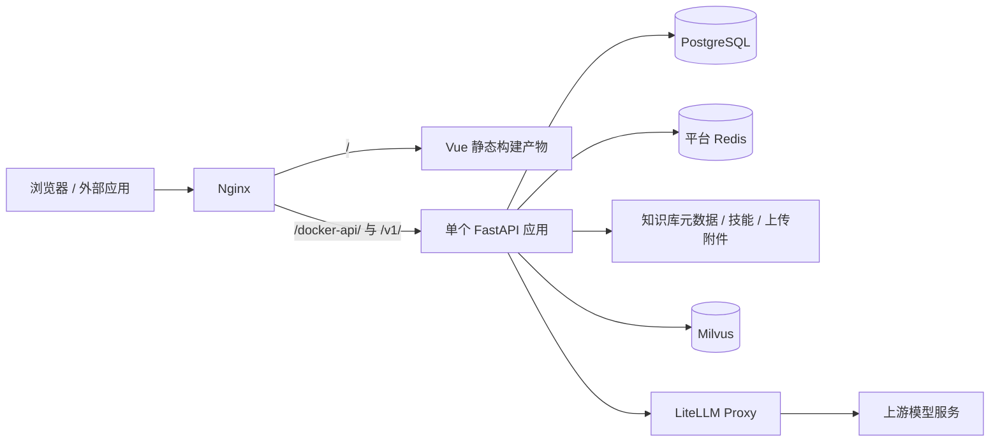

# 智衡 AI 开放平台 — 代码说明

更新日期：2026-10-10。本文描述 `release/platform-integration-merge` 集成版本的代码结构，包含模块边界、镜像发布、模型视觉与重排序、对话取消恢复等实现。部署环境以实际发布的镜像和前端构建产物为准；文件夹名称不等于分支名称，开发前应先核对 Git 分支。

后端专项阅读：[后端目录说明](backend/docs/后端目录说明.md)，覆盖启动流程、目录职责、模块依赖和功能修改入口。

## 一、项目总览

智衡 AI 开放平台基于 ZhiHeng-Vue3-FastAPI 构建，采用前后端分离的**模块化单体**架构，通过插件机制组织 AI、智能体和工作任务等业务。业务模块共享一个 FastAPI 应用和一个前端构建产物，通过公开接口协作；插件生命周期管理不等同于独立服务发布或进程故障隔离。项目由以下核心子系统组成：

| 子系统 | 技术栈 | 职责 |
| --- | --- | --- |
| Web 前端 | Vue 3 + Vite + Ant Design Vue + Element Plus | 管理后台与 AI 工作台界面 |
| 后端服务 | FastAPI + SQLAlchemy + PostgreSQL + Redis | 业务逻辑、插件运行时、API 网关 |
| 模型网关 | LiteLLM Proxy | 统一代理上游模型服务（对话 / Embedding / Rerank） |
| 向量数据库 | Milvus | 知识库向量存储与检索 |
| 部署编排 | Docker Compose + Python + Shell | 源码部署、离线镜像发布、应用回滚与数据初始化 |

---

## 二、顶层目录结构

```
zhiheng/                          ← 项目根目录
├── .github/                      ← GitHub Actions CI 检查工作流
│   └── workflows/
│       ├── backend.yml           ← 后端测试（含 PostgreSQL 并发集成测试）
│       ├── playwright.yml        ← 前端契约与 mock API 浏览器检查
│       └── ruff.yml              ← 后端 Python 静态检查与格式检查
├── .superpowers/                 ← 辅助工具（头脑风暴沙盒）
├── data/                         ← 运行时数据目录（不提交 Git）
│   ├── agent-skills/skills/      ← 平台技能持久文件
│   ├── knowledge/                ← 知识库数据
│   └── milvus/                   ← Milvus 存储数据（etcd + RDB）
├── deploy/                       ← 部署配置与脚本
├── docs/                         ← 架构、设计与运维文档
├── frontend/       ← Web 前端工程（Vue 3 + Vite + Ant Design Vue）
├── backend/        ← 后端主工程（Python / FastAPI）
├── compose.yaml                  ← 源码部署的 Docker Compose 统一编排文件
├── docker-compose.pg.yml          ← 旧拆分部署编排文件
├── deploy.sh                     ← 源码部署与 release 子命令入口
├── .env                          ← 源码实例环境变量（权限 0600）；发布实例配置位于 --site
└── README.md                     ← 项目说明文档
```

---

## 三、后端工程 `backend/`

后端采用分层架构与插件化扩展设计。模块内组织 Controller、Service、DAO 和 Entity；已收拢的跨模块能力通过 `public/` 接口或插件声明的回调提供，调用方不直接操作对应模块的 DAO/ORM。

### 3.1 顶层文件

```
backend/
├── app.py                        ← 应用入口，启动 uvicorn 服务
├── server.py                     ← FastAPI 应用工厂，生命周期管理（lifespan）
├── alembic.ini                   ← Alembic 数据库迁移配置
├── Dockerfile.pg                 ← PostgreSQL 版本 Docker 构建文件
├── .env.dev / .env.prod / .env.dockerpg  ← 各环境配置文件
├── requirements.txt              ← 基础 Python 依赖
├── requirements-pg.txt           ← PostgreSQL 部署依赖
└── requirements-test.txt         ← 后端测试依赖（含异步数据库与 Redis 模拟依赖）
```

### 3.2 核心分层

```
┌─────────────────────────────────────────────────────────────┐
│                      server.py（应用工厂）                    │
│  创建 FastAPI 实例 → 注册中间件 → 注册路由 → 挂载子应用       │
│  → 启动插件运行时 → 启动后台任务（调度器 + 日志聚合）          │
└─────────────────────────────────────────────────────────────┘
         │              │              │              │
         ▼              ▼              ▼              ▼
   config/        middlewares/    common/       exceptions/
  （配置层）      （中间件层）   （公共层）     （异常层）
```

#### `config/` — 配置层

| 文件 | 职责 |
| --- | --- |
| `env.py` | 全局配置类（AppSettings / JwtSettings / DbSettings / RedisSettings 等），基于 pydantic-settings 从环境变量加载 |
| `database.py` | SQLAlchemy 异步引擎与会话工厂 |
| `get_db.py` | 数据库连接管理（初始化、建表、关闭） |
| `get_redis.py` | Redis 连接池管理 |
| `get_scheduler.py` | APScheduler 定时任务调度器管理 |

#### `common/` — 公共层

| 目录/文件 | 职责 |
| --- | --- |
| `annotation/` | 装饰器注解：缓存（cache）、日志（log）、Pydantic 校验、限流（rate_limit） |
| `aspect/` | AOP 切面：数据权限（data_scope）、数据库会话（db_session）、接口鉴权（interface_auth）、权限校验（pre_auth） |
| `constant.py` | 全局常量定义 |
| `context.py` | 请求上下文管理 |
| `enums.py` | 枚举类型定义 |
| `router.py` | 增强路由器 `APIRouterPro` + 自动路由注册 `auto_register_routers` |
| `vo.py` | 通用视图对象 |

#### `middlewares/` — 中间件层

| 文件 | 职责 |
| --- | --- |
| `cors_middleware.py` | 跨域资源共享配置 |
| `gzip_middleware.py` | Gzip 响应压缩 |
| `context_middleware.py` | 请求上下文注入 |
| `demo_mode_middleware.py` | 演示模式拦截 |
| `api_response_header_middleware.py` | API 响应头处理 |
| `transport_crypto_middleware.py` | 传输加解密 |
| `trace_middleware/` | 链路追踪（ctx / span / middle） |
| `handle.py` | 中间件统一注册入口 |

#### `exceptions/` — 异常层

| 文件 | 职责 |
| --- | --- |
| `exception.py` | 自定义异常类定义 |
| `handle.py` | 全局异常处理器注册 |

### 3.3 业务模块

主要业务模块按 **Controller → Service → DAO → Entity** 分层；文档解析工具与定时任务模块按各自职责组织：

```
module_xxx/
├── controller/        ← 接口层：接收请求、参数校验、调用 Service、返回响应
├── service/           ← 业务层：核心业务逻辑编排
├── dao/               ← 数据访问层：数据库 CRUD 操作
└── entity/
    ├── do/            ← 数据对象（Data Object）：与数据库表一一对应
    └── vo/            ← 视图对象（View Object）：请求/响应模型
```

#### `module_admin/` — 管理后台模块

平台基础管理功能，涵盖 ZhiHeng 后端全部管理能力：

| 子域 | Controller | 核心能力 |
| --- | --- | --- |
| 用户管理 | `user_controller` | 用户 CRUD、头像、密码重置 |
| 角色管理 | `role_controller` | 角色 CRUD、数据权限、菜单授权 |
| 菜单管理 | `menu_controller` | 菜单树 CRUD |
| 部门管理 | `dept_controller` | 部门树 CRUD |
| 岗位管理 | `post_controller` | 岗位 CRUD |
| 字典管理 | `dict_controller` | 字典类型 + 字典数据 CRUD |
| 参数配置 | `config_controller` | 系统参数 CRUD |
| 定时任务 | `job_controller` | 任务调度、日志、Cron 管理 |
| 文件管理 | `file_controller` | 文件上传/下载/访问控制/生命周期 |
| 日志管理 | `log_controller` | 操作日志 + 登录日志查询 |
| 通知公告 | `notice_controller` | 公告 CRUD |
| 在线用户 | `online_controller` | 在线会话查询与强退 |
| 缓存监控 | `cache_controller` | Redis 缓存键值查询 |
| 服务监控 | `server_controller` | 服务器状态信息 |
| 验证码 | `captcha_controller` | 图形验证码生成 |
| 登录认证 | `login_controller` | 登录/注销/注册 |
| 传输加密 | `transport_crypto_controller` | 加密策略管理 |
| 通用接口 | `common_controller` | 文件上传等通用能力 |

#### `module_generator/` — 代码生成模块

根据数据库表结构自动生成前后端代码（Controller / Service / DAO / DO / VO / Vue 页面 / API 调用 / SQL）。

```
module_generator/
├── controller/gen_controller.py
├── service/gen_service.py
├── dao/gen_dao.py
├── entity/do/gen_do.py, entity/vo/gen_vo.py
└── templates/               ← Jinja2 代码模板
    ├── python/              ← 后端 Python 模板
    ├── vue/                 ← 前端 Vue 模板
    ├── js/                  ← API 调用模板
    └── sql/                 ← SQL 模板
```

#### `module_Knowledge/` — 文档解析与分块工具

提供文档解析、文本分块和送入 Embedding 模型前的文本规范化工具。知识库业务编排、模型调用、元数据、向量存储和图谱归属 `plugins/ai/knowledge/`。

```
module_Knowledge/
└── src/knowledge/
    ├── indexing.py           ← 文档解析（支持多格式 → Markdown）
    └── kb_utils.py           ← 文本分块、Embedding 输入文本规范化
```

#### `module_task/` — 定时任务模块

```
module_task/
├── file_task.py              ← 文件生命周期定时任务（保留通知、清理、对账）
└── scheduler_test.py         ← 调度器测试任务
```

### 3.4 插件系统 `plugins/`

插件系统是平台的核心扩展机制，采用声明式配置（`plugin.yaml`）+ 生命周期钩子 + 自动路由扫描的架构。

```
plugins/
├── core/                     ← 插件框架核心（不承载业务）
├── ai/                       ← AI 插件（模型管理 + 智能对话 + 开发者 API）
└── agent_extension/          ← 智能体扩展插件（技能 + 智能体 + 工作任务）
```

#### `plugins/core/` — 插件框架核心

| 目录 | 职责 |
| --- | --- |
| `discovery/` | 插件发现与注册（扫描 `plugin.yaml`、构建插件清单） |
| `lifecycle/` | 插件生命周期管理（安装、启用、停用、升级、卸载、迁移、种子数据） |
| `management/` | 插件管理后台（DAO / Entity / Service / Gateway），与 `module_admin` 的菜单、角色联动 |
| `manifest/` | 插件清单解析（`plugin.yaml` schema、菜单树构建） |
| `runtime/` | 插件运行时（应用启动协调、Hook 调度、依赖注入、路由守卫、健康检查、迁移执行）；`resource_references.py` 调用插件声明的持久资源引用查询 |

#### `plugins/ai/` — AI 管理插件

**声明**：`plugin.yaml`（id: `ai`，version: `0.9.1`）

```
plugins/ai/
├── plugin.yaml                ← 插件清单
├── config.py                  ← LiteLLM 配置类
├── hooks.py                   ← 生命周期钩子（onStartup / onShutdown）
├── jobs.py                    ← 定时任务（知识库图构建等）
├── public/                    ← 模块公开协作接口（不是 HTTP 路由目录）
│   ├── model_queries.py       ← 模型只读快照、选项查询与引用写入锁
│   ├── application_queries.py ← 应用启用状态与所有权查询
│   ├── api_transport.py       ← 开放 API 认证、请求解析、错误与流式响应
│   ├── model_references.py    ← 模型引用检查协议与 AI 自有 SQL 引用查询
│   └── rate_cards.py          ← 费率查询、追加价格版本与计费模式校验
├── controller/                ← 接口层
│   ├── ai_model_catalog_controller.py   ← 模型目录管理
│   ├── ai_model_engine_controller.py    ← 模型接入与引擎管理
│   ├── ai_chat_controller.py            ← 智能对话
│   ├── ai_application_controller.py     ← 开发接入（应用管理）
│   ├── ai_knowledge_controller.py       ← 知识库管理
│   ├── ai_runtime_controller.py         ← 模型运行时管理
│   └── openai_compat_controller.py      ← OpenAI 兼容接口
├── service/                   ← 业务层
│   ├── model_catalog_service.py         ← 模型目录
│   ├── model_engine_service.py          ← 模型引擎
│   ├── model_service.py                 ← 模型服务
│   ├── model_smoke_test_service.py      ← 模型连接测试
│   ├── platform_chat_service.py         ← 平台对话
│   ├── chat_runtime_coordinator.py      ← 对话运行协调
│   ├── chat_preferences_service.py      ← 对话偏好
│   ├── application_service.py           ← 应用管理
│   ├── developer_key_service.py         ← 开发者密钥
│   ├── api_entitlement_service.py       ← API 权益
│   ├── openai_compat_service.py         ← OpenAI 兼容
│   ├── public_invocation_coordinator.py ← 公共 API 调用协调
│   └── runtime_model_access_service.py  ← 运行时模型访问
├── dao/                       ← 数据访问层
│   ├── ai_model_catalog_dao.py
│   ├── ai_developer_api_dao.py
│   ├── ai_resource_binding_dao.py
│   └── platform_chat_dao.py
├── entity/                    ← 实体层
│   ├── do/                    ← 数据对象
│   └── vo/                    ← 视图对象
├── domain/                    ← 领域层（纯业务规则，无 IO）
│   ├── chat_files.py          ← 对话附件领域规则
│   ├── developer_api_errors.py
│   ├── model_runtime.py       ← 模型运行时规则
│   ├── model_service_errors.py
│   ├── public_api_errors.py
│   └── resource_id.py         ← 资源标识规则
├── infrastructure/            ← 基础设施层（外部系统适配）
│   ├── litellm_client.py                ← LiteLLM Runtime 客户端
│   ├── litellm_management_client.py     ← LiteLLM Management 客户端
│   ├── litellm_runtime_adapter.py       ← Runtime 适配器
│   ├── litellm_management_adapter.py    ← Management 适配器
│   ├── openai_stream_adapter.py         ← OpenAI 流式适配
│   ├── platform_sse.py                  ← SSE 推送
│   ├── platform_chat_provider.py        ← 平台对话提供者
│   ├── model_engine_provider.py         ← 模型引擎提供者
│   ├── model_runtime_provider.py        ← 模型运行时提供者
│   ├── model_runtime_access_provider.py ← 模型访问控制
│   ├── model_reference_provider.py      ← 装配 AI、扩展插件与知识库的模型删除检查
│   ├── model_connection_resolver.py     ← 模型连接解析
│   ├── developer_api_provider.py        ← 开发者 API 提供者
│   ├── developer_key_authenticator.py   ← 开发者密钥认证
│   ├── developer_key_codec.py           ← 密钥编解码
│   ├── knowledge_runtime_provider.py    ← 知识库运行时提供者
│   ├── chat_knowledge_adapter.py        ← 对话知识库适配
│   ├── chat_file_adapter.py             ← 对话附件适配
│   ├── skill_context_adapter.py         ← 技能上下文适配
│   ├── connection_test_diagnostics.py   ← 连接测试诊断
│   ├── connection_probe_policy.py       ← 已验证模型的轻量连接探测参数
│   ├── rerank_compatibility.py          ← 硅基流动重排序协议与原连接身份转换
│   └── runtime_state.py                 ← 运行时状态管理
├── knowledge/                 ← 知识库子域
│   ├── graph.py               ← 知识图谱构建
│   ├── graph_config.py        ← 图谱配置
│   ├── graph_jobs.py          ← 图构建定时任务
│   ├── graph_progress.py      ← 图构建进度
│   ├── graph_tokenizer.py     ← 图谱分词
│   ├── graph_errors.py        ← 图谱错误
│   ├── metadata.py            ← 知识库元数据
│   ├── model_references.py    ← 配置及历史版本的模型引用查询与并发锁
│   ├── models.py              ← 知识库数据模型
│   ├── runtime.py             ← 知识库运行时
│   └── stores.py              ← 向量存储
├── migrations/                ← 数据库增量迁移 SQL
│   ├── mysql/                 ← MySQL 迁移脚本
│   └── postgresql/            ← PostgreSQL 迁移脚本
└── seeds/                     ← 种子数据 SQL
```

#### `plugins/agent_extension/` — 智能体扩展插件

**声明**：`plugin.yaml`（id: `agent_extension`，version: `0.4.0`）

```
plugins/agent_extension/
├── plugin.yaml                ← 插件清单
├── config.py                  ← 配置
├── hooks.py                   ← 生命周期钩子
├── public/                    ← 模块公开协作接口
│   └── model_references.py    ← Agent 配置、发布快照及 Work 持久记录的模型引用
├── controller/                ← 接口层
│   ├── agent_controller.py             ← 智能体管理
│   ├── agent_invocation_controller.py  ← 智能体调用
│   ├── skill_controller.py             ← 技能管理
│   └── work_task_controller.py         ← 工作任务管理
├── service/                   ← 业务层
│   ├── agent_service.py                ← 智能体服务
│   ├── agent_invocation_service.py     ← 智能体调用服务
│   ├── skill_service.py                ← 技能服务
│   ├── work_task_service.py            ← 工作任务服务
│   └── work_task_run_service.py        ← 工作任务执行服务
├── dao/                       ← 数据访问层
├── entity/                    ← 实体层（do / vo）
├── domain/                    ← 领域层
│   ├── agent_errors.py        ← 智能体业务错误
│   ├── agent_knowledge.py     ← 智能体知识库规则
│   ├── skill_errors.py        ← 技能业务错误
│   ├── skill_id.py            ← 技能标识校验
│   ├── skill_package.py       ← 技能包解析
│   └── work_task_context.py   ← 工作任务上下文
├── infrastructure/            ← 基础设施层
│   ├── skill_storage.py                ← 技能文件存储
│   ├── knowledge_context_provider.py   ← 知识库上下文提供
│   └── work_task_provider.py           ← 工作任务提供者
├── buildin/                   ← 内置技能包
│   ├── deep-research/SKILL.md
│   └── document-summary/SKILL.md
└── migrations/                ← 数据库迁移 SQL
```

### 3.5 CLI 工具 `cli/`

基于 Typer + Rich 构建的命令行管理工具，提供应用管理、缓存操作、配置查看、数据库迁移、代码生成、定时任务、运维诊断和插件管理等能力。

```
cli/
├── main.py                    ← CLI 入口
├── bootstrap.py               ← CLI 引导
├── context.py                 ← CLI 上下文
├── core/                      ← 核心调度
│   ├── app_builder.py         ← 应用构建器
│   ├── completion_dispatcher.py ← 自动补全调度
│   ├── context_factory.py     ← 上下文工厂
│   └── execution.py           ← 命令执行
├── groups/                    ← 命令组
│   ├── app/                   ← 应用管理（run / status）
│   ├── cache/                 ← 缓存操作
│   ├── config/                ← 配置查看
│   ├── crypto/                ← 加密管理
│   ├── db/                    ← 数据库迁移
│   ├── dev/                   ← 开发辅助
│   ├── gen/                   ← 代码生成
│   ├── job/                   ← 定时任务
│   ├── ops/                   ← 运维诊断
│   └── plugin/                ← 插件管理（discovery / lifecycle / dependency / configuration / developer）
├── runtime/                   ← 命令运行时（各命令组的 gateway / service / support）
├── tui/                       ← 终端 UI（Textual 框架）
│   ├── actions/               ← 交互动作
│   ├── adapters/              ← 数据适配器
│   ├── screens/               ← 屏幕组件
│   └── widgets/               ← UI 组件
├── wizard/                    ← 交互向导
└── metadata/                  ← 命令元数据（参数规格、风险标记）
```

### 3.6 工具层 `utils/`

| 文件 | 职责 |
| --- | --- |
| `common_util.py` | 通用工具函数 |
| `jwt_util.py` | JWT 令牌生成与解析 |
| `crypto_util.py` | 加解密工具 |
| `pwd_util.py` | 密码哈希与校验 |
| `log_util.py` | 日志工具（loguru 封装） |
| `response_util.py` | 统一响应格式 |
| `page_util.py` | 分页工具 |
| `file_util.py` | 文件操作工具 |
| `upload_util.py` | 上传工具 |
| `excel_util.py` | Excel 导入导出 |
| `gen_util.py` | 代码生成工具 |
| `template_util.py` | 模板渲染工具 |
| `cron_util.py` | Cron 表达式工具 |
| `string_util.py` | 字符串工具 |
| `time_format_util.py` | 时间格式化 |
| `message_util.py` | 消息工具 |
| `dependency_util.py` | 依赖注入工具 |
| `import_util.py` | 动态导入工具 |
| `client_ip_util.py` | 客户端 IP 解析 |
| `server_util.py` | 服务器状态、启动协调、API 文档工具 |
| `api_annotation_util.py` | API 注解工具 |
| `api_response_header_util.py` | API 响应头工具 |
| `transport_crypto_util.py` | 传输加密工具 |

### 3.7 其他

| 目录/文件 | 职责 |
| --- | --- |
| `sub_applications/` | 子应用挂载（静态文件服务） |
| `alembic/` | Alembic 数据库迁移框架配置 |
| `scripts/` | 运维脚本（平台 SQL 构建、初始化、文件迁移、图谱分词准备） |
| `sql/` | 完整数据库初始化 SQL（`platform-pg.sql` 为合并文件） |
| `assets/` | 静态资源（字体等） |

### 3.8 模型接入与对话收尾

模型接入分为连接测试、引擎部署、平台目录、运行绑定和发布五步。测试成功仅说明可调用服务商，完成目录创建与发布后才会出现在平台模型列表中。

前端 `ModelOnboardingDrawer.vue` 同时把 `modelType` 传给连接测试和部署创建。后端 `model_engine_service.py` 组装连接，`rerank_compatibility.py` 对已确认的硅基流动重排地址选择内部兼容协议；列表和凭据解析仍使用原连接身份，共享凭据不会因此改写。`litellm_runtime_adapter.py` 规范输入文档、结果索引和用量字段，公开 API 根据原始请求决定是否返回正文。

视觉开关属于平台模型的 `capabilities.vision`。接入和编辑入口分别为 `ModelOnboardingDrawer.vue` 与 `ModelVisionDialog.vue`；后端通过已有模型目录更新服务保存。它是能力声明，不是自动识图探测，也不等于文档 OCR。

对话取消与断连由 `platform_chat_service.py`、`chat_runtime_coordinator.py` 和 `litellm_client.py` 协作处理：关闭上游流、保存终态与已有内容、释放会话锁。结果对象负责首次迭代之前的关闭，控制器通过 `public/api_transport.py` 的 `ManagedStreamingResponse` 持有响应资源；请求取消时保护收尾，持久化失败仍尝试解锁，正常结束事件在提交和解锁之后发送。公开 API 的配额/账本结算同样保护取消收尾，重试保留原终态；会话删除检查所有活动运行。

---

## 四、前端工程 `frontend/`

Web 前端是平台的主界面，基于 Vue 3 + Vite + Ant Design Vue + Element Plus 构建，提供管理后台与 AI 工作台。前端同样采用插件化架构，AI 和智能体扩展的页面以插件形式组织在 `plugins/` 目录下。

### 4.1 顶层文件

```
frontend/
├── index.html                  ← HTML 入口
├── package.json                ← 依赖配置（Vue 3 / Ant Design Vue / Element Plus / Pinia / Axios 等）
├── vite.config.js              ← Vite 构建配置（代理 / 别名 / 打包）
├── vite/plugins/               ← Vite 插件配置
│   ├── index.js                ← 插件汇总
│   ├── auto-import.js          ← 自动导入
│   ├── compression.js          ← Gzip 压缩
│   ├── svg-icon.js             ← SVG 图标加载
│   └── setup-extend.js         ← Vue setup 扩展
├── .env.development            ← 开发环境变量
├── .env.production             ← 生产环境变量
├── .env.docker                 ← Docker 环境变量
├── .env.staging                ← 预发布环境变量
├── Dockerfile                  ← 前端 Docker 构建文件
├── bin/                        ← 辅助脚本（构建 / Nginx 配置 / 运行）
└── dist/                       ← 随仓库维护的预构建产物；源码改动后须重新构建再发布
```

当前统一编排由 Nginx 挂载 `dist/` 提供页面；部署已有产物无需 Node.js。修改前端源码不会自动更新运行中的页面，发布前需按目标环境构建，例如 Docker 部署使用 `npm run build:docker`。

`vite/plugins/index.js` 明确计算 Monaco worker 输出目录，支持 `--outDir` 指向绝对路径。完整产物必须包含 `dist/monacoeditorwork/` 下的编辑器、CSS、HTML、JSON 和 TypeScript worker，不能只复制 HTML 与 `static/`。

### 4.2 源码结构 `src/`

```
src/
├── main.js                     ← 应用入口
├── App.vue                     ← 根组件
├── settings.js                 ← 全局设置
├── permission.js               ← 路由权限控制
├── router/index.js             ← 路由配置（静态路由 + 动态路由）
├── api/                        ← API 请求封装
├── assets/                     ← 静态资源
├── components/                 ← 全局公共组件
├── design/                     ← Ant Design 主题配置
├── directive/                  ← 自定义指令
├── layout/                     ← 布局框架
├── plugins/                    ← 前端插件（auth / cache / modal / tab / download）
├── store/                      ← Pinia 状态管理
├── utils/                      ← 工具函数
└── views/                      ← 页面视图
```

### 4.3 API 层 `src/api/`

| 目录/文件 | 职责 |
| --- | --- |
| `login.js` | 登录/注销/注册/验证码 |
| `menu.js` | 菜单数据 |
| `platformWorkspace.js` | 工作台接口 |
| `system/` | 系统管理接口（用户 / 角色 / 菜单 / 部门 / 岗位 / 字典 / 配置 / 通知 / 文件 / 插件） |
| `monitor/` | 监控接口（缓存 / 定时任务 / 登录日志 / 操作日志 / 在线用户 / 服务器 / 传输加密） |
| `tool/` | 工具接口（代码生成） |

### 4.4 全局组件 `src/components/`

| 目录 | 职责 |
| --- | --- |
| `Antd/` | Ant Design 增强组件（AuthShell / PermissionAction / PlatformIcon / ResourceDrawer / ResourceTable / SecretField / WorkspacePage / AsyncState） |
| `Workspace/` | 工作台框架组件（WorkspaceShell / WorkspacePanel / WorkspaceSidebar / WorkspaceToolbar / WorkspaceStatus / WorkspaceState / WorkspaceModeSwitch / WorkspaceMoreMenu） |
| `Breadcrumb/` | 面包屑导航 |
| `DictTag/` | 字典标签 |
| `Editor/` | 富文本编辑器 |
| `FileUpload/` / `ImageUpload/` / `BusinessFileUpload/` | 文件/图片上传 |
| `Pagination/` | 分页 |
| `RightToolbar/` | 右侧工具栏 |
| `SvgIcon/` | SVG 图标 |
| `TreePanel/` | 树面板 |
| `Crontab/` | Cron 表达式编辑器 |
| `ExcelImportDialog/` | Excel 导入对话框 |
| `HeaderSearch/` / `IconSelect/` / `ImagePreview/` / `Screenfull/` / `SizeSelect/` | 搜索 / 图标选择 / 图片预览 / 全屏 / 尺寸 |

### 4.5 布局框架 `src/layout/`

```
layout/
├── index.vue                   ← 主布局入口
└── components/
    ├── Navbar.vue              ← 顶部导航栏
    ├── AppMain.vue             ← 主内容区
    ├── Sidebar/                ← 管理后台侧边栏（Logo / SidebarItem / Link）
    ├── TagsView/               ← 标签页视图
    ├── TopNav/                 ← 顶部导航菜单
    ├── TopBar/                 ← 顶部工具栏
    ├── HeaderNotice/           ← 通知消息
    ├── Settings/               ← 布局设置面板
    ├── Copyright/              ← 版权信息
    ├── AdminSidebar.vue        ← 管理后台侧边栏入口
    ├── PlatformSidebar.vue     ← 平台侧边栏（AI 工作台）
    ├── PlatformTopbar.vue      ← 平台顶部栏
    ├── PlatformAccountMenu.vue ← 平台账户菜单
    ├── AiResourceShell.vue     ← AI 资源外壳
    ├── RecentSessions.vue      ← 最近会话
    ├── RecentWorkTasks.vue     ← 最近工作任务
    ├── IframeToggle/           ← iframe 切换
    └── InnerLink/              ← 内链页面
```

后台的默认首页和旧官网入口在路由、菜单及标签页边界过滤。`AdminSidebar.vue` 在 Logo 下方提供固定的“返回 AI 工作台”入口，桌面顶部和手机菜单也可返回；跳转目标依据当前账号可访问的 AI 页面选择。

### 4.6 页面视图 `src/views/`

管理后台页面按功能域组织：

| 目录 | 页面 | 说明 |
| --- | --- | --- |
| `dashboard/` | `index.vue` | 保留的仪表盘组件；已取消默认首页入口 |
| `system/user/` | `index.vue` / `authRole.vue` / `profile/` | 用户管理、授权角色、个人中心 |
| `system/role/` | `index.vue` / `authUser.vue` | 角色管理、授权用户 |
| `system/menu/` | `index.vue` | 菜单管理 |
| `system/dept/` | `index.vue` | 部门管理 |
| `system/post/` | `index.vue` | 岗位管理 |
| `system/dict/` | `index.vue` / `data.vue` / `detail.vue` | 字典管理 |
| `system/config/` | `index.vue` | 参数配置 |
| `system/notice/` | `index.vue` / `ReadUsers.vue` | 通知公告 |
| `system/file/` | `index.vue` + `components/` | 文件管理（ACL / 审计 / 详情 / 对账 / 引用 / 保留策略 / 搜索 / 统计 / 传输） |
| `system/plugin/` | `index.vue` + `components/` | 插件管理（详情 / 依赖 / 配置 / 诊断 / 计划） |
| `monitor/job/` | `index.vue` / `log.vue` / `detail.vue` | 定时任务 |
| `monitor/cache/` | `index.vue` / `list.vue` | 缓存监控 |
| `monitor/operlog/` | `index.vue` / `detail.vue` | 操作日志 |
| `monitor/logininfor/` | `index.vue` | 登录日志 |
| `monitor/online/` | `index.vue` | 在线用户 |
| `monitor/server/` | `index.vue` | 服务监控 |
| `monitor/transportCrypto/` | `index.vue` | 传输加密 |
| `tool/gen/` | `index.vue` + 表单页 | 代码生成 |
| `tool/build/` | `index.vue` + 组件 | 表单构建器 |
| `tool/swagger/` | `index.vue` | Swagger 文档 |
| `error/` | `401.vue` / `404.vue` | 错误页面 |
| — | `login.vue` / `register.vue` / `lock.vue` | 登录 / 注册 / 锁屏 |

### 4.7 前端插件 `plugins/`

前端插件与后端插件一一对应，提供 AI 工作台和智能体扩展的页面、API 和工具函数：

```
plugins/
├── ai/                         ← AI 管理前端插件
│   ├── public/                 ← 供宿主及其他插件使用的公开入口
│   │   ├── chatSessions.js    ← 会话列表、详情、重命名、状态与删除
│   │   ├── resourceSelection.js ← 模型/知识库选择、归一化与分页
│   │   ├── applications.js    ← 应用列表、创建与归一化
│   │   └── developerKeys.js   ← 密钥操作、展示及调用地址辅助能力
│   ├── api/                    ← API 请求
│   │   ├── modelCatalog.js     ← 模型目录
│   │   ├── modelEngine.js      ← 模型引擎
│   │   ├── chat.js             ← 智能对话
│   │   ├── application.js      ← 开发接入
│   │   └── knowledge.js        ← 知识库
│   ├── utils/                  ← 工具函数
│   │   ├── sseParser.js        ← 兼容转发至 src/utils/platformSse.js
│   │   ├── chatTransforms.js   ← 对话数据转换
│   │   ├── chatFiles.js        ← 对话附件
│   │   ├── apiDocs.js          ← API 文档生成
│   │   ├── application.js      ← 应用工具
│   │   ├── knowledge.js        ← 知识库工具
│   │   ├── modelEngine.js      ← 模型引擎工具
│   │   └── connectionDiagnostics.js  ← 连接诊断
│   ├── views/                  ← 页面视图
│   │   ├── model/              ← 模型中心
│   │   │   ├── index.vue
│   │   │   └── components/     ← CredentialForm / CredentialsPanel / DeploymentForm / EngineDeploymentsPanel / ModelOnboardingDrawer / ModelVisionDialog / PlatformModelsPanel / RuntimeStatusPanel
│   │   ├── chat/               ← 智能对话
│   │   │   ├── index.vue
│   │   │   └── components/     ← AiMessage / ChatEmptyState / ChatMessageFiles / ChatSessionPanel / SkillPicker
│   │   ├── application/        ← 开发接入
│   │   │   ├── index.vue
│   │   │   └── components/     ← ApplicationOverviewPanel / ApplicationKeysPanel / ApplicationModelsPanel / ApplicationUsagePanel / ApplicationApiDocs
│   │   ├── knowledge/          ← 知识库
│   │   │   ├── index.vue
│   │   │   └── components/     ← KnowledgeOverview / KnowledgeDocuments / KnowledgeQuery / KnowledgeGraph / KnowledgeGraphPage / KnowledgeSectionNav / ChunkFields
│   │   └── usage/              ← 用量记录
│   │       └── index.vue
│   └── README.md
└── agent_extension/            ← 智能体扩展前端插件
    ├── public/                 ← 供宿主及其他插件使用的公开入口
    │   ├── skills.js          ← 可选技能、选项归一化与输入触发符
    │   └── workTasks.js       ← Work store、侧栏导航接口与能力判定
    ├── stores/
    │   └── workTask.js        ← 工作任务状态、草稿、执行、恢复与会话清理
    ├── api/                    ← API 请求
    │   ├── agent.js            ← 智能体
    │   ├── skill.js            ← 技能
    │   └── workTask.js         ← 工作任务
    ├── utils/                  ← 工具函数
    │   ├── agent.js
    │   ├── skill.js
    │   └── workTask.js
    └── views/                  ← 页面视图
        ├── agent/              ← 智能体管理
        │   ├── index.vue
        │   └── components/     ← AgentApiDrawer / AgentEditorModal / AgentPreviewDrawer
        ├── skill/              ← 技能管理
        │   ├── index.vue
        │   └── components/     ← SkillDetailDrawer / SkillUploadModal
        └── work/               ← 智能对话（工作任务）
            ├── index.vue
            └── components/     ← WorkTaskPage / WorkAgentPicker / WorkEmptyState / WorkMemberBar / WorkMessageTimeline
```

宿主最近会话、Chat 技能选择、Agent 资源选择与 API 抽屉通过上述公开入口协作。旧 `api/` 中已迁出的请求函数保留兼容导出；新调用应使用对应 `public/` 入口，避免重新维护同一请求。

### 4.8 状态管理 `src/store/`

基于 Pinia 的模块化状态管理：

| 模块 | 职责 |
| --- | --- |
| `user` | 用户信息、登录状态、令牌 |
| `permission` | 路由权限、菜单权限 |
| `app` | 应用全局状态（侧边栏 / 设备 / 主题） |
| `dict` | 字典数据缓存 |
| `settings` | 布局设置 |
| `tagsView` | 标签页视图状态 |
| `lock` | 锁屏状态 |
| `workspace` | 工作台状态 |
| `workTask` | 兼容入口；实际实现归属 `plugins/agent_extension/stores/workTask.js` |

`src/store/sessionLifecycle.js` 提供按 Pinia 实例隔离的会话清理注册机制，由 `src/store/index.js` 安装。已初始化的 store 通过 `sessionCleanup` 声明自己的同步清理动作，销毁时注销；登录切换、退出和当前令牌失效时由用户模块触发清理。目前 Work 已接入，其他业务状态尚未全部接入。

Work 清理会停止流与轮询、清空任务和草稿，并使旧异步结果失效。平台侧栏通过 `public/workTasks.js` 的 `useWorkTaskNavigation` 读取摘要和执行列表操作，任务执行与成员编辑仍由 Work 内部管理。

### 4.9 工具函数 `src/utils/`

| 文件 | 职责 |
| --- | --- |
| `request.js` | Axios 请求封装（拦截器 / 错误处理 / 认证失效处理）；旧令牌请求的迟到 401 不清除新会话 |
| `platformSse.js` | Chat 与 Work 共用的平台 SSE 解析器（JSON 事件、`[DONE]`、跨分块换行与流清理） |
| `auth.js` | 令牌存取（Cookie / localStorage） |
| `zhiheng.js` | ZhiHeng 通用工具 |
| `dict.js` | 字典工具 |
| `validate.js` | 表单验证规则 |
| `permission.js` | 权限判断 |
| `jsencrypt.js` | RSA 加密 |
| `transportCrypto*.js` | 传输加密（策略 / 提供者 / 实现） |
| `errorCode.js` / `errorMessage.js` | 错误码与消息映射 |
| `passwordRule.js` | 密码规则 |
| `theme.js` | 主题切换 |
| `dynamicTitle.js` | 动态页面标题 |
| `sessionLogout.js` | 会话登出处理 |
| `pluginPlanFormatter.js` | 插件计划格式化 |
| `pluginViewResolver.js` | 插件视图解析 |
| `generator/` | 表单构建器工具（config / css / html / js / render） |

### 4.10 设计系统 `src/design/`

| 文件 | 职责 |
| --- | --- |
| `AntdRoot.vue` | Ant Design 根组件（主题注入） |
| `AntdFeedbackHost.vue` | Ant Design 反馈宿主（message / notification / modal） |
| `antdTheme.js` | Ant Design 主题算法与 Token |
| `themeSettings.js` | 主题设置 |
| `useAntdTheme.js` | 主题 Hook |

### 4.11 样式体系 `src/assets/styles/`

| 文件 | 职责 |
| --- | --- |
| `index.scss` | 全局样式入口 |
| `variables.module.scss` | SCSS 变量定义 |
| `yuxi-tokens.css` | Yuxi 设计 Token（亮色） |
| `yuxi-tokens.dark.css` | Yuxi 设计 Token（暗色） |
| `workspace.scss` | 工作台样式 |
| `antd-reset.scss` | Ant Design 样式重置 |
| `sidebar.scss` | 侧边栏样式 |
| `btn.scss` / `mixin.scss` / `transition.scss` / `zhiheng.scss` / `element-ui.scss` | 按钮样式 / 混入 / 过渡 / ZhiHeng 通用 / Element Plus 兼容 |

---

## 五、测试与质量检查

测试与各自工程一起维护：

| 路径 | 覆盖范围 | 执行方式 |
| --- | --- | --- |
| `backend/tests/` | 后端单元、集成、插件、部署与限定范围的模块依赖检查 | 安装运行与测试依赖后，在后端目录执行 `pytest -q` |
| `backend/tests/plugins/ai/test_model_reference_concurrency.py` | 真实 PostgreSQL 下的引用写入、删除竞争与锁顺序 | 配置临时测试库的 `ZHIHENG_TEST_POSTGRES_DSN` 后随 pytest 执行；未配置时跳过 |
| `frontend/tests/plugins/` | 前端插件逻辑与组件契约 | 在前端目录执行 `npm run test:plugin` |
| `frontend/tests/e2e/test_*.py` | 浏览器检查辅助逻辑与截图比较规则 | 在前端目录执行 `python -m unittest discover -s tests/e2e -p 'test_*.py' -v` |
| `frontend/tests/e2e/chat_work_mode_check.py` | Work 桌面与移动端交互 | 启动 Vite 后执行 Python 脚本，使用 mock API |
| `frontend/tests/e2e/platform_shell_check.py` | 工作台、主题、权限、目标页面与浏览器布局 | 启动 Vite 后执行 Python 脚本，使用 mock API |
| `frontend/tests/e2e/model_vision_check.py` | 图片理解配置、权限、保存与上传 | 隔离模拟业务 API；随 Playwright 工作流执行 |
| `frontend/tests/e2e/model_onboarding_check.py` | 接入类型传递、凭据复用、重试与响应丢失恢复 | 指定 `MODEL_ONBOARDING_BASE_URL` 后运行 |
| `backend/tests/plugins/ai/test_platform_chat_cancellation.py` | 断连、取消、终态保存、释放锁及后续发送 | 随 pytest 执行 |
| `backend/tests/plugins/ai/test_siliconflow_rerank.py` | 重排协议、凭据身份、文档格式与用量兼容 | 随 pytest 执行 |

三个工作流覆盖 `master` 与 `release/**` 的 push / pull request：后端使用 Python 3.10–3.13 矩阵和临时 PostgreSQL 16 服务运行 pytest；前端使用 Node.js 24、Python 3.12 运行插件契约、辅助测试、Work、平台外壳及视觉配置浏览器检查；Ruff 固定版本 0.16.4，覆盖后端源码、测试和发布工具。`backend.yml` 不构建发布镜像。

浏览器检查使用 mock API，不能代替真实后端联调。依赖安装和本地启动命令见 [README 测试与质量检查](./README.md#测试与质量检查)，最近一轮验证证据见 [模型引用、费率与质量收尾记录](./docs/operations/2026-09-29-model-lifecycle-pricing.md)。工作流配置与本地检查结果不代表云端 CI 已执行。

---

## 六、部署体系 `deploy/`

```
deploy/
├── platform.py                ← 部署自动化核心脚本（Python）
├── platform.env.example       ← 环境变量模板
├── compose.release.yaml       ← 固定镜像的发布编排，不挂载源码
├── release.sh                 ← 复制到发布包根目录的管理入口
├── release_cli.py             ← 发布 CLI 引导入口
├── release/
│   ├── cli.py                ← build / verify / deploy / rollback / status
│   ├── build.py              ← 隔离源码快照、前端构建、六镜像导出与来源记录
│   ├── manifest.py           ← 版本、镜像 ID、兼容指纹和文件 checksum 校验
│   ├── manager.py            ← 实例锁、完整包留存、发布记录与恢复流程
│   ├── environment.py        ← 实例配置、持久密钥与身份校验
│   ├── runtime.py            ← Docker 加载、Compose 编排和运行状态验证
│   ├── probe.py              ← 插件、迁移、路由与恢复条件探针
│   ├── Dockerfile.frontend   ← 前端静态资源镜像
│   ├── data-version          ← 非 SQL 持久格式的显式契约版本
│   └── README.md             ← 自含发布手册，也复制为发布包根 README
├── litellm/                   ← LiteLLM 模型网关
│   ├── compose.yaml           ← LiteLLM 独立 Compose 编排
│   ├── config.yaml            ← LiteLLM 模型配置
│   ├── init-env.sh            ← 环境初始化
│   └── init-platform-runtime-key.sh  ← 运行时密钥初始化
├── zhiheng/                     ← ZhiHeng 后端部署
│   └── init-shared-postgres.sh ← 共享 PostgreSQL 初始化
├── milvus/                    ← Milvus 向量数据库
│   ├── embedEtcd.yaml         ← 内嵌 etcd 配置
│   └── user.yaml              ← Milvus 用户配置
├── frp/                       ← FRP 内网穿透
│   └── frpc-platform.service  ← systemd 服务文件
├── legacy/                    ← 拆分部署兼容入口（平台与 LiteLLM 分开编排）
│   └── manage.sh
├── windows/                   ← Windows 部署支持
│   └── enable-platform-lan.ps1
└── README.md                  ← 部署说明文档
```

源码入口通过 `./deploy.sh release build --version 2026.09.30-rc1 --output /path/new-bundle` 生成独立发布目录，输出必须是新目录。构建端使用 Node.js 24、已安装的 npm 依赖、Python 与 Docker；运行端当前为 Linux amd64，只需 Python 3.10+、Docker 与支持 `up --wait` 的 Compose v2，无需源码 checkout 或 Node.js。

发布目录含六镜像 `images.tar`、`release.json`、运行脚本和配置。清单记录源码 revision/dirty/hash、镜像完整 ID、文件 SHA-256 及数据/运行契约指纹；前后端 tag 使用版本与源码哈希，基础设施 tag 使用镜像 ID。包内 `./release.sh verify` / `deploy --site /opt/zhiheng` 默认使用自身发布目录，从源码入口操作时需指定 `--bundle`。`rollback --site` 恢复上一成功应用，`status --site` 只读本地发布记录，不是实时健康检查。

安装目录保存 `.env`、`data/`、`runtime/`、`releases/` 与 `state.json`；PostgreSQL 和两个 Redis 另用 Docker 命名卷。实例项目名默认由安装路径派生，密钥独立生成后持续保留，发布管理器拒绝接管源码实例容器。完整备份应覆盖命名卷、文件数据、配置密钥、运行配置和历史发布记录/包；丢失 `.env` 或 `state.json` 需恢复备份。

快捷升级与回滚要求数据及基础运行契约指纹一致，兼容更新失败会尝试恢复原应用版本。SQL、插件 manifest、初始化器、非 SQL 持久格式（需更新 `data-version`）及基础运行配置变更须专项迁移，不自动降级数据库。checksum 不是签名，Python 镜像仍包含运行代码；交付和恢复步骤见 [镜像发布包说明](./deploy/release/README.md)。

---

## 七、Docker Compose 编排 `compose.yaml`

源码统一部署由 `deploy.sh` 驱动，默认 Compose 项目名为 `zhiheng`。镜像发布的 `deploy/compose.release.yaml` 使用同样的服务划分，镜像和项目名由发布管理器装配：

| 服务名 | 职责 |
| --- | --- |
| `litellm-db` | PostgreSQL，承载 LiteLLM 和平台的独立数据库 |
| `litellm-redis` | LiteLLM 缓存 |
| `litellm-proxy` | LiteLLM 模型网关 |
| `zhiheng-redis` | 平台会话与缓存 |
| `milvus` | 向量数据库，内嵌 etcd 并使用本地文件存储 |
| `platform-init` | SQL 初始化、插件安装和网关密钥创建 |
| `zhiheng-backend-pg` | FastAPI 后端 |
| `zhiheng-frontend` | Nginx 前端与统一入口，默认端口 12580 |

默认有 7 个常驻服务；`platform-init` 是一次性初始化任务，成功退出属于正常状态。FRP 如需启用，由已有的 systemd 客户端服务转发到 Nginx，不属于这 7 个常驻容器。

源码目录、CLI、平台服务和新部署默认配置统一采用 `zhiheng` / 智衡命名。平台数据库默认名称为 `zhiheng-fastapi`、Owner 为 `zhiheng`，新初始化标记为 `zhiheng_bootstrap_state`，密钥使用 `ZHIHENG_DB_PASSWORD` 和 `ZHIHENG_REDIS_PASSWORD`。`PLATFORM_DB_NAME` 和 `PLATFORM_DB_USER` 可显式选择已有旧数据库；初始化兼容历史完成标记，并在仅有旧默认库时拒绝另建空库。已有 `ruoyi-*` 容器需按 [旧命名实例升级说明](./deploy/README.md#旧命名实例升级) 完成迁移。

拆分部署使用根目录 `docker-compose.pg.yml`、默认项目名 `zhiheng-vue3-fastapi` 和外部 `litellm-network`，由 `deploy/legacy/manage.sh` 管理；路径中的 `legacy` 表示保留的拆分编排方式。平台服务、容器和平台网络均使用 `zhiheng` 命名。原 `ruoyi` 实例应先沿用原发布入口管理并完成迁移，当前脚本不会自动接管旧实例。

**请求路由**：

```
浏览器/外部应用 → Nginx(:12580)
                    ├── /           → 前端静态文件
                    ├── /docker-api/ → 后端 FastAPI
                    └── /v1/        → 开放 API（OpenAI 兼容）
```

---

## 八、数据流与依赖关系



`module_admin`、`module_generator`、AI 与 Agent 插件运行在同一个后端应用内，`plugins/core` 负责插件发现、运行时和生命周期。`/v1/` 是该应用的开放接口路径。图中展示主要业务访问关系；LiteLLM 自身的数据库和缓存见第七节。

---

## 九、插件架构详解

### 9.1 插件清单 `plugin.yaml`

每个插件通过 `plugin.yaml` 声明元信息、后端模块、生命周期钩子、路由规则、数据库迁移和可选的持久资源引用查询。下面摘录 AI 插件的主要字段，完整配置以实际清单为准：

```yaml
manifestVersion: 1
id: ai                          # 插件唯一标识
name: AI 管理
version: 0.9.1
backend:
  module: plugins.ai             # Python 模块路径
  hooks:
    onStartup: plugins.ai.hooks:on_startup    # 启动钩子
    onShutdown: plugins.ai.hooks:on_shutdown  # 关闭钩子
  routers:
    autoScan: true               # 自动扫描 controller 路由
    publicPrefixes: ["/v1"]      # 跳过平台登录守卫，由开放 API 自行认证
```

`publicPrefixes` 不表示免认证：模型和 Agent 开放调用仍需要开发者密钥的 Bearer 认证，以及业务授权和额度检查。

### 9.2 插件生命周期

```
发现（discovery）→ 安装（install）→ 迁移（migration）→ 种子（seed）
→ 启用（enable）→ 启动钩子（onStartup）→ 运行中
→ 停用（disable）→ 关闭钩子（onShutdown）→ 卸载（uninstall）→ 清除（purge）
```

### 9.3 插件与核心模块的关系

- `plugins/core/` 不承载业务，仅提供插件框架能力（发现、生命周期、管理、运行时）
- `plugins/ai/` 和 `plugins/agent_extension/` 是业务插件，依赖 `module_admin` 的用户/菜单/角色等基础能力
- `plugins/ai/knowledge/` 拥有知识库业务，依赖 `module_Knowledge/` 的文档解析与分块工具
- Agent 的模型和应用条件查询通过 AI 的 `public/` 入口；Agent 开放调用与模型开放调用复用 `public/api_transport.py`，无需导入 AI Controller
- 前端宿主与业务插件通过第 4.7 节的 `public/` 入口协作，公共 SSE 和会话清理机制由宿主维护
- 插件通过 `plugins/core/runtime/hooks.py` 的 `PluginHookContext` 与框架交互

### 9.4 数据与事务边界

下表中的后端路径相对于 `backend/plugins/`。

| 能力 | 当前归属与约定 |
| --- | --- |
| 模型选项与发布条件 | `ai/public/model_queries.py` 返回不可变字段快照；查询不返回 ORM 对象。写入持久模型引用时使用锁定入口，由调用方结束事务 |
| 应用绑定条件 | `ai/public/application_queries.py` 只返回未删除、已启用且属于指定所有者的判定；不替代开发者密钥认证、模型授权或额度检查 |
| 费率 | `ai/public/rate_cards.py` 拥有计费模式、追加版本及价格字段映射；模型目录服务负责确认模型和提交/回滚事务 |
| 开放调用传输 | `ai/public/api_transport.py` 负责认证入口、请求解析、错误与 SSE 响应；业务授权、额度、结算和事务仍由调用服务负责 |
| Work 状态 | 前端 Agent 插件拥有任务状态，宿主只提供通用生命周期机制和导航容器 |

数据库会话仍由现有基础设施提供。公共查询、费率服务和资源引用回调不自行 `commit` / `rollback`，避免打断调用方正在进行的业务事务；授权和用量结算的既有原子快照查询继续保留。

### 9.5 模型删除与持久引用

模型删除检查由 `ai/infrastructure/model_reference_provider.py` 汇总：AI 自有聊天、授权、费率和用量数据，Agent / Work 持久配置与快照，以及知识库配置和历史版本。仅未发布草稿或已停用模型可进入删除流程，且必须没有持久引用；归档或停用不等于历史引用消失。

Agent 在自己的清单中声明引用查询，框架通过 `plugins/core/runtime/resource_references.py` 调用数据所有者的公开接口：

```yaml
backend:
  module: plugins.agent_extension
  resourceReferences:
    ai.model: plugins.agent_extension.public.model_references:has_model_references
```

查询依据数据库中的安装证据及独立的 `sys_plugin_resource_ownership`，覆盖停用、异常、安全卸载和平台元数据清理后保留的数据。`management/service/resource_ownership.py` 在生命周期事务中维护 `none / retained / unknown` 及历史回调；核心引用端口只读检查，注册表负责找源码。历史不明确、缺少源码/回调或查询失败时拒绝删除，不能当作“没有引用”。回调契约为 `async def(db, resource_id) -> bool`，具体约束及旧库增量建表说明见 [插件开发手册：持久资源引用查询](./backend/docs/plugin_development.md#15-持久资源引用查询)。

持久引用写入与删除共用模型行锁，遵守先模型后业务行、多模型按 ID 排序的顺序；知识库引用写入持有共享文件锁，删除持有独占文件锁直到 SQL 事务结束。SQL 外键继续承担完整性保护，不通过级联删除业务历史解决引用冲突。

---

## 十、关键设计模式

| 模式 | 应用位置 | 说明 |
| --- | --- | --- |
| **模块化单体** | 前后端 `plugins/*/public/` 与插件声明接口 | 明确能力和数据归属，通过公开接口协作；应用仍统一构建部署 |
| **分层架构** | `module_*` / `plugins/ai` / `plugins/agent_extension` | Controller → Service → DAO → Entity（DO/VO）四层分离 |
| **领域驱动** | `plugins/*/domain/` | 纯业务规则与错误定义，无 IO 依赖 |
| **六角架构** | `plugins/*/infrastructure/` | 外部系统适配器（LiteLLM / Milvus / 文件系统），隔离基础设施与业务 |
| **插件化** | `plugins/core/`（后端）+ `plugins/`（前端） | 声明式配置 + 自动路由扫描 + 生命周期钩子 + 依赖注入；前端插件与后端插件一一对应 |
| **应用工厂** | `server.py` | FastAPI 实例按需创建，支持多 worker 与测试隔离 |
| **装饰器注解** | `common/annotation/` | 缓存、日志、限流、校验以装饰器方式声明 |
| **AOP 切面** | `common/aspect/` | 数据权限、接口鉴权以切面方式织入 |
| **自动路由注册** | `common/router.py` | 扫描 controller 目录，自动注册 `APIRouter` |
| **配置即代码** | `config/env.py` | pydantic-settings 从环境变量加载，类型安全 |
| **双 UI 框架** | `src/design/` + `src/assets/styles/` | Ant Design Vue（AI 工作台）+ Element Plus（管理后台）双框架共存，通过 Yuxi Design Token 统一视觉 |

---

## 十一、文档体系 `docs/`

```
docs/
├── architecture/               ← 模块边界说明与依赖分析基线
├── operations/                 ← 运维操作记录（按日期命名）
├── superpowers/
│   ├── plans/                  ← 功能规划文档
│   ├── specs/                  ← 技术设计文档
│   └── verification/           ← 验证确认文档
└── agent-knowledge-integration.md  ← 智能体知识库集成说明
```

阅读当前模块边界时，先看本文第九节和 [模块边界梳理](./docs/architecture/2026-09-29-module-boundaries.md) 第 10–16 节；后者第 1–9 节及依赖 CSV 是实施前的分析快照。具体改造与验证记录见 [模型引用、费率与质量收尾](./docs/operations/2026-09-29-model-lifecycle-pricing.md)，插件声明规则见 [插件开发手册](./backend/docs/plugin_development.md)。

近期行为与验证记录见 [后台返回入口](./docs/operations/2026-10-08-admin-workspace-return.md)、[模型视觉配置](./docs/operations/2026-10-08-model-vision-settings.md)、[对话取消恢复](./docs/operations/2026-10-10-chat-cancellation-recovery.md)、[硅基流动重排序](./docs/operations/2026-10-10-siliconflow-rerank.md) 和 [严格审查修复验收](./docs/operations/2026-10-10-strict-review-fixes.md)。运行环境的模型、凭据、上传文件和业务数据不随 Git 提交；模型接入记录不意味着新安装环境会自动拥有相同模型。

---

## 十二、维护约定

后续修改按以下约定维护模块边界：

1. **模块拥有自己的数据和状态**：内部按业务职责分层，跨模块复用优先使用已定义的公开入口，避免新增跨模块 DAO、ORM、Controller 或前端私有工具导入。
2. **公开接口明确事务和授权责任**：提供必要的查询结果或动作，保持调用方事务及既有权限语义；兼容导出用于承接旧调用，新调用使用正式入口。
3. **持久引用由数据所有者报告**：删除资源前汇总当前配置与保留历史的引用，配合写入锁保护并发一致性。
4. **插件操作遵守依赖和数据约束**：安装、启用、升级、卸载受生命周期规则约束；修改公共契约时需检查消费者并运行相应回归。
5. **发布按整体产物管理**：前后端统一交付；离线发布通过 `release.sh` + `compose.release.yaml` 管理固定镜像与兼容应用回滚，源码部署继续使用 `deploy.sh` + `compose.yaml`。持久数据契约变化须专项迁移，模块化用于控制影响范围，不保证任意模块改动对其他功能零影响。

目前依赖检查覆盖本轮已收拢的关键入口，尚不是所有业务模块的统一依赖门禁；模型运行时、文件与身份等已有协作能力可在后续需求中继续细化。
